# NOTEBOOK_WORK_PLAN — WO-N1 Gemini Notebook 기능 도입 작업 계획서

| 항목 | 내용 |
| --- | --- |
| 문서 상태 | **승인됨** (2026-11-23 작성·승인, 진도는 `NOTEBOOK_WORK_CHECK.md`). 신산님이 승인하면 §1의 결정과 이 계획 범위 안에서는 사용자 인수 테스트까지 추가 질문 없이 진행한다 |
| 설계 정본 | `docs/work_orders/WO-N1-gemini-notebook-parity.md` (이하 "설계서"). 이 계획서는 설계서를 실행 단위로 나눈 것이며, 설계와 다르게 정한 내용은 §1·§2에 근거와 함께 적었다 |
| 상위 정본 | `D:\Project\PMO\AGENTS.md` → `AGENTS.md` → `docs/daon2-user-studio-design.md` → `docs/daon2_user_development_plan.md` → `DESIGN.md`(화면 기준) |
| 진도 보고 | `NOTEBOOK_WORK_CHECK.md` — 이 계획서의 작업 단위 ID와 1:1로 대응한다 |
| 현재 사실 기록 | `WORK_STATUS.md` (오류·복구·배포·검증 결과를 누적 기록) |
| 기준 커밋 | `origin/main` ddb70040 (계획 작성 시점). 각 작업 단위는 시작할 때의 최신 `origin/main`에서 시작한다 |
| 인수 환경 | ysna-server (`https://daon2-user.sinsan.kr`, 배포 위치 `~/deploy/daon2-user`). WSL-server는 쓰지 않는다(2026-11-09 신산님 지시) |

---

## 0. 이 문서를 읽는 방법

- **총괄**은 §3~§6을 읽고 §8의 작업 단위를 순서대로 담당에게 지시한다. 지시문은 §5 양식을 그대로 쓴다.
- **담당**(subagent·다른 세션)은 §3 공통 규칙과 자기 작업 단위 하나만 읽으면 일할 수 있어야 한다. 작업 단위에 없는 내용은 추측하지 말고 설계서의 해당 절을 읽는다. 그래도 정할 수 없으면 §10의 "판단 기록(Ruling)"으로 결정하고 남긴다.
- **검수자**는 작업 단위의 "검수 기준"만 보고 통과/불통과를 판정할 수 있어야 한다. 기준은 모두 명령 결과·화면·DB 조회로 확인 가능한 문장으로 썼다.
- 진도는 `NOTEBOOK_WORK_CHECK.md`에서 본다. 표시: 완료 `[0]` · 테스트 중 `[1]` · 개발 중 `[2]` · 미착수 `[ ]`.

---

## 1. 인터뷰로 확정한 결정 (2026-11-23 신산님)

| ID | 질문 | 결정 | 계획에 미친 영향 |
| --- | --- | --- | --- |
| D-01 | 범위 | **N1-1 ~ N1-7 전부**. N1-8(인터랙티브 페이지)·N1-9(코드 실행)는 후보로 두고 구현하지 않는다 | 단계 1~4 + 인수 단계 5 |
| D-02 | 웹 도구 | **웹 제외, 내부만**. 질문 도구(N1-2)와 자료 찾기(N1-7)는 승인 지식과 지식 연결(Daon2·Daon2-RAG·법령)만 쓴다. 새 외부 검색 API·비용·키 없음 | 설계서의 "웹" 범위·정책 판정 항목은 이번 구현에서 제외 |
| D-03 | ysna 배포 승인 | **단계별 배포 사전 승인**. 이 계획서에 적힌 단계 배포(§8의 `NBk-D`)와 계획된 마이그레이션(0084~0087)은 계획 승인으로 허용한다. 배포마다 기록은 남기되 묻지 않는다. 실패하면 되돌린 뒤 보고한다 | 단계 끝마다 중단 없이 배포 |
| D-04 | 실행 주체·인계 | **Claude Code 총괄 + Codex 교차 확인**. 총괄이 작업 단위를 subagent 또는 Claude 세션에 맡긴다. "다른 도구"는 Codex | §9 인계 확인 3종 |
| D-05 | 인수 방식 | **단계별 확인 + 최종 1회 인수**. 단계마다 배포하고 확인 방법만 알린 뒤 작업은 계속한다. 마지막에 신산님이 인수 시나리오 전체를 한 번 수행한다. 결함은 고친 뒤 해당 항목만 다시 인수한다 | §8 단계 5, §11 |
| D-06 | 노트북 개요 생성 시점 | **자동 + 버튼**. 준비된 소스가 처음 생길 때 한 번 자동 생성. 이후 소스가 바뀌면 "낡음" 표시만 하고 사용자가 "다시 만들기"를 눌러야 새로 만든다 | NB2-F2 |
| D-07 | 답변 과정 공개 범위 | **노트북 사용자 전원**. 답변을 볼 수 있는 사람은 누구나 펼쳐 본다 | NB1-F1 권한 = 답변 조회 권한 |
| D-08 | 문서 위치 | **저장소 루트**. `NOTEBOOK_WORK_PLAN.md`, `NOTEBOOK_WORK_CHECK.md`를 `WORK_STATUS.md` 옆에 두고 `AGENTS.md` 정본 목록에 연결 | NB0-P |
| D-09 | Codex 인계 확인 방법 | **`codex exec` 읽기 전용**. 총괄이 인계 시점마다 Codex CLI를 읽기 전용(sandbox read-only, 파일 수정 없음)으로 실행한다. 신산님이 Codex 세션을 만들 필요가 없다 | §9 H-B |
| D-10 | 메모를 소스로 쓸 때 수정·삭제 | **반영 버튼 · 삭제 시 소스 유지**. 메모를 고치면 "소스에 반영"을 눌러야 새 소스 버전이 된다. 메모를 지워도 이미 만든 소스는 남기고 "원본 메모 없음"으로 표시한다 | NB1-F2 |
| D-11 | 소스 묶음 저장 기준 | **노트북 공유**. 노트북을 보는 모두에게 같은 묶음. 만들기·수정은 편집 권한자만 | NB3-F2 |
| D-12 | 개발·확인 중 실제 모델 호출 | **기존처럼 허용**. ysna에 설정된 모델(Media Bridge 등)로 기능당 필요한 만큼(대개 10회 안팎) 실제 시험. 새 유료 Provider는 추가하지 않는다 | 통합 단위(I)의 실서버 시험 |

---

## 2. 설계서와 실제 코드의 차이 (계획에 반영한 정정)

2026-11-23 코드 조사 결과, 설계서의 가정 중 아래는 실제와 달라 이 계획에서 바로잡았다. 담당은 설계서보다 이 표를 따른다.

| # | 설계서 | 실제 코드 | 이 계획의 처리 |
| --- | --- | --- | --- |
| C-1 | 메모 → "복사한 텍스트" 소스 경로 재사용 | 복사한 텍스트는 서버 경로가 없다. 브라우저가 `pasted-text-*.txt` 파일로 만들어 업로드하며(`product-workspace-shell.jsx` `submitPastedText`), 매번 새 소스가 된다 | 서버에 "텍스트로 소스 등록" 도우미를 새로 만들고(NB1-F2), 반영은 **메모 내용으로 새 소스를 만들어 연결하고 이전 소스는 노트북에서 뗀다**(2026-11-23 NB1-I2 정정: `notebook_bindings`는 소스당 한 버전만 연결되고 추가 전용이라 같은 소스의 새 버전을 노트북에 연결할 수 없음). NB4-F1도 이 도우미를 쓴다 |
| C-2 | 답변 응답에 `process` 추가 | 웹은 답변 필드를 정확한 목록으로 검사한다(`apps/web/lib/question-answering-api.js` `hasExactKeys`, `product-workspace-shell.jsx` `projectSafeQuestionAnswer`) | 두 곳의 목록 갱신을 NB1-F1(웹 API 클라이언트)·NB1-U1(화면 투영)에 각각 넣었다 |
| C-3 | Citation origin `connector:<kind>`, `web` | 실제 origin은 `raw_source`, `daon_knowledge`, `mcp_daon_rag`, `mcp_law`, `notebook_source`. 질문 입력 소스는 `raw_source`·`daon_knowledge`만 허용 | 새 origin을 만들지 않는다. 화면 라벨만 정리한다(NB2-U1) |
| C-4 | 질문 범위 "9개 이상 체크 시 안내" | 상한은 **8개**(`MAX_QUESTION_SOURCES = 8`, 서버도 1~8) | 묶음 체크도 8개 규칙을 그대로 따른다(NB3) |
| C-5 | 개요·심층 조사를 스튜디오 작업 큐로 | `studio_v2_jobs.output_id`는 NOT NULL·FK(산출물 필수) | 개요는 전용 테이블과 전용 작업 처리(NB2-F2). 심층 조사는 **스튜디오 보고서 산출물**로 만들어 기존 큐를 그대로 쓴다(NB4-F2) |
| C-6 | 자료 찾기에 `knowledge-packages` 검색 | `GET .../knowledge-packages`는 검색 인자가 없는 목록 조회뿐 | 지식 연결 도구(`search_document_evidence`, `approved_knowledge_search`)로 찾는다(NB4-F1) |
| C-7 | 웹 찾기 시 외부 전송 정책 허용 목적지 확인 | 웹사이트 가져오기는 허용 목적지를 보지 않는다 | D-02로 웹 제외. 이번 범위에서 고치지 않는다(별도 과제 후보로 §12에 기록) |

---

## 3. 공통 규칙 (모든 작업 단위에 적용)

### 3.1 업무 유형과 책임 경계

| 유형 | 표시 | 책임 | 소유 파일 범위 |
| --- | --- | --- | --- |
| 기능 | `F` | **저장·조회·권한 계약.** DB 마이그레이션, 서비스, API 경로, 권한 검사, 감사 기록, 웹 API 클라이언트·BFF의 응답 검증, OpenAPI 계약 | `services/api/**`, `apps/web/lib/**`(API 클라이언트), `apps/web/app/api/**`·BFF 프록시, `contracts`·`*.openapi.json`, 관련 시험 |
| 화면 | `U` | **조작·상태·이동.** 사용자가 누르는 것, 보이는 상태(대기·진행·완료·실패·차단·빈 상태), 화면 사이 이동, 문구, 접근성 | `packages/ui/src/**`, `apps/web/components/**`, `apps/web/app/**`의 화면 파일(API 경로 제외), CSS, `tools/visual-harness/**`, 화면 시험 |
| 통합 | `I` | **실제 연결 검수.** ysna 실서버에서 화면 조작 → API → DB → 다시 화면까지 이어지는지, 권한·실패 경로가 실제로 동작하는지 확인. 코드는 원칙적으로 고치지 않고, 결함은 F/U 단위로 되돌려 고친다 | 시험 기록 `docs/04_test_reports/n1/**`, 임시 시험 스크립트(사용 후 삭제) |
| 설명서 | `M` | 단계에서 바뀐 기능의 사용자 설명서 절 | `docs/manual/daon-user-manual/**`, `apps/web/public/manual/**`, `docs/manual/dist/**` |
| 배포 | `D` | 단계 결과를 ysna에 배포하고 상태 기록 | 서버 `~/deploy/daon2-user`(Git pull만), `WORK_STATUS.md` |
| 인계 | `H` | §9의 세 가지 인계 확인 | `NOTEBOOK_WORK_CHECK.md` 인계 기록 |
| 인수 | `A` | 사용자 인수 준비·진행·결함 처리·종료 | `docs/04_test_reports/n1/acceptance/**` |

- 기능 담당은 화면 파일을 고치지 않고, 화면 담당은 서버·API 클라이언트를 고치지 않는다. 경계를 넘는 변경이 필요하면 담당이 고치지 말고 총괄에게 돌려보낸다(총괄이 해당 유형 단위를 다시 연다).
- 화면 담당은 API를 `apps/web/lib`의 클라이언트 함수로만 부른다. 화면 코드에서 `fetch`를 직접 쓰지 않는다.
- 기능 단위가 병합되면 **기존 동작이 그대로**여야 한다(화면이 아직 없어도 main은 언제든 배포 가능). 새 설정의 기본값은 현재 동작과 같게 둔다.

### 3.2 작업 공간·브랜치·병합

- 작업 위치: `D:\tmp\daon2-user-<단위ID 소문자>` worktree(예: `D:\tmp\daon2-user-nb1-f1`). `D:\Project` 아래에 새 폴더를 만들지 않는다. 시작 직후 `pwd`로 위치를 확인한다.
- Node 시험이 필요한 worktree는 `cmd //c "mklink /J node_modules D:\Project\Daon2_User\node_modules"`로 연결한다. **worktree를 지우기 전에 junction부터 지운다**(`cmd //c rmdir node_modules`).
- 브랜치: `claude/n1-<단위ID 소문자>`(Codex가 맡으면 `codex/…`). 최신 `origin/main`에서 만든다.
- **동시에 미병합 구현 브랜치는 하나만 둔다**(PMO §8). 그래서 작업 단위는 §6 순서대로 하나씩 진행하고, 앞 단위가 병합·정리된 뒤 다음 단위를 시작한다. 읽기만 하는 확인(H, I의 조회)은 병행할 수 있다.
- 커밋: `git -c user.name=cyhuh7950 -c user.email=cyhuh7950@users.noreply.github.com commit`. 메시지 끝에 `Co-Authored-By: Claude Opus 5.5 <noreply@anthropic.com>`. 커밋 전에 `git show --check --format= HEAD`.
- 병합은 PR Broker로 한다. ① 브랜치 push ② `pr-request/<40자 HEAD SHA>/<브랜치>` 태그를 **현재 `origin/main` 커밋 SHA**에 만들어 push. 두 명령은 따로 실행한다. 태그를 만들기 전에 두 SHA가 모두 40자 16진수인지 확인한다. 병합 후 원격·로컬 브랜치와 로컬 태그, worktree를 정리한다. **PR 링크를 신산님께 넘기지 않는다.**
- PR 본문: 목적, 변경 요약, 영향, 검증, 미검증, 되돌리기. 끝에 `🤖 Generated with [Claude Code](https://claude.com/claude-code)`.
- subagent는 병합하지 않는다. 병합은 총괄이 검수 후에 한다.

### 3.3 시험 명령과 기준선

- API 시험(worktree의 `services/api`에서): `PYTHONPATH="src;tests" /d/Project/Daon2_User/services/api/.venv/Scripts/python -m pytest -q -p no:cacheprovider <대상>`
- Node 시험(worktree 루트에서): `node --test <대상>`. 전체는 `node --test scripts/tests/*.test.mjs`.
- 기준선(2026-11-16 기록): API 전체 실패 **9건**(`test_tts_audio` 6, `test_notification_dispatch_runtime` 1, `test_recovery_postgres` 2). Node 전체 실패 **98건**(platform-prototype-evidence 경로 줄은 무시). 부하 시 `website_source_import` 간헐 실패, junction 없는 worktree의 `NEXT_CLI_NOT_FOUND`는 환경 문제.
- 기준선 이름 목록은 NB0-P가 `docs/04_test_reports/n1/baseline/`에 저장한다. 비교는 실패 **이름끼리** 한다. "새 실패 0건"이 모든 F·U 단위의 공통 통과 조건이다.
- 새 기능은 **실패하는 시험을 먼저 쓰고 실패를 확인한 뒤** 구현한다. 기존 시험의 기대값을 느슨하게 바꿔 통과시키지 않는다. 기존 시험을 바꿔야 하면 이유를 PR과 인계 기록에 쓴다.

### 3.4 마이그레이션 규칙

- 번호: **0084** 메모-소스 연결(NB1-F2), **0085** 질문 도구(NB2-F1), **0086** 노트북 개요(NB2-F2), **0087** 소스 묶음(NB3-F2). 계획 순서가 바뀌어도 번호는 병합 순서대로 다시 매긴다(병합 시점의 최신 + 1).
- 형식은 `0083_studio_v2_edit_turns.{py,sql}`를 따른다. `.py`는 `revision`/`down_revision`과 `.sql` 실행, downgrade는 행이 있으면 `*_FORWARD_RECOVERY_REQUIRED`로 막는다. `.sql`은 선행 조건 블록(superuser, `alembic_version`이 직전 번호, `daon_app` 역할)으로 시작한다.
- 새 테이블의 RLS·소유자·GRANT: 사용자별 저장은 `0079_notebook_model_selection.sql`(actor 기준), 노트북 공유 저장은 `0074_studio_v2.sql`의 일반 테이블(tenant·workspace 기준)을 따른다. 노트북 FK는 `ON DELETE CASCADE`.
- 리비전 허용 목록 갱신: `git grep -n "'0083'\|\"0083\"" services/api/src`로 찾은 모든 집합·튜플에 새 번호를 넣고 `tests/test_cloud_storage.py` 기대값을 맞춘다.
- 마이그레이션 시험 파일: `services/api/tests/test_<이름>_migration.py`(SQL 문자열 검사: 리비전 사슬, 선행 조건, RLS, 소유자, 인덱스, GRANT).

### 3.5 보안·정책·문구

- 근거 원칙(WO-C1): 지식 답변·개요·조사 보고서는 소스·승인 지식·지식 연결 근거로만 쓴다. 근거 없는 문장을 만들지 않는다.
- 모든 모델 호출과 지식 연결 호출은 기존 외부 전송 판정(`question_egress.py`, `studio_egress.py`의 `StudioEgressGate`, `knowledge_connector_egress.py`의 `ConnectorEgressGate`)을 거친다. 새 우회 경로를 만들지 않는다.
- 화면의 켜짐·꺼짐 값을 서버가 그대로 믿지 않는다. 서버가 저장값으로 다시 판단한다.
- 감사 기록: `dependencies.audit_store.append(AuditEventDraft(...))`(트랜잭션 안이면 `INSERT INTO audit_events`). 질문 원문·메모 본문·비밀값·내부 주소는 남기지 않는다(개수·ID·결과 코드만).
- 화면: `DESIGN.md`의 토큰·글자 크기·영문 머리말 금지. 새 문구는 `packages/ui/src/notebook-messages.ko.js`(NB1-U1이 만든다)에 모은다. 스튜디오 문구는 기존 `studio-messages.ko.js`에 넣는다.
- 비밀값을 채팅·문서·커밋·로그에 쓰지 않는다. `.env`·후크를 건드리지 않는다. 브라우저 입력칸에 비밀번호·키를 넣지 않는다(로그인은 신산님).

### 3.6 시험 자료와 임시 자원

- ysna 실서버 시험은 admin 계정의 기본 워크스페이스에서, 이름이 `QA-N1-`로 시작하는 노트북만 만들어 쓴다. 시험에 쓴 소스는 합성 글(약관·제안요청서 성격의 짧은 문서)이다.
- 통합 단위가 만든 노트북은 그 단위가 끝나면 지운다. **단, 인수용 노트북(`QA-N1-인수-*`)은 NB5-A1이 만들고 NB5-A4가 신산님 인수 후에 지운다.**
- 서버 안 임시 스크립트(`docker cp`로 넣은 파일)와 `/tmp/*n1*.log`는 쓰고 바로 지운다. 지운 결과(잔여 0)를 인계 기록에 남긴다.
- 임시 자원을 만들기 전에 이름·환경·이유·수명·정리 방법을 WORK_STATUS에 적는다(PMO §6).

---

## 4. 전체 구조와 의존 관계

### 4.1 단계

| 단계 | 기능(설계서) | 작업 단위 | 끝나는 조건 |
| --- | --- | --- | --- |
| 0 | 준비 | NB0-P | 기준선·문서 연결·인계 시험 도구 준비 완료 |
| 1 | N1-1 답변 과정, N1-3 메모를 소스로 | NB1-F1·U1·I1, NB1-F2·U2·I2, NB1-M, NB1-D, NB1-H | ysna에서 두 기능 실제 동작, 인계 3종 통과 |
| 2 | N1-2 질문 도구, N1-4 개요·추천 질문 | NB2-F1·U1·I1, NB2-F2·U2·I2, NB2-M, NB2-D, NB2-H | 같음 |
| 3 | N1-6 구성 확인 확대, N1-5 소스 묶음 | NB3-F1·U1·I1, NB3-F2·U2·I2, NB3-M, NB3-D, NB3-H | 같음 |
| 4 | N1-7 자료 찾기(빠른 찾기 → 심층 조사) | NB4-F1·U1·I1, NB4-F2·U2·I2, NB4-M, NB4-D, NB4-H | 같음 |
| 5 | 사용자 인수 | NB5-A1, NB5-H, NB5-A2, NB5-A3, NB5-A4 | 신산님 인수 완료, 정리 |

### 4.2 의존 관계

```mermaid
flowchart LR
  P[NB0-P 준비] --> F11[NB1-F1 답변과정 계약]
  F11 --> U11[NB1-U1 답변과정 화면]
  P --> F12[NB1-F2 메모-소스 계약]
  F12 --> U12[NB1-U2 메모-소스 화면]
  U11 & U12 --> M1[NB1-M 설명서] --> D1[NB1-D 배포]
  D1 --> I11[NB1-I1 통합] & I12[NB1-I2 통합]
  I11 & I12 --> H1[NB1-H 인계]
  F11 --> F21
  H1 --> F21[NB2-F1 질문도구 계약] --> U21[NB2-U1 화면]
  H1 --> F22[NB2-F2 개요 계약] --> U22[NB2-U2 화면]
  U21 & U22 --> M2[NB2-M] --> D2[NB2-D] --> I21[NB2-I1 통합] & I22[NB2-I2 통합]
  I21 & I22 --> H2[NB2-H]
  H2 --> F31[NB3-F1 구성확인 계약] --> U31[NB3-U1]
  H2 --> F32[NB3-F2 소스묶음 계약] --> U32[NB3-U2]
  U31 & U32 --> M3[NB3-M] --> D3[NB3-D] --> I31[NB3-I1] & I32[NB3-I2]
  I31 & I32 --> H3[NB3-H]
  F12 --> F41
  F21 --> F41
  H3 --> F41[NB4-F1 빠른찾기 계약] --> U41[NB4-U1]
  F41 --> F42[NB4-F2 심층조사 계약] --> U42[NB4-U2]
  U41 --> U42
  U41 & U42 --> M4[NB4-M] --> D4[NB4-D] --> I41[NB4-I1] & I42[NB4-I2]
  I41 & I42 --> H4[NB4-H]
  H4 --> A1[NB5-A1 인수 준비] --> H5[NB5-H 최종 인계] --> A2[NB5-A2 신산님 인수] --> A3[NB5-A3 결함 수정] --> A4[NB5-A4 종료]
  A3 -. 재인수 .-> A2
```



### 4.3 진행 순서

브랜치는 하나씩만 열리므로 실제 진행은 아래 순서다. 통합(I) 단위는 ysna 실서버에서 확인하므로 그 단계의 F·U·M이 병합되고 배포(D)된 직후에 한다(§8의 각 I 단위 선행 조건 참조).

`NB0-P → NB1-F1 → NB1-U1 → NB1-F2 → NB1-U2 → NB1-M → NB1-D → NB1-I1 → NB1-I2 → NB1-H → NB2-F1 → NB2-U1 → NB2-F2 → NB2-U2 → NB2-M → NB2-D → NB2-I1 → NB2-I2 → NB2-H → NB3-F1 → NB3-U1 → NB3-F2 → NB3-U2 → NB3-M → NB3-D → NB3-I1 → NB3-I2 → NB3-H → NB4-F1 → NB4-U1 → NB4-F2 → NB4-U2 → NB4-M → NB4-D → NB4-I1 → NB4-I2 → NB4-H → NB5-A1 → NB5-H → NB5-A2 → (NB5-A3 ↔ NB5-A2) → NB5-A4`

- 통합 단위에서 결함이 나오면: 총괄이 해당 F 또는 U 단위를 `[2]`로 되돌리고 수정 브랜치를 연다 → 병합 → 같은 단계 배포 기록을 추가(NBk-D 재실행) → 통합 단위를 다시 한다.

---

## 5. 작업 지시 양식 (총괄 → 담당)

총괄은 작업 단위를 맡길 때 아래 양식을 그대로 채워 보낸다. 담당이 이 지시문과 이 계획서만으로 일할 수 있어야 한다. 총괄이 직접 하는 단위(P·D·H·A)는 지시문을 보내지 않고, 작업 위치/브랜치 칸은 "총괄 직접, 기록 커밋은 `claude/n1-<단위ID 소문자>`"로 적는다.

```text
[작업 지시] NB?-?? <작업 단위 이름>
- 프로젝트: D:\Project\Daon2_User (원격 cyhuh7950/Daon2_User)
- 계획서: NOTEBOOK_WORK_PLAN.md §3(공통 규칙), §8 NB?-??  ← 이 두 곳을 먼저 끝까지 읽을 것
- 설계 근거: docs/work_orders/WO-N1-gemini-notebook-parity.md §4 N1-?
- 기준 커밋: origin/main <SHA>
- 작업 위치/브랜치: D:\tmp\daon2-user-nb?-?? / claude/n1-nb?-??
- 선행 단위 인계: <앞 단위가 남긴 인계 내용 요약 또는 NOTEBOOK_WORK_CHECK.md 해당 줄>
- 하지 말 것: 소유 범위 밖 파일 수정, 병합, ysna 접속(통합·배포 단위가 아닌 경우), 비밀값 출력
- 끝나면 돌려줄 것: §8 NB?-??의 "인계 내용" 항목 전부 + 커밋 SHA + 시험 결과(명령과 통과/실패 수, 기준선 대비 새 실패 이름)
```

담당이 돌려준 결과를 총괄이 검수하는 순서:

1. 변경 파일이 "수정 범위" 안인지 `git diff --stat origin/main...HEAD`로 확인한다.
2. "검증 방법"의 명령을 총괄이 직접 다시 실행해 결과를 대조한다(담당 보고를 그대로 믿지 않는다).
3. "검수 기준"을 하나씩 확인해 `NOTEBOOK_WORK_CHECK.md` 해당 단위의 검수 칸에 결과를 적는다.
4. 모두 통과하면 병합하고 상태를 갱신한다. 하나라도 불통과면 같은 담당에게 불통과 항목만 돌려보낸다(같은 원인 3회 실패 시 §10).

---

## 6. 상태 표시와 갱신 규칙

| 표시 | 의미 | 부여 시점 |
| --- | --- | --- |
| `[ ]` | 미착수 | 처음 상태 |
| `[2]` | 개발 중 | 담당에게 지시를 보낸 때 |
| `[1]` | 테스트 중 | 구현이 끝나 검수·시험 중이거나, 병합했지만 그 단위의 검수 기준 중 실서버 항목이 남은 때 |
| `[0]` | 완료 | 검수 기준을 모두 통과했고 증거(커밋·시험 결과·배포 기록·화면 확인)를 CHECK 문서에 적은 때 |

- F·U 단위: 병합 + 검수 기준 전부 통과 = `[0]`. 실서버 확인은 I 단위의 몫이므로 F·U 단위의 `[0]`을 막지 않는다.
- I 단위: ysna 실서버 확인을 마쳐야 `[0]`.
- D 단위: 배포 성공(rc=0, api·web·worker healthy, 마이그레이션 리비전 확인) = `[0]`.
- H 단위: 세 가지 인계 확인 모두 통과 = `[0]`. H-A·H-C가 합격하고 H-B만 외부 사유(Codex 인증·모델 거부 등 총괄이 고칠 수 없는 원인)로 실행하지 못하면 H를 `[1]`로 두고 다음 단계 첫 단위를 시작해도 된다(H-B는 미검증으로 대기 사항에 남기고, 해결되면 그 시점 정본으로 다시 실행).
- NB5-A2: 신산님이 인수 시나리오 전체를 통과로 판정 = `[0]`.
- 통합 결함으로 앞 단위를 고치면 그 단위를 `[2]`로 되돌린다(상태는 순서대로만 가지 않는다).
- CHECK 문서는 상태가 바뀌는 커밋 또는 그 직후 커밋에서 갱신한다. 총괄만 CHECK 문서를 고친다(단일 writer).

---

## 7. 인계 문서 묶음 (모든 담당이 남기는 것)

각 작업 단위가 끝날 때 담당은 아래를 총괄에게 돌려주고, 총괄은 이를 `NOTEBOOK_WORK_CHECK.md`(요약 한 줄)와 `WORK_STATUS.md`(실행 기록 한 행)에 옮긴다.

1. 단위 ID·상태 제안(`[1]` 또는 `[0]`)
2. 브랜치·커밋 SHA(병합 후 main SHA)
3. 바꾼 파일 목록
4. 만든 계약(경로·요청·응답·오류 코드·권한·테이블) — 계획서와 다르면 차이와 이유
5. 실행한 시험 명령과 결과(통과/실패 수, 기준선 대비 새 실패 이름)
6. 미검증 항목과 그 이유
7. 다음 단위가 알아야 할 것(함수 이름, 쓰는 방법, 주의점)
8. 만든 임시 자원과 정리 결과

---

## 8. 작업 단위

### NB0-P 준비: 기준선·문서 연결·인계 시험 도구

- **유형**: 준비(총괄 직접) · **선행**: 계획서 승인
- **입력 자료**: 이 계획서, `AGENTS.md`, `docs/daon2_user_development_plan.md`의 WO 표, `WORK_STATUS.md`
- **수정 범위**: `AGENTS.md`(정본 목록에 두 문서 연결), `docs/daon2_user_development_plan.md`(WO 표에 WO-N1 한 줄), `docs/04_test_reports/n1/baseline/{api-fails.txt,node-fails.txt,README.md}`, `docs/04_test_reports/n1/handover/prompts.md`(§9 인계 확인 질문 원문), `WORK_STATUS.md`(인수 체크포인트·인터뷰 결정 기록)
- **산출물**: 위 파일, 기준선 실패 이름 목록 2개
- **검증 방법**: main 기준 worktree에서 API 전체·Node 전체 시험을 돌려 실패 이름을 저장. `codex --version`, `codex exec --help`로 읽기 전용 옵션(`--sandbox read-only`) 확인
- **검수 기준**
  1. 기준선 API 실패 수·Node 실패 수가 §3.3과 같거나, 다르면 차이를 README에 적고 그 숫자를 새 기준선으로 쓴다
  2. `AGENTS.md` 정본 목록에 `NOTEBOOK_WORK_PLAN.md`, `NOTEBOOK_WORK_CHECK.md`가 있다
  3. `handover/prompts.md`에 H-A·H-B·H-C 질문과 합격 기준이 있다
  4. WORK_STATUS에 D-01~D-12 결정과 착수 체크포인트(정본 경로·SHA-256·WORK_STATUS 바이트 길이)가 있다
- **인계 내용**: 기준선 숫자와 파일 경로, Codex 실행 명령 원문, 다음 단위 NB1-F1 기준 커밋

---

### 단계 1 — N1-1 답변 과정 · N1-3 메모를 소스로

#### NB1-F1 답변 과정 기록·조회 계약 (기능)

- **설계 근거**: 설계서 §4 N1-1, 결정 D-07 · **선행**: NB0-P
- **입력 자료**: `question_answering_service.py`(`ask` :1022, `_ask_resolved` :1193, `_search_context` :916, `merge_evidence` :1300, 외부 전송 판정 :1336, 생성 :1376, 저장 :1416), `question_answering_postgres.py`(`persist_completed` :1507, `run_results` :1751, `_insert_canon` :384), `question_egress.py`, `runtime.py`(`_question_result_response` :4923, `_question_metadata` :4885, chat-history :6090), `notebook_copy.py`(`list_chat_turns` :61), `apps/web/lib/question-answering-api.js`(`hasExactKeys` :22, `askGroundedQuestion` :180), `apps/web/lib/studio-v2-api.js`(`listChatTurns` :333)
- **수정 범위**: 새 `services/api/src/daon2_user_api/answer_process.py`; 위 서버 파일; `apps/web/lib/question-answering-api.js`, `apps/web/lib/studio-v2-api.js`; OpenAPI 계약 파일(질문 응답 스키마가 있는 곳); 시험
- **계약**
  - 새 모듈 `answer_process.py`
    - `build_answer_process(*, scope, evidence, egress, model, verification) -> dict` — 아래 허용 목록 필드만 담는다
    - `validate_answer_process(value) -> dict` — 허용 목록 밖 키, URL·IP·호스트·이메일·토큰 모양 문자열이 있으면 `ValueError`
  - 블록 형식 `answer_process.v1`:
    ```json
    {"version":1,
     "scope":{"source_count":2,"knowledge_packages":[{"name":"제안서 작업"}],"tools":null},
     "evidence":{"searched":24,"selected":[{"title":"약관.txt","page":3,"origin":"raw_source"}]},
     "egress":{"decision":"allowed","masked":false,"redacted":false,"policy_ref":"3f2a9c1b0d4e"},
     "model":{"connection":"Media Bridge","model":"uss/solar-pro4","reasoning":null},
     "verification":{"citations":3,"valid":true,"insufficient":false,"retried":false}}
    ```
    - `scope.tools`는 NB2-F1 전까지 `null`. `evidence.selected`는 최대 20개. `egress.decision` ∈ `allowed|blocked|not_needed`. `policy_ref`는 정책 지문 앞 12자. `model.reasoning`은 사용자가 고른 추론 수준 값 그대로
    - 모델 내부 추론 문장, 프롬프트 원문, 비밀값, 내부 주소, DB ID(소스 ID 제외)는 넣지 않는다
  - 저장: `run_results.canonical_json`에 `process` 키를 더한다(정규화 JSON·digest는 기존 `_insert_canon` 그대로)
  - 응답: `POST /api/v1/workspaces/{ws}/questions` 성공 응답과 `GET .../notebooks/{nb}/chat-history` 각 답변에 `process`(없으면 `null`)
  - 외부 전송 차단: 기존 오류 응답을 유지하고 오류 본문 `details.process`에 블록을 싣는다(`egress.decision="blocked"`). 실행이 저장되지 않는 경로라면 chat-history에는 남지 않는다 — 실제 저장 여부를 코드로 확인해 인계 내용에 적는다
  - 일반 대화(소스·지식 없이 일반 대화 경로): `scope.source_count=0`, `evidence=null`
  - 과거 답변: `process` 없음 → `null`
  - 권한: 답변 조회 권한과 같다(새 권한 없음, D-07)
  - 웹 API 클라이언트: `hasExactKeys` 허용 목록에 선택 필드 `process`를 추가하고 `validateAnswerProcess`(서버와 같은 허용 목록)로 검사. 형식이 틀리면 답변 전체를 거부하지 말고 `process=null`로 낮춘다. `listChatTurns`도 같은 처리
- **산출물**: 코드, 시험, OpenAPI 갱신
- **검증 방법**
  - 새 시험 `services/api/tests/test_answer_process.py`(허용 목록·금지 문자열·최대 개수), `test_question_answering_service.py`·`test_question_answering_runtime_http.py`·`test_question_answering_postgres.py`에 근거 있음/근거 부족/차단/일반 대화 4경우 추가
  - Node: `scripts/tests/question-answering-api.test.mjs`에 `process` 수용·잘못된 `process` 낮춤 시험
  - 전체 API·Node 시험 → 기준선 대비 새 실패 0
  - `node scripts/verify-openapi-contract.mjs` 통과
- **검수 기준**
  1. 4경우 시험이 먼저 실패한 기록(커밋 또는 보고)과 이후 통과
  2. `test_answer_process.py`가 금지 문자열(예: `http://`, `10.0.0.1`, `sk-`로 시작하는 값)을 넣은 블록을 거부한다
  3. chat-history 응답에 저장된 `process`가 질문 직후 응답과 같다(시험으로 확인)
  4. 과거 답변(`process` 없음)이 `null`로 내려온다
  5. 새 실패 0, OpenAPI 계약 검사 통과
- **인계 내용**: 블록 필드 표, 차단 시 저장 여부, 화면이 쓸 함수(`askGroundedQuestion` 결과의 `process`, `listChatTurns` 결과의 `process`), NB2-F1이 채울 `scope.tools` 위치(함수·줄)

#### NB1-U1 답변 과정 화면 (화면)

- **설계 근거**: 설계서 §4 N1-1 흐름 · **선행**: NB1-F1 병합
- **입력 자료**: NB1-F1 인계, `packages/ui/src/product-workspace-shell.jsx`(`projectSafeQuestionAnswer` :524, `projectChatTurns` :625, `renderCitations` :2208, 답변 표시 :2300-2313), `answer-presentation.js`, `DESIGN.md`, `tools/visual-harness/main.jsx`
- **수정 범위**: 새 `packages/ui/src/answer-process.jsx`, 새 `packages/ui/src/notebook-messages.ko.js`, `product-workspace-shell.jsx`(투영 목록에 `process` 추가, 답변 아래 배치), 관련 CSS, 하네스, 화면 시험
- **조작·상태·이동**

  | 구분 | 내용 |
  | --- | --- |
  | 조작 | 답변 아래 "답변 과정" 버튼(기본 접힘, `aria-expanded`). 누르면 펼침/접힘. 근거 항목을 누르면 Citation을 누른 것과 같은 소스 보기로 이동 |
  | 단계 표시 | ① 질문 범위(소스 n개, 승인 지식 이름, 도구 — `tools`가 `null`이면 줄 생략) ② 근거 찾기(찾은 구간 수, 고른 근거 목록: 소스 이름·쪽) ③ 외부 전송(허용/차단/필요 없음, 가림·삭제 적용 여부) ④ 모델(연결·모델·추론 수준) ⑤ 검증(인용 n개 확인, 근거 부족 여부, 재요청 여부) |
  | 상태 | 정상 / 근거 부족(⑤ 강조) / 외부 전송 차단(오류 카드 안에 ③ 강조로 표시) / 일반 대화(①·③·④·⑤만) / 기록 없음("과정 기록 없음" 한 줄, 버튼은 보임) |
  | 이동 | 노트북을 다시 열어도(chat-history) 같은 과정이 보인다 |
  | 접근성 | 키보드로 펼침, 단계는 순서 목록(`ol`), 색만으로 상태를 나타내지 않음 |
- **산출물**: 화면 코드, 하네스 5개 상태, 시험
- **검증 방법**: 새 `scripts/tests/answer-process-react.test.mjs`(5상태 렌더, 펼침/접힘, 근거 클릭 시 소스 보기 호출), 기존 `question-answering-ui.test.mjs`·`product-workspace.test.mjs` 통과, 하네스(`127.0.0.1:5199`)에서 5상태 화면 캡처를 `docs/04_test_reports/n1/nb1-u1/`에 저장, 전체 Node 새 실패 0
- **검수 기준**
  1. 5상태가 하네스 캡처와 시험으로 모두 확인된다
  2. 화면 코드에 한글 문구가 직접 없다(`notebook-messages.ko.js`만)
  3. 모델 내부 추론처럼 보이는 문장을 만들지 않는다(서버 값만 표시)
  4. 근거 항목 클릭이 기존 Citation 클릭과 같은 함수로 이어진다(시험)
  5. 새 실패 0
- **인계 내용**: 컴포넌트 이름·props, 메시지 파일 경로(이후 단위가 이어 씀), 하네스 상태 이름, 화면 캡처 경로

#### NB1-F2 메모를 소스로 저장·조회 계약 (기능)

- **설계 근거**: 설계서 §4 N1-3, 결정 D-10, 정정 C-1 · **선행**: NB1-U1 병합(브랜치 순서)
- **입력 자료**: `studio_v2_postgres.py`(`create_memo` :633, `_STALE_SQL` :62), `studio_v2_service.py`(:105), `studio_v2_routes.py`(메모 :388), `source_upload.py`(`register_source` :112), `data_canon.py`(`append_source_version` :259, `register_uploaded_source` :307), `website_source_postgres.py`(:180, 새 버전 붙이는 예), `runtime.py`(소스 목록 응답), `apps/web/lib/studio-v2-api.js`, 소스 목록 API 클라이언트
- **수정 범위**: 마이그레이션 `0084_memo_source_links.{py,sql}`, 새 `services/api/src/daon2_user_api/text_source.py`(텍스트로 소스 등록 도우미), 새 `memo_source.py`(서비스), `studio_v2_routes.py`, 소스 목록 응답 조립 위치, 웹 API 클라이언트, 시험
- **계약**
  - 테이블 `memo_source_links`: `tenant_id, workspace_id, notebook_id, memo_output_id, source_id, reflected_revision_no int, created_by, created_at, updated_at`. PK `(tenant_id, workspace_id, memo_output_id)`, UNIQUE `(tenant_id, workspace_id, source_id)`. `memo_output_id`에는 FK를 두지 않는다(메모 삭제 후에도 연결 유지, D-10). 노트북 FK `ON DELETE CASCADE`. RLS는 workspace 기준
  - `text_source.register_text_source(context, notebook_id, *, title, text, origin) -> (source_id, source_version_id)` — 텍스트를 UTF-8 `.txt` 객체로 저장하고 기존 업로드 등록과 같은 경로(문서 처리 작업 포함)로 노트북에 연결. `append_text_version(context, source_id, text) -> source_version_id`
  - `POST /api/v1/workspaces/{ws}/notebooks/{nb}/studio/outputs/{oid}/source` → 201 `{source_id, source_version_id, state}`. 오류: 404 `STUDIO_OUTPUT_NOT_FOUND`, 422 `OUTPUT_NOT_MEMO`, 409 `MEMO_SOURCE_EXISTS`, 422 `MEMO_EMPTY`
  - `POST .../studio/outputs/{oid}/source/reflect` → 200 `{source_id, source_version_id}`. 오류: 404 `MEMO_SOURCE_NOT_LINKED`, 409 `MEMO_SOURCE_UNCHANGED`(메모 리비전이 `reflected_revision_no`와 같음)
  - 메모 산출물 조회 응답에 `source_link: {source_id, reflected_revision_no, outdated: bool} | null`
  - 소스 목록 응답의 각 소스에 `memo_origin: {memo_output_id, memo_exists: bool} | null`
  - 권한: 만들기·반영은 노트북 편집(`Action.EDIT`), 조회는 보기 권한
  - 반영하면 새 소스 버전이 생겨 기존 스튜디오 산출물의 "소스가 변경됨" 표시가 기존 `_STALE_SQL`로 그대로 켜진다
  - 감사: `studio.memo.source_created`, `studio.memo.source_reflected`(ID·리비전 번호만)
- **검증 방법**: `tests/test_memo_source_links_migration.py`, `tests/test_text_source.py`, `tests/test_memo_source.py`(만들기·중복·빈 메모·반영·변경 없음·메모 삭제 후 `memo_exists=false`·권한 없음 403·stale 켜짐), 웹 API 클라이언트 시험(`scripts/tests/studio-v2-api.test.mjs`), 전체 새 실패 0
- **검수 기준**
  1. 메모 삭제 후 소스와 연결 행이 남고 목록에 `memo_exists=false`가 나온다
  2. 반영 후 새 소스가 노트북에 연결되고 이전 소스는 떼어지며(notebook_source_unbindings), 이전 소스를 쓴 산출물이 stale이 된다(시험, 2026-11-23 정정 C-1)
  3. 보기 권한만 있는 사용자의 만들기·반영이 403
  4. 마이그레이션 시험·리비전 허용 목록 갱신·새 실패 0
- **인계 내용**: 경로·오류 코드 표, `register_text_source` 사용법(NB4-F1이 재사용), 마이그레이션 번호, 문서 처리 작업이 메모 소스를 TXT로 처리함을 확인한 시험 이름

#### NB1-U2 메모를 소스로 화면 (화면)

- **설계 근거**: 설계서 §4 N1-3 흐름, D-10 · **선행**: NB1-F2 병합
- **입력 자료**: NB1-F2 인계, `studio-viewers.jsx`(`MemoViewer` :268), `studio-panel.jsx`, `product-workspace-shell.jsx`(소스 목록 :2103-2130), `studio-messages.ko.js`, `notebook-messages.ko.js`
- **수정 범위**: 위 화면 파일, CSS, 하네스, 화면 시험
- **조작·상태·이동**

  | 구분 | 내용 |
  | --- | --- |
  | 조작 | 메모 보기에 "소스로 사용" 버튼(연결 없음). 연결 후 메모가 바뀌었으면 "소스에 반영", 같으면 "소스와 같음"(비활성). 소스 줄의 "메모" 표시를 누르면 해당 메모 보기 열기 |
  | 상태 | 만들기 진행 중(버튼 비활성·진행 표시) / 소스 처리 중(다른 소스와 같은 처리 상태 표시) / 반영 완료 알림 / 실패(오류 코드별 문구: 빈 메모, 이미 소스 있음, 권한 없음) / 원본 메모 없음(소스 줄 표시, 누를 수 없음) |
  | 이동 | 만들기 성공 → 소스 목록에 새 줄이 보이고 그 줄로 스크롤. 메모 표시 클릭 → 스튜디오 메모 보기 |
  | 권한 | 보기 권한만 있으면 버튼을 숨긴다(서버도 403) |
- **검증 방법**: 새 `scripts/tests/memo-source-react.test.mjs`(버튼 3상태, 실패 문구, 원본 메모 없음, 클릭 이동), 하네스 캡처 `docs/04_test_reports/n1/nb1-u2/`, 전체 Node 새 실패 0
- **검수 기준**: 1) 모든 상태가 시험·캡처로 확인 2) 보기 권한일 때 버튼 없음 3) 문구는 메시지 파일에만 4) 새 실패 0
- **인계 내용**: 버튼·표시 이름, 상태별 문구 키, 캡처 경로

#### NB1-M 단계 1 설명서

- **유형**: 설명서 · **선행**: NB1-U2 병합
- **입력 자료**: 설명서 `docs/manual/daon-user-manual/index.md`, `scripts/build-daon-manuals.py`, `scripts/tests/manual-content.test.mjs`, 하네스 캡처
- **수정 범위**: 설명서 원본·그림·`docs/manual/dist/*`·`apps/web/public/manual/*`, 설명서 시험의 필수 항목
- **산출물**: "답변 과정 보기" 절, "메모를 소스로 쓰기" 절(그림은 하네스 예시 자료로 촬영했음을 적는다)
- **검증 방법**: `node --test scripts/tests/manual-content.test.mjs scripts/tests/manual-structure.test.mjs`, 빌드 스크립트 재생성 후 공개 사본과 원본 일치
- **검수 기준**: 두 절이 원본·공개 사본에 같은 내용으로 있고, 설명서 시험 통과
- **인계 내용**: 절 번호, 그림 파일 이름

#### NB1-D 단계 1 배포

- **유형**: 배포(총괄 직접, D-03 사전 승인) · **선행**: NB1-M 병합
- **수정 범위**: 서버는 Git pull과 배포 스크립트만. 소스 직접 수정 금지
- **절차**: ① 배포 전 기록(현재 ysna 커밋, `alembic_version`) ② `ssh ysna-server 'cd ~/deploy/daon2-user && git pull --ff-only > /tmp/n1-d1.log 2>&1 && bash deploy/daon2-user/ysna-deploy.sh >> /tmp/n1-d1.log 2>&1; echo rc=$?'` ③ 컨테이너 상태·`/health/ready`·`alembic_version`=0084 확인 ④ 임시 로그 삭제
- **되돌리기**: 이전 커밋으로 `git checkout` 후 같은 배포 스크립트(마이그레이션은 추가형이라 유지). 실패 시 되돌린 뒤 WORK_STATUS와 신산님 보고
- **검수 기준**: rc=0, api·web·studio-v2-worker·document-worker healthy, 리비전 0084, 웹 번들에 새 화면 코드 포함(번들 문자열 확인), 임시 로그 0
- **인계 내용**: 배포 커밋, 리비전, 확인 시각, 신산님께 보낼 "단계 1 확인 방법" 안내문(화면 경로와 누를 버튼 3줄 이내 — D-05에 따라 알리고 작업은 계속)

#### NB1-I1 답변 과정 통합 검수 (통합)

- **선행**: NB1-D · **입력 자료**: NB1-F1·U1 인계, 배포 커밋
- **수정 범위**: 시험 기록 `docs/04_test_reports/n1/nb1-i1.md`만. 결함은 F/U로 되돌린다
- **연결 점검 목록**
  1. ysna에 `QA-N1-I1` 노트북을 만들고 합성 소스 2개를 올려 ready 확인
  2. 근거 있는 질문 → 화면 "답변 과정" 5단계 표시, 근거 항목 클릭 시 소스 보기 열림(내장 브라우저, 신산님 로그인 상태가 필요하면 로그인만 요청)
  3. 근거 없는 질문 → 근거 부족 표시와 ⑤ 강조
  4. 외부 전송 차단 경우: 시험 워크스페이스의 정책을 바꾸지 않는다. 대신 서버 안 임시 스크립트로 차단 판정을 받는 질문 서비스를 호출해 `details.process`를 확인하고, 화면 차단 상태는 하네스 캡처로 갈음 — 이 갈음을 미검증으로 적는다
  5. 노트북 다시 열기 → 같은 과정 표시(chat-history)
  6. DB 조회: 해당 `run_results.canonical_json`에 `process` 키 존재, 금지 문자열 없음
  7. 노트북 삭제, 임시 스크립트 삭제
- **검수 기준**: 1~7 결과가 기록에 있고 2·3·5·6이 실서버에서 통과, 4의 갈음이 명시됨, 잔여 자원 0
- **인계 내용**: 기록 파일 경로, 결함 목록(있으면 되돌린 단위 ID)

#### NB1-I2 메모를 소스로 통합 검수 (통합)

- **선행**: NB1-I1 · **수정 범위**: `docs/04_test_reports/n1/nb1-i2.md`
- **연결 점검 목록**
  1. `QA-N1-I2` 노트북에서 질문 → "메모에 저장" → 메모 보기 "소스로 사용" → 소스 목록에 "메모" 표시 소스가 생기고 ready
  2. 그 메모 소스를 체크해 질문 → Citation이 메모 소스로 연결
  3. 메모 수정 → "소스에 반영" → `source_versions` 새 버전, 기존 스튜디오 산출물(미리 하나 만듦)에 "소스가 변경됨"
  4. 메모 삭제 → 소스 남음, "원본 메모 없음"
  5. 보기 권한 사용자 시험은 서버 안 임시 스크립트로 403 확인(화면은 U 시험으로 갈음)
  6. 노트북·임시 자원 삭제
- **검수 기준**: 1~4 실서버 통과, 5 결과 기록, 잔여 0

#### NB1-H 단계 1 인계 확인

- **유형**: 인계(총괄) · **선행**: NB1-I1·NB1-I2의 실서버 항목 완료(시험 자원 정리만 남은 `[1]`은 허용, 정리는 H와 병행) · **방법**: §9의 H-A·H-B·H-C를 실행
- **검수 기준**: 세 확인 모두 합격 기준 통과, 결과를 CHECK 문서 인계 기록에 기록. 불합격이면 문서(계획서·CHECK·WORK_STATUS)를 고쳐 다시 실행
- **인계 내용**: 다음 단위 NB2-F1 기준 커밋

---

### 단계 2 — N1-2 질문 도구 켜고 끄기 · N1-4 노트북 개요와 추천 질문

#### NB2-F1 질문 도구 저장·적용 계약 (기능)

- **설계 근거**: 설계서 §4 N1-2, 결정 D-02(웹 제외), 정정 C-3 · **선행**: NB1-H
- **입력 자료**: `model_selection.py`(저장·라우트·reader 주입 방식 :114~:378), `0079_notebook_model_selection.sql`, `knowledge_connector_service.py`(`KINDS` :25, `KIND_TOOLS` :27), `knowledge_scope_service.py`(`selection` :208), `question_external_evidence.py`(`NotebookKnowledgeEvidence` :336), `question_answering_service.py`(`QuestionInputSource` :517·:526, `ask` :1071 외부 근거), `runtime.py`(:5198-5226, :5269-5276), NB1-F1 인계(`scope.tools` 위치)
- **수정 범위**: 마이그레이션 `0085_notebook_question_tools`, 새 `question_tools.py`(서비스·라우트), `question_answering_service.py`·`question_external_evidence.py`(적용), `runtime.py`(등록), `answer_process.py`(`scope.tools` 채움), 웹 API 클라이언트(`apps/web/lib/studio-v2-api.js` 또는 새 `question-tools-api.js`), BFF 경로 허용, 시험
- **계약**
  - 도구 목록: `approved_knowledge`(노트북 승인 지식 범위 = `daon_knowledge` 입력), `connector:<connector_id>`(워크스페이스에서 허용된 지식 연결 각각: daon2_rag·daon2·law 종류). 웹 없음
  - 테이블 `notebook_question_tools`: `tenant_id, workspace_id, notebook_id, actor_id, enabled_json jsonb, updated_at`, PK 네 열, RLS는 0079와 같은 actor 기준, 노트북 FK cascade
  - `GET /api/v1/workspaces/{ws}/notebooks/{nb}/question-tools` → `{tools:[{id, kind:"approved_knowledge"|"connector", connector_kind?, label, available:bool, enabled:bool, reason?: "NO_SCOPE_SELECTED"|"CONNECTOR_NOT_READY"|"CONNECTOR_DISABLED"}]}`
  - `PUT` 같은 경로 `{enabled:{"<id>":bool}}` → 같은 응답. 모르는 id는 422 `QUESTION_TOOL_UNKNOWN`. `available=false`인 도구를 켜면 저장은 하되 응답의 `enabled`는 `false`
  - **기본값(행 없음) = 현재 동작**: 승인 지식 켬(범위가 있으면), 허용·준비된 지식 연결 켬
  - 적용: 질문 처리 때 서버가 저장값을 읽어 ① `approved_knowledge` 꺼짐이면 `daon_knowledge` 입력 소스와 승인 지식 근거를 쓰지 않음 ② 꺼진 연결은 `NotebookKnowledgeEvidence`가 호출하지 않음. 화면이 보낸 값은 쓰지 않는다
  - `answer_process.scope.tools` = 켜진 도구 라벨 목록
  - 권한: 자기 선택 조회·저장은 노트북 보기 권한
  - 감사: `notebook.question_tools.update`(켜진 id 목록만)
- **검증 방법**: `tests/test_notebook_question_tools_migration.py`, `tests/test_question_tools.py`(기본값=현재 동작, 저장·조회, 모르는 id, 준비 안 된 연결), `test_question_answering_service.py`·`test_question_external_evidence.py`에 꺼진 도구는 호출되지 않음(가짜 연결의 호출 수 0) 시험, 웹 API 시험, 전체 새 실패 0
- **검수 기준**: 1) 행이 없을 때 질문 경로의 호출이 변경 전과 같다(시험) 2) 꺼진 연결 호출 수 0 3) 승인 지식 꺼짐이면 `daon_knowledge` 근거 0 4) `process.scope.tools` 채워짐 5) 새 실패 0
- **인계 내용**: 경로·응답 표, 기본값 규칙, reader 주입 위치, 라벨 규칙

#### NB2-U1 질문 도구 화면 (화면)

- **설계 근거**: 설계서 §4 N1-2 흐름·화면 · **선행**: NB2-F1 병합
- **입력 자료**: NB2-F1 인계, `model-selection-bar.jsx`, `product-workspace-shell.jsx`(입력창 :2348, Citation :2208·:2298), `answer-presentation.js`
- **수정 범위**: 새 `packages/ui/src/question-tools-menu.jsx`, 셸 배치, `answer-presentation.js`(origin 라벨), 메시지, CSS, 하네스, 시험
- **조작·상태·이동**

  | 구분 | 내용 |
  | --- | --- |
  | 조작 | 입력창 아래 모델 선택 바 옆 "도구" 버튼 → 목록에서 도구마다 켜고 끄기(즉시 저장). 버튼에 켠 도구 수 표시 |
  | 상태 | 불러오는 중 / 사용할 수 없는 도구(흐리게, 이유 문구: 승인 지식 범위 없음·연결 준비 안 됨·관리자가 끔) / 저장 실패(이전 값으로 되돌리고 알림) / 모든 도구 꺼짐(소스만으로 답한다는 한 줄 안내) |
  | 이동 | 노트북을 다시 열면 같은 선택. 다른 노트북은 따로 |
  | Citation 라벨 | `daon_knowledge`→"승인 지식", `mcp_daon_rag`→"문서 근거", `mcp_law`→"법령", `raw_source`→소스 이름 |
- **검증 방법**: 새 `scripts/tests/question-tools-react.test.mjs`, `answer-presentation.test.mjs` 라벨 시험, 하네스 캡처, 전체 새 실패 0
- **검수 기준**: 상태 4개 확인, 다시 열기 유지(시험), 라벨 4종, 새 실패 0

#### NB2-F2 노트북 개요·추천 질문 저장·조회 계약 (기능)

- **설계 근거**: 설계서 §4 N1-4, 결정 D-06, 정정 C-5 · **선행**: NB2-U1 병합
- **입력 자료**: `studio_v2_worker.py`(`StudioV2Worker`, `_registry` :197, 생성기 조립 :212~:235), `studio_source_reader.py`, `studio_text_generation.py`, `studio_egress.py`, `studio_validation.py`, `studio_v2_queue.py`(lease 방식 참고)
- **수정 범위**: 마이그레이션 `0086_notebook_overviews`, 새 `notebook_overview.py`(서비스·생성·작업 처리), `studio_v2_worker.py`(개요 작업 처리 루프 추가), 라우트 등록, 웹 API 클라이언트, 시험
- **계약**
  - 테이블 `notebook_overviews`: `tenant_id, workspace_id, notebook_id, state CHECK IN ('queued','working','ready','failed','blocked'), summary text, questions jsonb, citations jsonb, source_fingerprint text, model_ref text, safe_error_code text, attempt int, lease_until timestamptz, created_at, updated_at`. PK 세 열. RLS workspace 기준
  - `source_fingerprint` = 노트북에 연결된 ready 소스 버전 ID를 정렬해 이은 문자열의 SHA-256
  - `GET .../notebooks/{nb}/overview` → `{state, summary, questions:[3개], citations:[{label, source_title, page}], stale:bool, generated_at}`
    - 행이 없고 ready 소스가 1개 이상이면 **자동으로 queued 행을 만들고** `state:"queued"` 반환(D-06 첫 자동 생성). ready 소스가 없으면 `state:"none"`
    - 행이 있고 지문이 다르면 `stale:true`(자동 재생성 없음)
  - `POST .../overview/regenerate` → 202. queued·working이면 409 `OVERVIEW_IN_PROGRESS`. 권한 노트북 편집
  - 생성: 소스 근거만으로 요약 한 문단(문장마다 인용)과 추천 질문 3개. 인용 검증에 실패한 문장은 버리고, 남은 문장이 없으면 `failed`(`OVERVIEW_UNGROUNDED`). 외부 전송 차단이면 `blocked`. 같은 원인 실패 최대 3회
  - 작업 처리: `studio_v2_worker` 안에서 `FOR UPDATE SKIP LOCKED`로 queued 행을 잡고 lease를 쓴다(기존 스튜디오 작업과 같은 프로세스)
  - 감사: `notebook.overview.generate`(상태·소스 수만)
- **검증 방법**: 마이그레이션 시험, `tests/test_notebook_overview.py`(자동 생성 조건, stale, 재생성 409, 인용 없는 문장 제거, 차단 → blocked, 실패 3회), 웹 API 시험, 전체 새 실패 0
- **검수 기준**: 1) ready 소스 없을 때 행이 생기지 않는다 2) 지문이 바뀌어도 자동 재생성하지 않는다 3) 인용 없는 문장이 저장되지 않는다 4) 차단 시 모델 호출 0 5) 새 실패 0
- **인계 내용**: 응답 상태 목록, 폴링 권장 간격(3초, ready·failed·blocked에서 멈춤), 오류 코드

#### NB2-U2 노트북 개요 화면 (화면)

- **설계 근거**: 설계서 §4 N1-4 흐름 · **선행**: NB2-F2 병합
- **수정 범위**: 새 `packages/ui/src/notebook-overview.jsx`, 셸 대화 영역 위쪽 배치, 메시지, CSS, 하네스, 시험
- **조작·상태·이동**

  | 구분 | 내용 |
  | --- | --- |
  | 조작 | 추천 질문 칩을 누르면 입력창에 채운다(자동 전송 안 함). "다시 만들기" 버튼(편집 권한자). 인용 칩을 누르면 소스 보기 |
  | 상태 | 없음(소스 없음 — 기존 빈 화면 유지) / 만드는 중(자리 표시) / 완료 / 낡음("소스가 바뀌었습니다" + 다시 만들기) / 실패(문구 + 다시 시도) / 차단("외부 전송 정책으로 개요를 만들 수 없습니다", 설계서의 시작 제안 3개만 표시) |
  | 이동 | 만드는 중일 때 3초마다 다시 조회, 끝 상태에서 멈춤. 접기 버튼으로 개요를 접을 수 있고 노트북별로 기억(브라우저 저장) |
- **검증 방법**: 새 `scripts/tests/notebook-overview-react.test.mjs`(6상태, 칩 → 입력창 채움·전송 안 함, 폴링 멈춤), 하네스 캡처, 전체 새 실패 0
- **검수 기준**: 6상태, 칩이 전송하지 않음, 폴링이 끝 상태에서 멈춤(시험), 새 실패 0

#### NB2-M · NB2-D · NB2-I1 · NB2-I2 · NB2-H

- **NB2-M 설명서**: "질문 도구 켜고 끄기", "노트북 개요와 추천 질문" 절. 검증·검수는 NB1-M과 같다
- **NB2-D 배포**: NB1-D와 같은 절차, 로그 `/tmp/n1-d2.log`, 리비전 0086 확인. 신산님께 "단계 2 확인 방법" 안내
- **NB2-I1 질문 도구 통합**(`docs/04_test_reports/n1/nb2-i1.md`): ① `QA-N1-I2a` 노트북에 승인 지식 범위(제안서 작업 패키지)와 소스 1개 ② 도구 모두 켬 → 질문 → 답변 과정 ①에 도구 표시, 승인 지식·문서 근거 Citation ③ 지식 연결 끔 → 같은 질문 → `mcp_daon_rag` Citation 없음, 서버 로그·감사에서 연결 호출 없음 확인 ④ 승인 지식 끔 → `daon_knowledge` 근거 없음 ⑤ 새로고침 후 선택 유지 ⑥ 정리
- **NB2-I2 개요 통합**(`nb2-i2.md`): ① 새 노트북에 소스 업로드 → ready 후 개요 자동 생성(만드는 중 → 완료) ② 요약의 인용 칩이 실제 소스로 연결 ③ 추천 질문 칩 → 입력창 채움 → 전송하여 답변 ④ 소스 하나 추가 → "낡음" → 다시 만들기 → 새 개요 ⑤ DB에서 `notebook_overviews` 상태·지문 확인 ⑥ 정리
- **NB2-H**: §9 세 가지 인계 확인

---

### 단계 3 — N1-6 생성 전 구성 확인 확대 · N1-5 소스 묶음

#### NB3-F1 슬라이드·동영상 개요 구성 확인 계약 (기능)

- **설계 근거**: 설계서 §4 N1-6 · **선행**: NB2-H
- **입력 자료**: `studio_v2_types.py`(보고서 `confirm_outline` :36-38), `studio_generators.py`(`ReportGenerator` :121·:133-136, `_confirmed_outline` :158, `SlidesGenerator` :246), `studio_video.py`(`VideoOverviewGenerator.generate` :308, 장면 검증 직후 :321, TTS :333-345), `studio_v2_routes.py`(regenerate :238), `studio-v2.openapi.json`
- **수정 범위**: 위 서버 파일, 계약 JSON, 시험
- **계약**
  - 슬라이드·동영상 개요 유형 설정에 `confirm_outline`(기본 `"no"` — 현재 동작)과 `confirmed_outline` 추가
  - 슬라이드: 확인 켬 → 장 목록 `{slides:[{title, points:[...]}]}`을 보고서와 같은 `outline_review` 봉투로 반환하고 멈춤. `regenerate`에 `{confirm_outline:"no", confirmed_outline}` → 그 목록대로 슬라이드 생성
  - 동영상: 확인 켬 → 장면 목록 `{scenes:[{title, narration_summary}]}`에서 멈춤. **멈춘 상태에서는 TTS·화면 렌더링·MP4 합성을 호출하지 않는다.** 확정 → 장면 생성을 건너뛰고 확정 목록으로 진행
  - 확정 목록 검증: 빈 목록·항목 수 상한 초과(슬라이드 30장, 장면 20개)·빈 제목은 422 `OUTLINE_INVALID`
  - 취소: 기존 산출물 취소 경로 그대로
- **검증 방법**: `test_studio_v2_*`·`test_studio_video.py`에 멈춤·확정·취소 시험, TTS 가짜 객체 호출 수 0 확인, 계약 재생성(`node scripts/build-studio-v2-contract.mjs`), 전체 새 실패 0
- **검수 기준**: 1) 기본값에서 기존 슬라이드·동영상 시험 그대로 통과 2) 멈춤 상태에서 TTS·렌더 호출 0 3) 확정 목록 그대로 생성(제목 일치) 4) `OUTLINE_INVALID` 5) 새 실패 0

#### NB3-U1 구성 확인 화면 (화면)

- **선행**: NB3-F1 병합 · **입력 자료**: `studio-dialogs.jsx`(:59-82 보고서 체크칸), `studio-viewers.jsx`(`OutlineReview` :23-37), `studio-panel.jsx`(:145 확정 호출)
- **조작·상태·이동**

  | 구분 | 내용 |
  | --- | --- |
  | 조작 | 슬라이드·동영상 설정 창에 "만들기 전에 구성 확인" 체크칸. 검토 화면에서 장·장면 제목과 요지를 고치고, 순서를 바꾸고(위/아래 버튼), 지우고, 추가 |
  | 상태 | 카드에 "구성 확인 필요" 표시 / 검토 중 / 확정 후 생성 중 / 입력 오류(빈 제목·상한 초과 문구) / 취소됨 |
  | 이동 | 카드 클릭 → 검토 화면, "이대로 만들기" → 카드가 생성 중으로, "취소" → 카드 취소 상태 |
- **검증 방법**: `studio-panel-react.test.mjs`·새 `scripts/tests/outline-review-react.test.mjs`, 하네스 캡처, 전체 새 실패 0
- **검수 기준**: 두 유형 모두 체크칸·검토·확정·취소 동작(시험), 문구 메시지 파일, 새 실패 0

#### NB3-F2 소스 묶음 저장·조회 계약 (기능)

- **설계 근거**: 설계서 §4 N1-5, 결정 D-11, 정정 C-4 · **선행**: NB3-U1 병합
- **수정 범위**: 마이그레이션 `0087_source_groups`, 새 `source_groups.py`(서비스·라우트), 웹 API 클라이언트, 시험
- **계약**
  - `source_groups`: `tenant_id, workspace_id, notebook_id, group_id ('sg-'+32 hex), name (1~80자), position int, created_by, created_at, updated_at`, PK `(tenant_id, workspace_id, group_id)`, 노트북 FK cascade
  - `source_group_members`: `tenant_id, workspace_id, notebook_id, group_id, source_id, position int`, PK `(tenant_id, workspace_id, notebook_id, source_id)`(소스 하나는 묶음 하나에만), 묶음 FK cascade
  - `GET .../notebooks/{nb}/source-groups` → `{groups:[{group_id, name, position, source_ids:[...]}]}`. 노트북에서 빠졌거나 삭제 요청된 소스는 결과에서 뺀다
  - `POST` → 201 `{group_id}` (`{name}`), 노트북당 50개 상한(409 `SOURCE_GROUP_LIMIT`)
  - `PATCH .../source-groups/{gid}` `{name?, position?}`, `DELETE .../source-groups/{gid}`(소스는 묶음 밖으로, 소스 자체는 그대로)
  - `PUT .../source-groups/{gid}/members` `{source_ids:[...]}` — 순서 그대로 저장, 다른 묶음에 있던 소스는 옮겨 온다. 노트북에 없는 소스는 422 `SOURCE_NOT_IN_NOTEBOOK`
  - 권한: 조회는 보기, 변경은 노트북 편집(D-11 노트북 공유)
  - 질문 범위 계산은 바뀌지 않는다(묶음은 화면 편의, 서버 상한 8개 유지)
  - 감사: `notebook.source_group.{create,update,delete,members}`
- **검증 방법**: 마이그레이션 시험, `tests/test_source_groups.py`(만들기·이름 길이·상한·이동·삭제 시 소스 유지·노트북 밖 소스·권한 403·삭제된 소스 숨김), 웹 API 시험, 전체 새 실패 0
- **검수 기준**: 위 시험 모두, 질문 서비스 코드 변경 없음(diff), 새 실패 0

#### NB3-U2 소스 묶음 화면 (화면)

- **선행**: NB3-F2 병합 · **입력 자료**: 셸 소스 칸(:2046, 체크칸 :2109, `uncheckedSourceVersionIds` :846, 상한 안내 :1562-1568)
- **조작·상태·이동**

  | 구분 | 내용 |
  | --- | --- |
  | 조작 | "묶음 만들기"(이름 입력), 묶음 머리글 접기/펴기, 묶음 체크칸(안의 소스 전체 체크/해제), 소스 줄 메뉴 "묶음으로 이동"(묶음 목록·묶음 밖으로), 묶음 이름 바꾸기·삭제. 끌어 놓기는 선택 사항(메뉴 이동이 기준) |
  | 상태 | 묶음 체크칸 세 상태(전체·일부·없음) / 빈 묶음("소스를 이 묶음으로 옮기세요") / 8개 초과 체크 시 기존 안내 그대로 / 저장 실패(되돌리고 알림) / 보기 권한(변경 메뉴 숨김) |
  | 이동 | 묶음 밖 소스는 맨 아래 "묶음 없음" 아래 그대로. 접힘 상태는 노트북별 브라우저 저장 |
- **검증 방법**: 새 `scripts/tests/source-groups-react.test.mjs`(세 상태 체크칸, 묶음 체크 → 질문 범위 소스 목록이 개별 체크와 같음, 8개 안내, 권한), 하네스 캡처, 전체 새 실패 0
- **검수 기준**: 묶음 체크 결과가 같은 소스를 하나씩 체크한 결과와 같다(시험), 세 상태, 8개 안내 유지, 새 실패 0

#### NB3-M · NB3-D · NB3-I1 · NB3-I2 · NB3-H

- **NB3-M 설명서**: "만들기 전에 구성 확인(슬라이드·동영상)", "소스 묶음" 절
- **NB3-D 배포**: 로그 `/tmp/n1-d3.log`, 리비전 0087
- **NB3-I1 구성 확인 통합**(`nb3-i1.md`): ① 슬라이드 확인 켬 → 검토에서 장 하나 제목 수정·하나 삭제 → 확정 → 결과 PPTX의 장 제목이 수정본과 같음 ② 동영상 확인 켬 → 검토에서 멈춘 동안 TTS 작업이 없음(작업 로그·`studio_v2_jobs` 진행 메모 확인) → 확정 → MP4 생성 ③ 취소 시 음성·영상 파일 없음 ④ 정리
- **NB3-I2 소스 묶음 통합**(`nb3-i2.md`): ① 소스 5개 노트북에 묶음 2개 만들고 이동 ② 다른 사용자(보기 권한) 화면에서 같은 묶음이 보이고 변경 메뉴 없음 — QA 계정이 없으면 서버 안 임시 스크립트로 조회·403 확인하고 화면은 미검증으로 기록 ③ 묶음 체크로 질문 → 답변 과정 ①의 소스 수가 묶음 안 소스 수와 같음 ④ 묶음 삭제 후 소스 유지 ⑤ 정리
- **NB3-H**: §9

---

### 단계 4 — N1-7 자료 찾기 (내부: 승인 지식·지식 연결)

#### NB4-F1 빠른 찾기 계약 (기능)

- **설계 근거**: 설계서 §4 N1-7, 결정 D-02, 정정 C-6 · **선행**: NB3-H
- **입력 자료**: `knowledge_connector_service.py`(`call` :319, 외부 전송 :336), `knowledge_scope_service.py`(목록·`replace` :220), `question_external_evidence.py`(도구 호출·결과 정리 방식), NB1-F2 인계(`register_text_source`), NB2-F1 인계(도구 사용 가능 판정)
- **수정 범위**: 새 `source_discovery.py`(서비스·라우트), 라우트 등록, 웹 API 클라이언트, 시험
- **계약**
  - 범위(scope): `knowledge`(Daon2 승인 지식: `approved_knowledge_search` 등 daon2 연결 도구) · `documents`(Daon2-RAG 문서: `search_document_evidence`). 각 범위는 해당 종류의 연결이 허용·준비돼 있을 때만 쓸 수 있다
  - `POST .../notebooks/{nb}/source-discovery/search` `{query: 1~500자, scopes:["knowledge","documents"]}` → `{candidates:[{candidate_id, kind:"knowledge_package"|"document", title, origin_label, reason, preview(≤300자), action:"add_scope"|"add_source", ref:{...}}], unavailable:[{scope, reason}]}`. 후보 최대 20개, 검색 한 번에 도구 호출 최대 4회
  - `POST .../source-discovery/add` `{ref}` → 서버가 `ref`의 접근 권한을 다시 확인한 뒤
    - `add_scope`: 노트북 승인 지식 범위에 패키지 추가(기존 `replace` 사용), 이미 있으면 200 그대로
    - `add_source`: `get_document_text`로 본문(최대 2 MiB, 넘으면 413 `DISCOVERY_DOCUMENT_TOO_LARGE`)을 받아 `register_text_source`로 텍스트 소스 등록. 소스 메타데이터에 `discovery: {connector_kind, document_id, document_version}`
    - 응답 `{added:"scope"|"source", source_id?}`
  - 자동 추가 없음(사람이 고른 것만). 모든 호출은 `ConnectorEgressGate`를 거친다
  - 권한: 검색은 노트북 보기, 추가는 노트북 편집
  - 오류: 422 `DISCOVERY_SCOPE_UNAVAILABLE`, 502 `DISCOVERY_CONNECTOR_FAILED`(연결 실패, 다른 범위 결과는 그대로 반환하고 `unavailable`에 기록)
  - 감사: `source_discovery.search`(범위·후보 수만, 검색어 저장 안 함), `source_discovery.add`
- **검증 방법**: `tests/test_source_discovery.py`(가짜 연결로 범위별 호출, 호출 상한 4, 한 범위 실패 시 부분 결과, add_scope 중복, add_source 크기 초과, 권한, 검색어가 감사에 없음), 웹 API 시험, 전체 새 실패 0
- **검수 기준**: 위 시험 모두, 연결 호출이 모두 외부 전송 판정을 거친다(가짜 게이트 호출 수 = 도구 호출 수), 새 실패 0
- **인계 내용**: `DiscoverySearcher`(NB4-F2가 재사용할 검색 함수) 이름과 사용법

#### NB4-U1 빠른 찾기 화면 (화면)

- **선행**: NB4-F1 병합
- **조작·상태·이동**

  | 구분 | 내용 |
  | --- | --- |
  | 조작 | 소스 칸 위쪽 검색창("필요한 자료를 찾아보세요"), 범위 칩(승인 지식·문서), 방식 전환(빠른 찾기·심층 조사 — 심층 조사는 NB4-U2에서 연결), 후보마다 체크칸, "선택한 자료 추가" |
  | 상태 | 찾는 중 / 결과 없음 / 범위 사용 불가(칩 흐리게, 이유) / 일부 범위 실패(결과 위 한 줄 안내) / 추가 중 / 추가됨(후보에 "추가됨", 소스 목록 또는 승인 지식 범위에 반영) / 추가 실패(크기 초과 등 문구) / 보기 권한(추가 버튼 숨김) |
  | 이동 | 추가된 소스는 소스 목록에 처리 중으로 나타남. 승인 지식 패키지는 승인 지식 영역에 표시 |
- **검증 방법**: 새 `scripts/tests/source-discovery-react.test.mjs`, 하네스 캡처, 전체 새 실패 0
- **검수 기준**: 8상태, 추가 후 목록 갱신 호출(시험), 새 실패 0

#### NB4-F2 심층 조사 계약 (기능)

- **설계 근거**: 설계서 §4 N1-7 심층 조사, 정정 C-5 · **선행**: NB4-U1 병합
- **입력 자료**: NB4-F1 인계(`DiscoverySearcher`), `studio_generators.py`(`ReportGenerator`), `studio_v2_types.py`, `studio_v2_queue.py`(`heartbeat`의 `progress_pct`·`progress_note`), `studio_knowledge.py`(근거 묶음 방식)
- **수정 범위**: 새 `studio_research.py`(조사 생성기), `studio_v2_types.py`(보고서 설정 `research_query`, `research_scopes`), `studio_v2_worker.py`(등록), 계약 JSON, 웹 API 클라이언트, 시험
- **계약**
  - 심층 조사 = 스튜디오 **보고서** 산출물. 생성 요청 설정에 `research_query`(1~500자)와 `research_scopes`가 있으면 조사 생성기로 처리
  - 단계: ① 계획(모델이 하위 질문 최대 5개) ② 찾기(하위 질문마다 `DiscoverySearcher`, 전체 도구 호출 최대 12회) ③ 작성(보고서, 문장마다 인용, 근거 없는 문장은 빼거나 "근거 부족" 표시) ④ 결과 내용에 `research: {query, sub_questions, candidates:[NB4-F1 후보 형식]}`
  - 진행 표시: `heartbeat(progress_pct, progress_note)` — 메모는 `"계획"`, `"찾기 2/5"`, `"작성"` 같은 짧은 코드성 문구
  - 시간 상한 10분, 넘으면 `failed`(`RESEARCH_TIMEOUT`). 취소는 기존 취소 경로
  - 모델 호출은 `StudioEgressGate`, 도구 호출은 `ConnectorEgressGate`
  - 보고서 내보내기(DOCX·PDF 등)는 기존 보고서 내보내기 그대로
- **검증 방법**: `tests/test_studio_research.py`(가짜 모델·연결: 하위 질문 상한, 호출 상한 12, 인용 없는 문장 처리, 시간 초과, 취소, candidates 형식), 계약 재생성, 전체 새 실패 0
- **검수 기준**: 상한 2종이 지켜짐, 인용 없는 문장이 근거 있는 문장처럼 저장되지 않음, 기존 보고서 시험 통과, 새 실패 0

#### NB4-U2 심층 조사 화면 (화면)

- **선행**: NB4-F2 병합
- **조작·상태·이동**

  | 구분 | 내용 |
  | --- | --- |
  | 조작 | 검색창 방식 "심층 조사" + 질문 입력 + "조사 시작" → 스튜디오 보고서 카드 생성. 보고서 보기 아래 "사용한 자료" 목록에서 골라 소스로 추가(NB4-U1과 같은 추가 동작) |
  | 상태 | 카드 진행 문구(계획 → 찾기 n/m → 작성) / 완료 / 시간 초과·실패 문구 / 취소 / 범위 사용 불가 |
  | 이동 | 조사 시작 → 스튜디오 패널의 새 카드로 스크롤. 카드 → 보고서 보기 |
- **검증 방법**: `source-discovery-react.test.mjs` 확장, `studio-panel-react.test.mjs`에 진행 문구, 하네스 캡처, 전체 새 실패 0
- **검수 기준**: 진행 문구 3단계 표시, 사용한 자료 추가 동작(시험), 새 실패 0

#### NB4-M · NB4-D · NB4-I1 · NB4-I2 · NB4-H

- **NB4-M 설명서**: "자료 찾기(빠른 찾기·심층 조사)" 절
- **NB4-D 배포**: 로그 `/tmp/n1-d4.log`. 새 마이그레이션 없음(리비전 0087 유지 확인)
- **NB4-I1 빠른 찾기 통합**(`nb4-i1.md`): ① 실제 Daon2 연결로 "제안서" 관련 검색 → 두 범위 후보 ② 패키지 추가 → 승인 지식 범위에 반영 ③ 문서 추가 → 텍스트 소스 생성·ready → 그 소스로 질문해 Citation 확인 ④ 감사 기록에 검색어 없음 ⑤ 정리(추가된 범위·소스 포함)
- **NB4-I2 심층 조사 통합**(`nb4-i2.md`): ① 실제 연결로 조사 1회(시간·호출 수 기록) ② 진행 문구 변화 확인 ③ 보고서 인용이 실제 근거로 열림 ④ 사용한 자료 하나를 소스로 추가 ⑤ 취소 1회 ⑥ 정리
- **NB4-H**: §9

---

### 단계 5 — 사용자 인수

#### NB5-A1 인수 준비

- **유형**: 인수(총괄) · **선행**: NB4-H
- **할 일**
  1. 최종 회귀: main 기준 API 전체·Node 전체 → 기준선 대비 새 실패 0. 설명서 시험 통과
  2. ysna가 최신 main인지 확인(아니면 NB4-D 절차로 배포)
  3. 인수용 노트북 3개를 ysna admin 워크스페이스에 준비: `QA-N1-인수-기본`(합성 소스 4개, 메모 1개), `QA-N1-인수-지식`(제안서 작업 승인 지식 범위 + 소스 2개), `QA-N1-인수-묶음`(소스 6개, 묶음 없음)
  4. 인수 안내서 `docs/04_test_reports/n1/acceptance/UAT-GUIDE.md` 작성: §11 시나리오를 화면 경로·누를 것·기대 결과·판정 칸으로 정리
- **검수 기준**: 회귀 결과 기록, 노트북 3개 준비 확인(ID 기록), 안내서가 §11 시나리오 전부를 포함

#### NB5-H 최종 인계 확인

- §9의 H-A·H-B·H-C를 인수 직전 상태로 실행. 특히 H-C(총괄 교체)는 새 총괄이 "신산님 인수 대기 중, 인수 안내서 위치, 결함이 나오면 할 일"을 정확히 말해야 합격

#### NB5-A2 신산님 인수 진행

- **유형**: 인수(신산님) · **선행**: NB5-A1, NB5-H
- 총괄은 안내서 경로와 시작 화면 주소(`https://daon2-user.sinsan.kr`)를 알리고 `USER_ACCEPTANCE_WAIT` 상태로 둔다. 신산님이 시나리오마다 통과/결함을 판정한다
- **검수 기준**: 모든 시나리오 판정이 기록됨. 전부 통과면 `[0]`

#### NB5-A3 인수 결함 수정

- 결함마다: 원인 단위(F/U) 식별 → 그 단위를 `[2]`로 되돌려 수정 브랜치 → 검수·병합 → 배포(NBk-D 절차, D-03 범위) → 해당 통합 점검 재실행 → 해당 시나리오만 신산님 재인수(NB5-A2로)
- 범위 밖 요청(설계 변경)은 고치지 않고 §12 후속 목록에 적고 신산님께 결정을 요청한다

#### NB5-A4 종료

- 인수 노트북 3개와 모든 `QA-N1-*` 자원 삭제(잔여 0 확인), 서버 임시 로그 삭제, 브랜치·worktree 정리, `WORK_STATUS.md`·`docs/daon2_user_development_plan.md`·`NOTEBOOK_WORK_CHECK.md` 최종 갱신, 완료 보고(§13)

---

## 9. 인계 확인 (H 단위의 방법)

각 단계 끝(NB1-H~NB4-H)과 인수 직전(NB5-H)에 아래 세 가지를 모두 실행한다. 질문 원문은 NB0-P가 `docs/04_test_reports/n1/handover/prompts.md`에 고정하고, 매번 같은 질문을 쓴다.

| 확인 | 누가 | 어떻게 | 주는 자료 | 합격 기준 |
| --- | --- | --- | --- | --- |
| **H-A 같은 도구의 새 세션** | Claude 새 컨텍스트(이 대화 기록이 없는 subagent) | 질문: "D:\Project\Daon2_User의 N1 작업을 이어받는다. 정본만 읽고 ① 현재 단계와 마지막 완료 단위 ② 다음 단위와 그 입력 자료·수정 범위·검수 기준 ③ 열린 브랜치·배포 상태·미검증 항목 ④ 다음 단위 지시문(§5 양식)을 써라" | 저장소 경로만. 대화 요약을 주지 않는다 | ①~③이 CHECK·WORK_STATUS·Git 실제 상태와 일치하고, ④가 §5 양식을 다 채웠으며 계획서의 다음 단위와 같다. 신산님께 물어야 할 것이 없다고 답한다(있다면 그 항목이 문서 누락) |
| **H-B 다른 도구** | Codex CLI | `codex exec --sandbox read-only -C D:\Project\Daon2_User "<H-A와 같은 질문>"`(D-09). 결과를 `handover/<단계>-H-B.md`에 저장 | 같음 | H-A와 같은 기준. 두 답의 ②가 같은 단위를 가리킨다 |
| **H-C 총괄 교체** | Claude 새 컨텍스트에게 총괄 역할을 준다 | 질문: "당신이 새 총괄이다. 정본만 보고 ① 진행 중이거나 되돌려진 단위가 있는지 ② 지금 병합·배포·정리하지 않은 것이 있는지 ③ 다음에 담당에게 보낼 지시문 ④ 이미 끝나 반복하면 안 되는 일 ⑤ 신산님께 알려야 할 대기 사항을 답하라" | 같음 | ①②가 실제 Git(`git branch -a`, `git worktree list`, 원격 브랜치·태그)와 일치, ③이 H-A의 ④와 같은 단위, ④에 완료 단위를 다시 하라는 내용이 없고, ⑤가 CHECK 문서의 대기 사항과 같다 |

- 불합격이면 원인이 된 문서(계획서·CHECK·WORK_STATUS)를 고친 뒤 같은 질문으로 다시 실행한다. 고친 내용과 재실행 결과를 인계 기록에 남긴다.
- Codex 실행은 읽기 전용이며 파일을 바꾸지 않는다. 실행 후 `git status`로 변경 없음을 확인한다.
- 인계 확인 결과는 CHECK 문서의 "인계 확인 기록" 표에 단계·확인 종류·결과·불합격 원인·조치를 적는다.

---

## 10. 판단 기록·중단 조건

- 계획서가 정하지 않은 세부(함수 이름, 내부 구조 등)는 담당이 정하고 인계 내용에 `Ruling: <결정> — <이유> — <틀렸을 때 비용>`으로 남긴다. 총괄은 Ruling을 CHECK 문서 비고에 옮긴다.
- **작업을 멈추고 신산님께 보고하는 경우만**:
  1. 설계·공개 API·데이터 계약을 이 계획과 다르게 바꿔야 할 때(대안 2~3개와 권장안을 함께)
  2. 계획에 없는 DB 변경, 인증·권한 체계 변경, 비밀값, 새 외부 비용, 파괴적 작업이 필요할 때
  3. 같은 근본 원인 실패가 3회 연속일 때
  4. 배포 실패 후 되돌리기도 실패했을 때
  5. 외부 시스템(Daon2·Daon2-RAG)의 문제로 통합 확인이 불가능할 때 — 이 경우 그 확인만 미검증으로 두고 다른 단위는 계속한다
- 그 밖의 일(시험 자료 준비, QA 노트북, 문서 갱신, 재시도)은 신산님께 넘기지 않고 담당·총괄이 처리한다.

---

## 11. 사용자 인수 시나리오 (NB5-A2에서 신산님이 수행)

| ID | 기능 | 화면에서 할 일 | 기대 결과 |
| --- | --- | --- | --- |
| UAT-01 | 답변 과정 | `QA-N1-인수-기본`에서 근거가 있는 질문을 하고 "답변 과정"을 펼친다 | 질문 범위·근거·외부 전송·모델·검증 5단계가 보이고, 근거를 누르면 그 소스가 열린다 |
| UAT-02 | 답변 과정 | 소스에 없는 내용을 묻는다 | 근거 부족 답변과 함께 과정의 검증 단계에 근거 부족이 보인다 |
| UAT-03 | 답변 과정 | 노트북을 닫았다 다시 연다 | 앞의 답변들의 과정이 그대로 보인다 |
| UAT-04 | 메모를 소스로 | 답변을 메모에 저장하고 메모에서 "소스로 사용"을 누른다 | 소스 목록에 "메모" 표시 소스가 생기고 처리 완료된다. 그 소스로 질문하면 Citation이 메모 소스를 가리킨다 |
| UAT-05 | 메모를 소스로 | 메모를 고치고 "소스에 반영"을 누른 뒤, 메모를 지운다 | 반영 후 이 소스를 쓴 스튜디오 자료에 "소스가 변경됨"이 보이고, 메모를 지워도 소스는 남아 "원본 메모 없음"으로 보인다 |
| UAT-06 | 질문 도구 | `QA-N1-인수-지식`에서 "도구"를 열어 지식 연결을 끄고 질문한다 | 문서 근거(Daon2-RAG) Citation 없이 답한다. 다시 켜고 질문하면 문서 근거가 나온다. 새로고침해도 선택이 유지된다 |
| UAT-07 | 노트북 개요 | 새 노트북을 만들어 소스를 올린다 | 처리가 끝나면 개요(요약·추천 질문 3개)가 자동으로 생긴다. 추천 질문을 누르면 입력창에 채워진다 |
| UAT-08 | 노트북 개요 | 소스를 하나 더 올린다 | "소스가 바뀌었습니다"가 보이고, "다시 만들기"를 눌러야 새 개요가 된다 |
| UAT-09 | 구성 확인 | 슬라이드를 "만들기 전에 구성 확인"으로 만들고 장 제목을 고쳐 확정한다 | 고친 제목대로 슬라이드가 만들어진다(PPTX 내려받아 확인) |
| UAT-10 | 구성 확인 | 동영상 개요를 구성 확인으로 시작했다가 취소한다 | 검토 화면에서 멈추고, 취소하면 영상이 만들어지지 않는다 |
| UAT-11 | 소스 묶음 | `QA-N1-인수-묶음`에서 묶음 2개를 만들고 소스를 옮긴 뒤 묶음 체크로 질문한다 | 묶음 체크칸이 안의 소스를 모두 체크하고, 답변 과정의 소스 수가 묶음 안 소스 수와 같다 |
| UAT-12 | 자료 찾기 | 검색창에 업무 주제를 넣고 빠른 찾기로 찾아 문서 하나와 승인 지식 패키지 하나를 추가한다 | 문서는 소스로, 패키지는 승인 지식 범위로 들어간다 |
| UAT-13 | 자료 찾기 | 심층 조사로 질문을 넣고 시작한다 | 스튜디오에 보고서 카드가 생기고 진행(계획 → 찾기 → 작성)이 보인 뒤, 인용 달린 조사 보고서가 완성된다. "사용한 자료"에서 하나를 소스로 추가할 수 있다 |
| UAT-14 | 설명서 | 설정 메뉴의 사용자 설명서에서 새 절들을 연다 | 위 기능들의 설명 절이 있고 내용이 화면과 맞다 |

- 판정: 신산님이 시나리오마다 통과/결함. 결함은 NB5-A3로 고친 뒤 그 시나리오만 다시 한다.
- 인수 전체 통과 = NB5-A2 `[0]`.

---

## 12. 범위 밖·후속 후보 (이번에 하지 않음)

- N1-8 인터랙티브 페이지, N1-9 코드 실행 환경(D-01)
- 웹 질문 도구·웹 자료 찾기·외부 검색 API(D-02)
- 웹사이트 가져오기의 외부 전송 허용 목적지 확인(정정 C-7)
- 공개 노트북·추천·컬렉션, 실시간 음성(설계서 §3)

---

## 13. 완료 정의와 최종 보고

- 완료: §8의 모든 단위가 `[0]`, NB5-A2 신산님 인수 통과, 잔여 시험 자원 0, 브랜치·worktree 정리, 문서 3종(WORK_STATUS·개발 계획서·CHECK) 갱신.
- 최종 보고 항목: 단위별 증거(커밋·시험·배포·통합 기록), 바뀐 기능 목록, 마이그레이션 0084~0087, 미검증 항목과 이유, 되돌리기 방법, 후속 후보(§12).
