# Daon 사용자 설명서

- Release: 2.0.0
- 문서 업데이트: 2026-11-11
- 언어: 한국어(ko-KR)
- 대상: 처음 쓰는 사용자, 업무 담당자, 시스템 관리자
- 범위: Web 화면. 공개 범위는 로그인·가입 화면과 이 설명서이며, Notebook·Source·질문·스튜디오·설정은 로그인 후 조직 전용 범위입니다.

> 이 설명서는 세 부분으로 되어 있습니다. 처음이면 1부를 순서대로 따라 하세요. 이미 익숙하면 2부(화면별 설명)와 부록 C(찾아보기)에서 필요한 화면을 바로 찾으세요. 3부는 시스템 관리자용입니다.

## 1부 처음 시작하기

1부는 첫 업무를 끝까지 해 보는 순서입니다. 각 단계는 "무엇을 하는지 → 따라 하기 → 끝났는지 확인 → 자세히" 순서로 되어 있습니다.

### 1-1 이 설명서 읽는 법

- 처음 쓰는 사용자: 1-2부터 1-8까지 순서대로 따라 합니다. 끝나면 노트북 하나에 자료를 올리고, 질문하고, 스튜디오 산출물과 제안서 초안을 만들어 내려받은 상태가 됩니다.
- 익숙한 사용자: 2부에서 화면 이름으로 찾습니다. 모든 화면 설명은 같은 순서(기능·목적 → 쓸 수 있는 사람 → 사용 순서 → 화면 구성 → 주의·오류 → 관련)로 되어 있습니다.
- 하고 싶은 일은 알지만 화면을 모르면 부록 C 찾아보기를 봅니다. 화면에 뜬 오류 문구는 부록 A에서 찾습니다.
- 굵은 글씨는 화면에 보이는 버튼·메뉴·항목 이름입니다. 화면 그림의 ①②③ 번호는 그 아래 표의 번호와 같습니다.

자세히: 2-3 작업 화면

### 1-2 가입과 로그인

무엇을 하는지: 계정을 만들고 로그인해 노트북 홈으로 들어갑니다.

1. 로그인 화면에서 **가입하기**를 누릅니다.
2. **사용자 ID**, **메일 주소**, **비밀번호**(12자 이상)를 입력하고 **가입**을 누릅니다.
3. 메일로 받은 인증 토큰을 **이메일 인증 토큰**에 입력하고 **이메일 인증**을 누릅니다. 메일이 오지 않으면 **인증 재전송**을 누릅니다.
4. **사용자 ID**와 **비밀번호**를 입력하고 **로그인**을 누릅니다.

끝났는지 확인: 노트북 홈(**Daon Notebook**)이 열립니다.

자세히: 2-1 로그인·가입·비밀번호 재설정

### 1-3 노트북 만들기

무엇을 하는지: 업무 하나를 담을 노트북을 만듭니다. 자료, 질문, 산출물은 모두 노트북 안에 쌓입니다.

1. 노트북 홈에서 **새 Notebook**을 누릅니다.
2. **제목**을 입력합니다. 설명(선택)은 비워 두어도 됩니다.
3. **만들기**를 누릅니다.

끝났는지 확인: 새 노트북이 열리고 왼쪽 **Source·지식·권위**, 가운데 **대화·실행**, 오른쪽 **스튜디오**가 보입니다.

자세히: 2-2 노트북 홈

### 1-4 자료(Source) 올리기

무엇을 하는지: 질문과 산출물의 근거가 될 자료를 노트북에 올립니다. 자료 하나하나를 Source라고 부릅니다.

1. 왼쪽 위 **Source 추가**를 누릅니다.
2. **파일 업로드** 탭에서 **파일을 선택하세요**를 눌러 PDF·DOCX·XLSX·TXT 같은 파일을 고릅니다. 글을 바로 넣으려면 **복사한 텍스트** 탭에 붙여 넣고 **텍스트 등록**을 누릅니다.
3. **Raw Source** 목록에 올린 자료가 생기고 상태가 **처리 중**에서 **사용 가능**으로 바뀔 때까지 기다립니다.

끝났는지 확인: 자료 줄 앞의 체크 칸이 켜져 있고 상태가 **사용 가능**입니다. **처리 실패**가 보이면 그 아래 빨간 사유를 읽고 **재처리**를 누릅니다.

자세히: 2-4 Source 추가 창과 Source 상태

### 1-5 질문하고 근거 확인하기

무엇을 하는지: 올린 자료를 근거로 질문하고, 답변이 자료의 어디에서 나왔는지 확인합니다.

1. 질문에 쓸 자료의 체크 칸이 켜져 있는지 확인합니다.
2. 가운데 아래 입력 칸에 질문을 쓰고 Enter를 누릅니다.
3. 답변 아래 Citation 링크를 눌러 근거가 된 자료 위치를 엽니다.
4. 남겨 둘 답변은 **메모에 저장**을 누릅니다.

끝났는지 확인: 답변 아래에 Citation이 있고, 눌렀을 때 자료 원문이 보입니다. **근거 부족**이 붙은 답변은 자료에서 근거를 찾지 못한 것이니 자료나 질문을 바꿔 다시 묻습니다.

자세히: 2-5 대화와 근거

### 1-6 스튜디오로 자료 만들기와 대화로 고치기

무엇을 하는지: 자료를 바탕으로 보고서·슬라이드·퀴즈 같은 산출물을 만들고, 말로 지시해 고칩니다.

1. 오른쪽 **스튜디오**에서 **보고서** 타일을 누릅니다. 기본 설정으로 바로 만들어집니다. 언어·포커스 지시문을 바꾸려면 만든 카드의 ⋮ → **설정 변경 후 다시 생성**에서 고르고 **만들기**를 누릅니다(**형식**은 이 경로로 바뀌지 않습니다. 2-6 참고).
2. 목록에 **생성 중…** 카드가 생기고, 끝나면 카드 제목을 눌러 내용을 엽니다.
3. 아래 **대화로 수정** 칸에 "둘째 문단을 더 짧게"처럼 고칠 곳을 쓰고 **보내기**를 누릅니다.
4. **고치기 전**·**고친 뒤**를 비교하고 **반영** 또는 **취소**를 누릅니다.

끝났는지 확인: 카드에 완료된 산출물이 있고, 반영한 내용이 본문에 보입니다.

자세히: 2-6 스튜디오

### 1-7 문서 작성으로 제안서 만들기

무엇을 하는지: 제안요청서(RFP)를 읽어 요구사항을 뽑고, 요구사항에 맞춘 제안서 초안을 씁니다.

1. 스튜디오에서 **문서 작성**을 누르고 **작성 템플릿**에서 제안서 템플릿을 고른 뒤 **시작**을 누릅니다.
2. 제안요청서로 쓸 자료를 체크합니다. 파일이 여러 개면 모두 체크합니다. **다음**을 누릅니다.
3. **분석 중** 단계가 끝나면 **요구사항 확인** 표에서 잘못 뽑힌 항목을 고치거나 지웁니다. **출처 파일** 칸에서 어느 파일에서 나온 요구사항인지 봅니다.
4. **확정하고 초안 만들기**를 누르고, **작성 중** 단계가 끝날 때까지 기다립니다.

끝났는지 확인: **완료** 단계에서 **본문**과 **요구사항 대응표** 탭이 보입니다.

자세히: 2-7 문서 작성 마법사

### 1-8 내려받기와 로그아웃

무엇을 하는지: 만든 산출물을 파일로 내려받고 안전하게 로그아웃합니다.

1. 산출물을 연 상태에서 **다운로드**를 누르고 형식(DOCX, PDF 등)을 고릅니다. 문서 작성 결과는 완료 화면의 **다운로드** 버튼을 씁니다.
2. 조직이 내려받기 추가 인증을 켜 두었다면 **현재 비밀번호**를 넣고 **인증 후 내려받기**를 누릅니다.
3. 작업을 마치면 위쪽 **설정**에서 **로그아웃**을 누릅니다.

끝났는지 확인: 파일이 내려받아지고, 로그아웃 뒤 로그인 화면으로 돌아옵니다.

자세히: 2-6 스튜디오

## 2부 화면별 설명

모든 화면 설명은 같은 순서로 되어 있습니다. 화면 그림의 번호는 "화면 구성" 표의 번호와 같습니다.

### 2-1 로그인·가입·비밀번호 재설정

#### 기능·목적

Daon에 들어오는 첫 화면입니다. 로그인, 가입, 이메일 인증, 비밀번호 재설정을 합니다. 이미 로그인되어 있으면 노트북 홈으로 바로 이동합니다.

#### 쓸 수 있는 사람

누구나 쓸 수 있습니다. 가입한 뒤 이메일 인증을 끝내야 로그인할 수 있습니다.

#### 사용 순서

1. 가입: **가입하기** → **사용자 ID**, **메일 주소**, **비밀번호** 입력 → **가입**.
2. 이메일 인증: **이메일 인증 토큰** 입력 → **이메일 인증**. 다시 받으려면 **인증 재전송**.
3. 로그인: **사용자 ID**, **비밀번호** 입력 → **로그인**.
4. 비밀번호를 잊었을 때: **비밀번호를 잊으셨나요?** → **사용자 ID 또는 메일 주소** 입력 → **재설정 메일 요청** → 받은 **재설정 토큰**과 **새 비밀번호** 입력 → **비밀번호 재설정**.
5. 비밀번호 변경을 요구받으면 `/password-change`의 **새 비밀번호 설정** 화면에서 **현재 비밀번호**, **새 비밀번호**, **새 비밀번호 확인**을 넣고 **비밀번호 변경**을 누릅니다.

#### 화면 구성

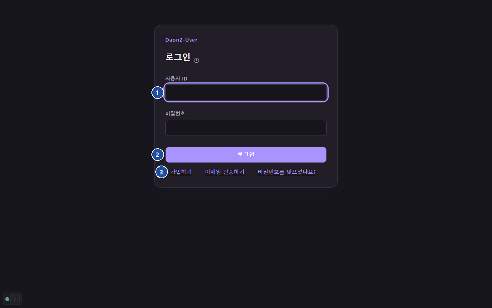

| 번호 | 항목 | 설명 | 비활성 조건 |
| --- | --- | --- | --- |
| ① | **사용자 ID**, **비밀번호** | 가입할 때 정한 ID와 비밀번호 | 요청 처리 중 |
| ② | **로그인** | 로그인하고 노트북 홈으로 이동 | 요청 처리 중 |
| ③ | **가입하기**, **이메일 인증하기**, **비밀번호를 잊으셨나요?** | 가입, 인증, 재설정 화면으로 전환 | 없음 |

#### 주의·오류

| 화면 메시지 | 원인 | 조치 |
| --- | --- | --- |
| `EMAIL_VERIFICATION_REQUIRED` | 이메일 인증 전 | 인증 토큰을 입력해 인증 |
| `EMAIL_TOKEN_INVALID` | 인증 토큰이 틀리거나 만료 | **인증 재전송** 후 새 토큰 입력 |
| `PASSWORD_POLICY_FAILED` | 비밀번호가 12자 미만 등 규칙 위반 | 규칙에 맞게 다시 입력 |
| `AUTHENTICATION_REQUIRED` | ID 또는 비밀번호 불일치 | 다시 입력 |
| "새 비밀번호가 일치하지 않습니다." | 확인 칸이 다름 | 같은 값을 두 번 입력 |

인증되지 않은 상태에서 노트북 주소를 직접 열었을 때 내용이 보이면 정상이 아닙니다. 브라우저를 닫고 운영 담당자에게 알립니다.

#### 관련

1-2 가입과 로그인, 2-11 내 설정(계정 설정), 3-1 사용자 관리(보호 admin)

### 2-2 노트북 홈

#### 기능·목적

내 노트북 목록입니다. 노트북을 찾고, 만들고, 열고, 지웁니다. 공통 설정 메뉴도 여기에 있습니다.

#### 쓸 수 있는 사람

로그인한 사용자. 설정 메뉴의 **조직 정책**, **사용자 관리**, **음성 엔진**은 시스템 관리자에게만 보입니다.

#### 사용 순서

1. 찾기: **Notebook 제목 검색**에 제목을 입력합니다. 정렬은 **최근 수정** 또는 **제목**.
2. 만들기: **새 Notebook** → **제목**, 설명(선택) → **만들기**. 빈 노트북이 바로 열립니다.
3. 열기: 노트북 카드를 누릅니다.
4. 지우기: 카드의 ⋮ → **노트북 삭제** → 노트북 제목을 똑같이 입력 → **영구 삭제**. 되돌릴 수 없습니다.

#### 화면 구성

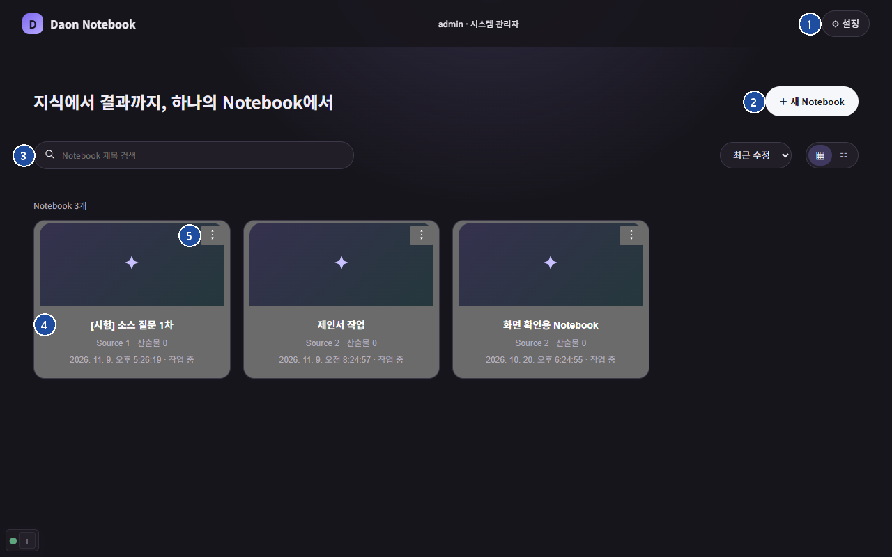

| 번호 | 항목 | 설명 | 비활성 조건 |
| --- | --- | --- | --- |
| ① | **설정** | **화면 설정**, **라이선스**, **사용자 설명서**, **LLM 설정**, **작업 범위 새로고침**, **로그아웃**. 관리자에게는 **조직 정책**, **사용자 관리**, **음성 엔진**이 더 보임 | 없음 |
| ② | **새 Notebook** | 새 노트북 만들기 | 없음 |
| ③ | **Notebook 제목 검색**, **최근 수정**·**제목** | 찾기와 정렬 | 없음 |
| ④ | 노트북 카드 | 제목, Source·산출물 개수, 상태(**비어 있음**, **작업 중**, **확인 필요**) | 없음 |
| ⑤ | 카드 ⋮ | **노트북 삭제** | 없음 |

#### 주의·오류

| 화면 메시지 | 원인 | 조치 |
| --- | --- | --- |
| "Notebook을 불러오지 못했습니다." | 서버 연결 문제 | **다시 시도** |
| `LICENSE_RESOURCE_LIMIT_REACHED` | 라이선스의 Notebook 수 한도 도달 | 3-8 라이선스 확인 |
| `DELETE_SHARED_DATA_BLOCKED` | 다른 노트북과 함께 쓰는 자료가 있음 | 공유 자료를 먼저 정리 |
| `NOTEBOOK_DELETION_IN_PROGRESS` | 이미 삭제 중 | 잠시 뒤 목록 새로고침 |

**영구 삭제** 버튼은 입력한 제목이 노트북 제목과 같아야 켜집니다.

#### 관련

1-3 노트북 만들기, 2-3 작업 화면, 2-9 노트북 메뉴

### 2-3 작업 화면

#### 기능·목적

노트북 안에서 일하는 화면입니다. 왼쪽에서 자료를 관리하고, 가운데에서 질문하고, 오른쪽 스튜디오에서 산출물을 만듭니다.

#### 쓸 수 있는 사람

그 노트북에 접근할 수 있는 사용자. 화면에서 편집·열람 권한을 따로 나누어 보여 주지는 않으며, 서버가 동작마다 권한을 다시 확인합니다.

#### 사용 순서

1. 왼쪽 **Source·지식·권위**에서 자료를 올리고 쓸 자료를 체크합니다(2-4).
2. 가운데 **대화·실행**에서 질문하고 근거를 확인합니다(2-5).
3. 오른쪽 **스튜디오**에서 산출물을 만듭니다(2-6).
4. 위쪽 **설정**에서 모델·정책·라이선스·설명서를 열거나 **로그아웃**합니다. 좁은 화면에서는 아래 **Source**·**대화**·**Studio** 탭으로 영역을 바꿉니다.

#### 화면 구성

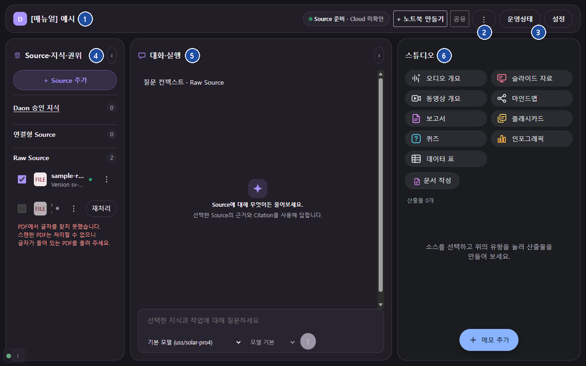

| 번호 | 항목 | 설명 | 비활성 조건 |
| --- | --- | --- | --- |
| ① | 노트북 제목, 상태 표시 | Source 상태(**Source 준비**, **Source 확인 필요** 등)와 연결 상태 | 없음 |
| ② | **노트북 만들기**, **공유**, ⋮ | ⋮은 노트북 메뉴(2-9) | **공유**는 준비 중이라 항상 꺼짐 |
| ③ | **운영상태**, **설정** | 설정 메뉴: **LLM 설정**, **출력·버전**, **동기화·승인**, **조직 정책**, **라이선스**, **사용자 설명서**, **음성 엔진**, **로그아웃** | 없음 |
| ④ | **Source·지식·권위** | 자료 목록과 **Source 추가** | 없음 |
| ⑤ | **대화·실행** | 질문과 답변 | 없음 |
| ⑥ | **스튜디오** | 산출물 타일과 카드 | 없음 |

설정 메뉴의 **출력·버전**은 산출물 유형별 기본 형식을 정하고, **동기화·승인**은 대기 중인 동기화 항목을 확인해 고른 것만 승인합니다. **조직 정책**은 이 Workspace에 적용된 외부 전송 정책을 읽기 전용으로 보여 줍니다(3-2).

#### 주의·오류

| 화면 메시지 | 원인 | 조치 |
| --- | --- | --- |
| "현재 권한으로 Workspace를 열 수 없습니다." | 이 노트북에 접근 권한이 없음 | 노트북 홈으로 돌아가 다른 노트북 선택 |
| "Source를 불러오지 못했습니다. 운영상태에서 연결을 확인해 주세요." | 서버 연결 문제 | **운영상태** 확인 후 **다시 시도** |

#### 관련

1-1 이 설명서 읽는 법, 2-4, 2-5, 2-6, 2-9, 3-9 운영 상태

### 2-4 Source 추가 창과 Source 상태

#### 기능·목적

질문과 산출물의 근거 자료(Source)를 올리고 처리 상태를 확인합니다. 처리에 실패한 자료는 사유를 보고 다시 처리합니다.

#### 쓸 수 있는 사람

노트북에 접근할 수 있는 사용자.

#### 사용 순서

1. **Source 추가**를 누릅니다.
2. 탭을 고릅니다: **파일 업로드**, **웹사이트**, **Drive**, **복사한 텍스트**, **MCP 연결**.
3. 파일은 **파일을 선택하세요**로 고르고, 텍스트는 붙여 넣은 뒤 **텍스트 등록**, 웹사이트는 **공개 HTTPS URL**을 넣고 수집 권한 확인 칸을 체크한 뒤 **웹사이트 가져오기**를 누릅니다.
4. **Raw Source** 목록에서 상태가 **사용 가능**이 될 때까지 기다립니다.
5. 질문과 산출물에 쓸 자료만 체크 칸을 켜 둡니다.
6. **처리 실패**나 **모델 대기**이면 아래 빨간 사유를 읽고 **재처리**를 누릅니다. **처리 방식**을 고르고 **설정 확인·재처리**를 누릅니다.

#### 화면 구성

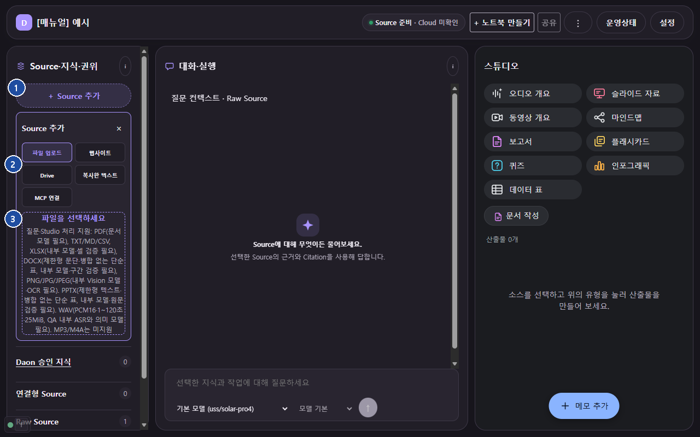

| 번호 | 항목 | 설명 | 비활성 조건 |
| --- | --- | --- | --- |
| ① | **Source 추가** | 자료를 올리는 창 열기 | 없음 |
| ② | **파일 업로드**, **웹사이트**, **Drive**, **복사한 텍스트**, **MCP 연결** | 자료 종류별 탭 | 없음 |
| ③ | **파일을 선택하세요** | 지원 형식: PDF, TXT·MD·CSV, XLSX, DOCX, PPTX, PNG·JPG, WAV. MP3·M4A는 지원하지 않음 | 처리 중 |

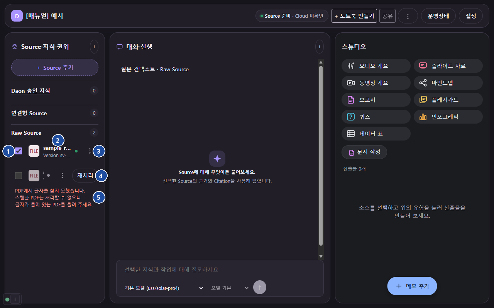

| 번호 | 항목 | 설명 | 비활성 조건 |
| --- | --- | --- | --- |
| ① | 체크 칸 | 켜진 자료만 질문과 산출물에 씀 | 자료가 **사용 가능**이 아닐 때 |
| ② | 자료 이름, 상태 | 상태: **등록됨**, **처리 중**, **색인 중**, **사용 가능**, **모델 대기**, **검토 필요**, **처리 실패** 등 | 없음 |
| ③ | ⋮ | **Notebook에서 제거**(원본은 보존), **Source 삭제 요청** | 없음 |
| ④ | **재처리** | 실패한 자료를 다시 처리 | 실패·모델 대기·검토 필요 자료에만 보임 |
| ⑤ | 실패 사유 | 처리하지 못한 이유와 조치 | 실패·모델 대기 자료에만 보임 |

**Daon 승인 지식**과 **연결형 Source** 묶음은 관리자가 연결한 지식과 외부 연결 자료입니다. **Daon 승인 지식**은 고른 것만 질문에 씁니다.

#### 주의·오류

| 화면 메시지 | 원인 | 조치 |
| --- | --- | --- |
| "PDF에서 글자를 찾지 못했습니다. 스캔한 PDF는 처리할 수 없으니 글자가 들어 있는 PDF를 올려 주세요." | 스캔본 PDF | 글자가 들어 있는 PDF로 다시 올림 |
| "암호가 걸린 PDF는 처리할 수 없습니다. 암호를 해제한 파일을 올려 주세요." | 암호 PDF | 암호를 풀어 다시 올림 |
| "기본 모델이 지정되지 않았습니다. 설정의 모델 연결에서 기본 모델을 지정하세요." | Workspace 기본 모델 없음 | 3-3에서 기본 모델 저장 후 **재처리** |
| "처리하지 못했습니다. 재처리를 눌러 다시 시도해 주세요." | 그 밖의 일시 오류 | **재처리** |
| "다른 Notebook에서도 사용하는 자료입니다. Notebook에서 제거를 사용하세요." | 공유 자료 삭제 시도 | **Notebook에서 제거** 사용 |

한 번에 올릴 수 있는 파일은 25MiB 이하입니다. PDF는 글자가 들어 있는 문서만 처리합니다. 표는 글자만 읽으므로 칸 구조가 흐트러질 수 있습니다.

#### 관련

1-4 자료(Source) 올리기, 2-5 대화와 근거, 3-3 모델 연결

### 2-5 대화와 근거

#### 기능·목적

체크한 자료를 근거로 질문하고 답변을 받습니다. 답변의 Citation을 눌러 근거 위치를 확인하고, 필요한 답변은 메모로 남깁니다.

#### 쓸 수 있는 사람

노트북에 접근할 수 있는 사용자. 채팅 기록은 본인만 봅니다.

#### 사용 순서

1. 질문에 쓸 자료를 체크합니다. 자료가 없으면 일반 상담으로 답합니다.
2. 필요하면 입력 칸 위에서 모델과 추론 수준(**모델 기본**, **낮음**, **보통**, **높음** 등)을 고릅니다.
3. 입력 칸에 질문을 쓰고 Enter를 누르거나 보내기 버튼을 누릅니다.
4. 답변 아래 Citation 링크(쪽, 이미지 영역, 지식 구간 등)를 눌러 근거 원문을 봅니다.
5. **메모에 저장** 또는 **복사**를 누릅니다.

#### 화면 구성

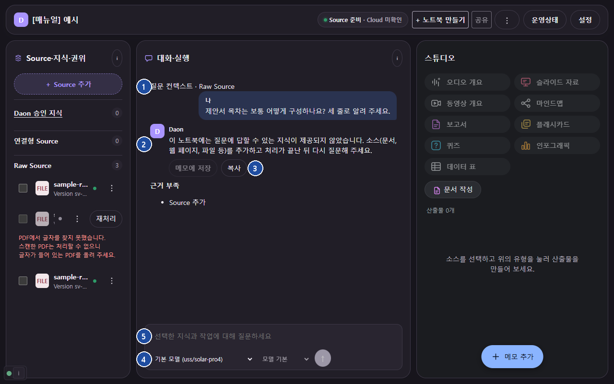

| 번호 | 항목 | 설명 | 비활성 조건 |
| --- | --- | --- | --- |
| ① | 질문 범위 표시 | **Raw Source**, **일반 상담** 등 지금 질문이 쓰는 자료 범위 | 없음 |
| ② | 답변, Citation, 표시 | **근거 부족**, **승인 지식 사용** 같은 답변 성격 표시. 그림은 근거를 찾지 못한 경우로, 답변 아래 **근거 부족**과 할 일(**Source 추가**)이 보이고 Citation은 없음. 근거를 찾으면 답변 끝에 Citation 링크가 붙음 | 없음 |
| ③ | **메모에 저장**, **복사** | 답변을 메모로 저장하거나 복사 | **근거 부족** 답변, 저장 중 |
| ④ | 모델·추론 수준 | 이 노트북에서 쓸 모델과 추론 수준. 다른 모델로 자동 전환하지 않음 | 모델을 고르기 전에는 추론 수준 꺼짐 |
| ⑤ | 입력 칸과 보내기 | 질문 입력 | 답변 대기 중, 입력이 비었을 때 |

질문 한 번에 쓸 수 있는 자료는 최대 8개입니다. 더 많이 체크하면 앞의 8개를 씁니다.

#### 주의·오류

| 화면 메시지 | 원인 | 조치 |
| --- | --- | --- |
| "선택한 모델을 사용할 수 없어 답변하지 못했습니다." | 고른 모델을 지금 쓸 수 없음 | 다른 모델을 골라 다시 질문 |
| "질문 실행에 실패했습니다." | 일시 오류 등 | 입력을 확인하고 다시 질문 |
| "추가 인증 비밀번호를 입력해 주세요." | 외부 전송에 추가 인증 필요 | 비밀번호 입력 후 **인증 후 질문 제출** |
| **근거 부족** | 자료에서 근거를 찾지 못함 | 자료 체크나 질문을 바꿔 다시 질문 |

Citation 원문과 답변을 함께 확인한 뒤 업무에 씁니다. 답변만 보고 판단하지 않습니다.

#### 관련

1-5 질문하고 근거 확인하기, 2-8 메모, 3-2 조직 정책과 외부 전송 정책

### 2-6 스튜디오

#### 기능·목적

체크한 자료로 산출물을 만듭니다. 산출물은 오디오 개요, 슬라이드, 동영상 개요, 마인드맵, 보고서, 플래시카드, 퀴즈, 인포그래픽, 데이터 표입니다. 완성된 산출물은 열어 보고, 편집하고, 말로 고치고, 내려받습니다.

#### 쓸 수 있는 사람

노트북에 접근할 수 있는 사용자. 오디오·동영상 개요는 관리자가 음성 엔진을 등록했을 때만 켜집니다.

#### 사용 순서

1. 타일을 누르면 기본 설정으로 바로 만듭니다. 설정을 바꾸려면 만든 카드의 ⋮ → **설정 변경 후 다시 생성**을 눌러 설정 창에서 고르고 **만들기**를 누릅니다. 현재 이 경로에서는 **형식** 변경이 반영되지 않고 언어·포커스 지시문 등만 반영됩니다.
2. 카드가 **생성 중…**으로 보이며, 만드는 중에도 질문을 계속할 수 있습니다. 멈추려면 **취소**.
3. 완료된 카드를 누르면 산출물이 열립니다. **편집**으로 직접 고치거나 아래 **대화로 수정**으로 말로 고칩니다.
4. **다운로드**에서 형식을 골라 내려받습니다.
5. 카드 ⋮로 **공유**, **이름 바꾸기**, **프롬프트 및 소스 보기**, **다시 생성**, **설정 변경 후 다시 생성**, **삭제**를 합니다.

#### 화면 구성

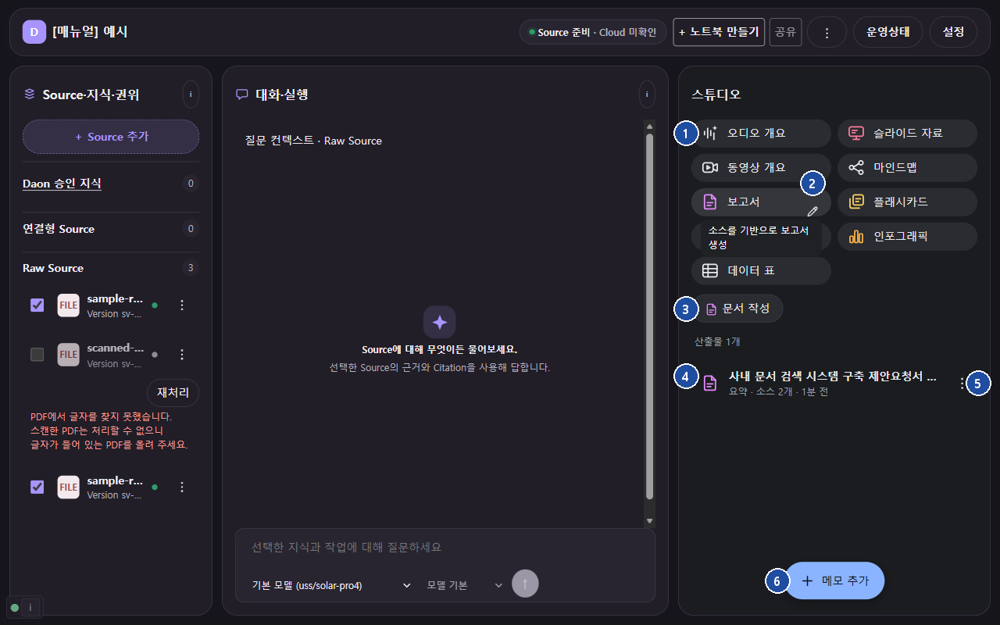

| 번호 | 항목 | 설명 | 비활성 조건 |
| --- | --- | --- | --- |
| ① | 타일(**보고서**, **슬라이드 자료**, **마인드맵** 등) | 누르면 기본 설정으로 바로 생성. 마우스를 올리면 설명이 보임 | 자료 없음, 체크한 자료 없음, 자료 처리 중, 제공하지 않는 유형 |
| ② | **문서 작성** | 제안서 등 문서 작성(2-7) | 서버가 지원할 때만 보임 |
| ③ | 카드 | 상태: **생성 중…**, 대기 중, 실패(**다시 시도**), **소스가 변경됨**, **취소됨** | 없음 |
| ④ | 카드 ⋮ | **공유**, **이름 바꾸기**, **다운로드**, **프롬프트 및 소스 보기**, **다시 생성**, **설정 변경 후 다시 생성**, **삭제** | 완료 전에는 **공유**·**다운로드** 꺼짐 |
| ⑤ | **메모 추가** | 빈 메모(2-8) | 없음 |

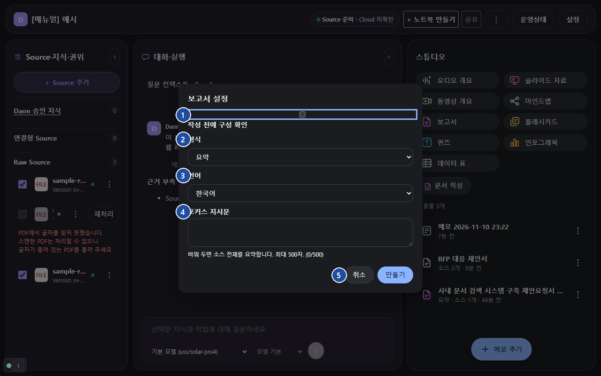

| 번호 | 항목 | 설명 | 비활성 조건 |
| --- | --- | --- | --- |
| ① | **작성 전에 구성 확인** | 켜면 본문을 쓰기 전에 구성(목차)을 먼저 보여 주고 확인받음 | 구성 확인을 지원하는 유형에서만 보임 |
| ② | **형식** | 보고서: **요약**, **브리핑**, **블로그**, **스터디 가이드**, **사용자 정의** | **설정 변경 후 다시 생성**에서는 골라도 반영되지 않음(현재 제한) |
| ③ | **언어** | **한국어** 또는 **English** | 없음 |
| ④ | **포커스 지시문** | 비워 두면 자료 전체를 요약. 최대 500자 | 없음 |
| ⑤ | **취소**, **만들기** | 이 설정으로 생성 | 없음 |

플래시카드·퀴즈 등은 유형에 따라 **길이**, **난이도**, **개수** 칸이 더 보이며, 비워 두면 **자동**입니다.

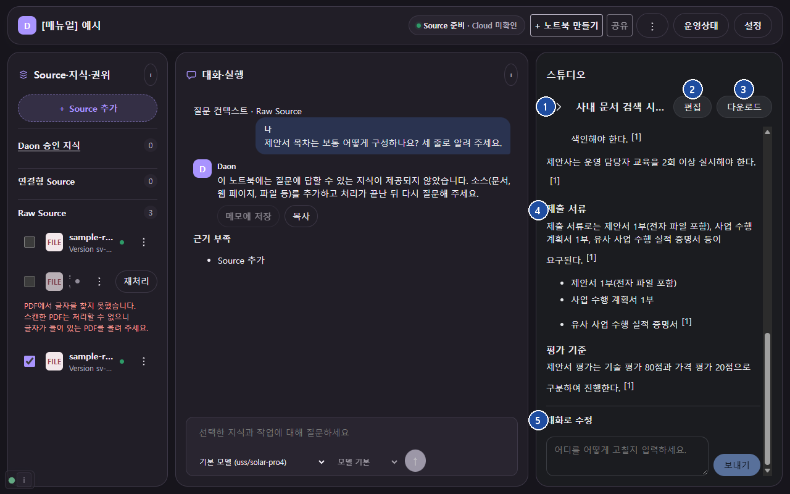

| 번호 | 항목 | 설명 | 비활성 조건 |
| --- | --- | --- | --- |
| ① | 목록으로 | 카드 목록으로 돌아가기 | 없음 |
| ② | **편집** | 보고서·슬라이드·플래시카드·퀴즈를 직접 고쳐 새 버전으로 저장 | 완료 전 |
| ③ | **다운로드** | 형식 선택 | 완료 전 |
| ④ | 본문 | 유형별 보기(아래 표) | 없음 |
| ⑤ | **대화로 수정** | 고칠 곳을 말로 쓰고 **보내기** → **고치기 전**·**고친 뒤** 비교 → **반영** 또는 **취소** | 수정안을 만드는 중 |

| 유형 | 보기에서 하는 일 | 내려받기 형식 |
| --- | --- | --- |
| 보고서 | 인용 번호를 눌러 근거 보기 | DOCX, PDF, MD |
| 데이터 표 | **열 표시**로 열 고르기 | XLSX, CSV, PDF |
| 마인드맵 | **확대**·**축소**·**맞춤**, **이 개념으로 질문** | SVG, PNG, JSON |
| 플래시카드 | **이전**·**다음**·**섞기**, **알아요**·**모르겠어요**, **모르는 카드만** | CSV, JSON, PDF |
| 퀴즈 | **제출**, **결과 보기**, **틀린 문항만 다시** | CSV, JSON, PDF |
| 슬라이드 | **발표자 노트** 보기 | PPTX, PDF |
| 인포그래픽 | 그림 보기 | PNG, SVG, PDF |
| 오디오 개요 | **재생 속도**, **스크립트** | MP3 |
| 동영상 개요 | **챕터**, **한국어 자막** | MP4, VTT |
| 메모 | 본문 편집, 아래 미리보기 칸 | MD, TXT |

#### 주의·오류

| 화면 메시지 | 원인 | 조치 |
| --- | --- | --- |
| "사용할 수 있는 소스가 없습니다. 소스 처리가 끝났는지 확인하세요." | 체크한 자료가 처리 전 | 2-4에서 상태 확인 |
| "조직 정책이 외부 전송을 허용하지 않습니다." | 외부 전송 정책이 막음 | 3-2 정책 확인을 관리자에게 요청 |
| "음성 서버에 연결하지 못했습니다. 잠시 후 다시 시도하세요." | 음성 엔진 연결 문제 | 잠시 뒤 다시 생성, 반복되면 관리자에게 알림 |
| "인증하지 못했습니다. 비밀번호를 확인해 주세요." | 내려받기 추가 인증 실패 | 비밀번호 다시 입력 |
| "처리하지 못했습니다. 잠시 후 다시 시도하세요." | 일시 오류 | **다시 시도** |

**공유**는 노트북에 접근할 수 있는 사람에게만 보이는 안내이며, 공개 링크는 만들 수 없습니다. 삭제한 산출물은 되돌릴 수 없습니다. 긴 문서 전체를 대화로 고치면 시간이 오래 걸려 실패할 수 있으니, 고칠 부분을 좁혀 지시합니다.

#### 관련

1-6 스튜디오로 자료 만들기와 대화로 고치기, 1-8 내려받기와 로그아웃, 2-7 문서 작성 마법사, 3-6 TTS 음성 엔진, 3-7 내려받기 정책

### 2-7 문서 작성 마법사

#### 기능·목적

제안요청서(RFP) 같은 기준 자료를 읽고 템플릿에 맞춰 문서 초안을 씁니다. 제안서 템플릿은 요구사항을 뽑아 확인받은 뒤 요구사항에 맞춘 본문을 씁니다.

#### 쓸 수 있는 사람

노트북에 접근할 수 있는 사용자. 서버가 문서 작성을 지원할 때 스튜디오에 **문서 작성** 버튼이 보입니다.

#### 사용 순서

1. 스튜디오에서 **문서 작성**을 누릅니다. **목표 분량**을 고르고 **작성 템플릿**에서 템플릿을 고른 뒤 **시작**을 누릅니다.
2. **입력** 단계: 질문에 답합니다. 제안요청서 질문에서는 쓸 자료를 체크합니다(최대 10개). **다음**을 누릅니다.
3. **분석 중** 단계: 자료 전체를 구간별로 읽어 요구사항을 뽑습니다. 긴 문서는 몇 분 걸립니다.
4. **확인** 단계: **요구사항 확인** 표에서 항목을 고치거나 지우고 **요구사항 추가**로 빠진 것을 넣습니다. **작성 계획**과 **출력 형식**을 확인하고 **확정하고 초안 만들기**를 누릅니다.
5. **작성 중** 단계: 소목차별로 씁니다. 필요하면 **일시 정지** 후 **본문 수정**이나 **이 소목차 다시 쓰기**를 하고 **이어서 작성**을 누릅니다.
6. **완료** 단계: 탭에서 결과를 보고 다운로드 버튼으로 내려받습니다.

#### 화면 구성

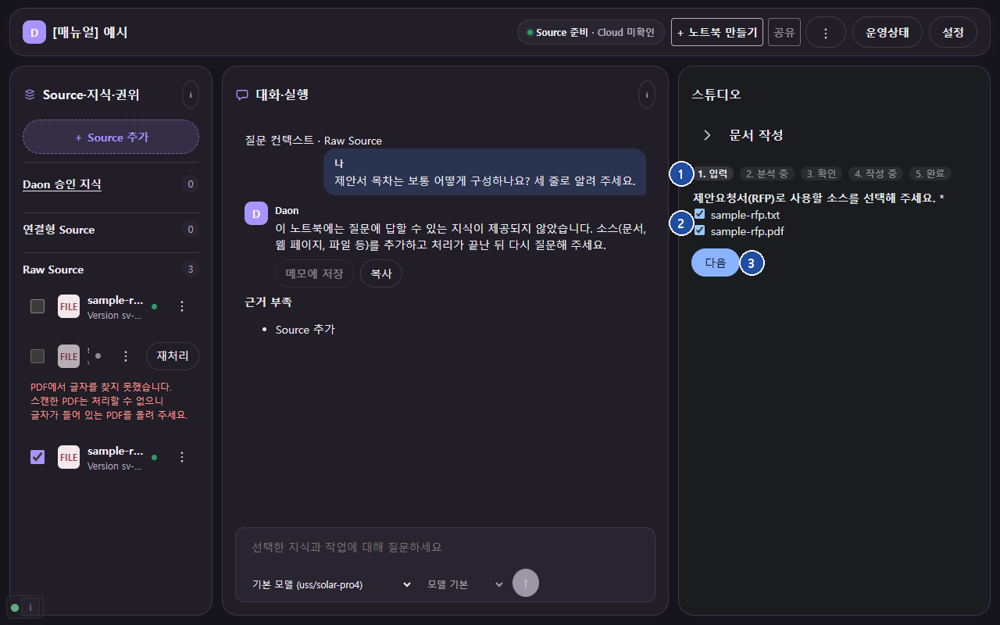

| 번호 | 항목 | 설명 | 비활성 조건 |
| --- | --- | --- | --- |
| ① | 작성 단계 | 1. **입력**, 2. **분석 중**, 3. **확인**, 4. **작성 중**, 5. **완료** | 없음 |
| ② | 자료 체크 칸 | 제안요청서로 쓸 자료. 여러 파일 선택 가능 | 처리가 끝난 자료만 보임 |
| ③ | **다음** | 답을 저장하고 다음 단계로 | 처리 중 |

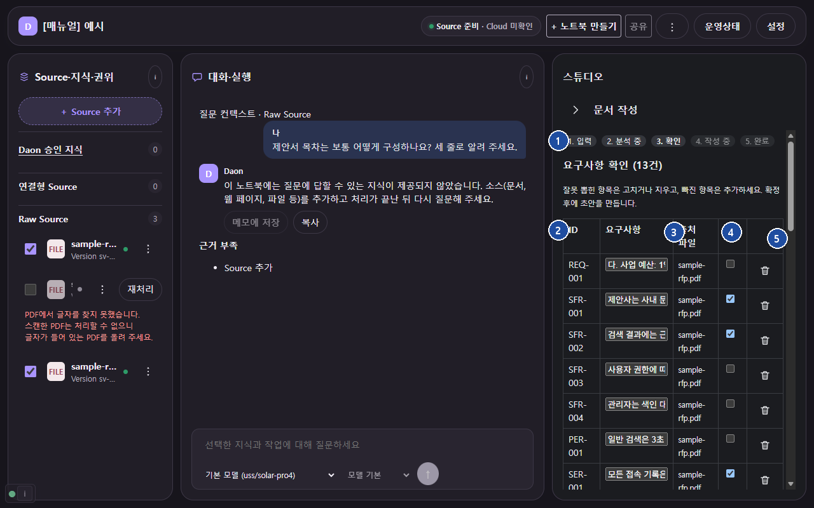

| 번호 | 항목 | 설명 | 비활성 조건 |
| --- | --- | --- | --- |
| ① | 작성 단계 | 지금 단계(**확인**)가 진하게 보임 | 없음 |
| ② | **요구사항 확인** 표 | ID와 요구사항 내용. 칸을 눌러 고침 | 없음 |
| ③ | **출처 파일** | 그 요구사항이 나온 파일 | 출처가 있는 요구사항이 있을 때만 보임 |
| ④ | **필수** | 반드시 대응할 요구사항 표시 | 없음 |
| ⑤ | 삭제(휴지통) | 요구사항이 아닌 줄 지우기 | 없음 |
| 아래쪽 | **요구사항 추가** | 빠진 요구사항 넣기 | 없음 |
| 아래쪽 | **작성 계획** | 절 순서와 소목차, 절마다 배정된 요구사항 수. 위·아래 화살표와 삭제로 순서 조정 | 없음 |
| 아래쪽 | **출력 형식** | DOCX, PPTX | 없음 |
| 아래쪽 | **확정하고 초안 만들기** | 확정하고 작성 시작 | 요구사항이 없거나 출력 형식을 고르지 않았을 때 |

그림 아래쪽 항목은 표를 내려(스크롤) 보면 나옵니다.

완료 화면의 탭은 **본문**, **요구사항 대응표**, **점검**, **가정·미결**입니다. 본문의 **[작성 필요]**는 사람이 채워야 할 곳입니다. 완료한 문서는 **다시 열어 고치기**나 **대화로 수정**으로 고칠 수 있습니다.

#### 주의·오류

| 화면 메시지 | 원인 | 조치 |
| --- | --- | --- |
| "사용할 수 있는 소스가 없습니다. 먼저 제안요청서를 소스로 추가하세요." | 노트북에 자료가 없음 | 2-4에서 자료 올리기 |
| "소스 처리에 실패했습니다. Source 목록에서 사유를 확인하고 재처리해 주세요." | 자료 처리 실패 | 2-4에서 사유 확인 후 **재처리** |
| "소스를 처리하는 중입니다. 처리가 끝나면 여기에서 선택할 수 있습니다." | 자료 처리 중 | 처리가 끝나면 다시 열기 |
| "구간 n개는 모델 분석에 실패해 규칙으로만 찾았습니다." | 일부 구간의 모델 분석 실패 | 표에서 빠진 요구사항을 추가 |
| "한 번에 보내기에 내용이 너무 많습니다. 항목을 줄여 다시 시도하세요." | 확정 내용이 너무 큼 | 불필요한 요구사항을 지우고 다시 확정 |
| "자료가 없거나 검증에 걸린 내용이 있습니다. 확인하고 고친 뒤 이어서 작성해 주세요." | 소목차에 근거 자료가 부족함(**확인 필요** 표시) | 해당 소목차를 읽고 고친 뒤 **이어서 작성**. 소목차마다 여러 번 멈출 수 있음 |

요구사항은 규칙과 모델로 뽑으므로 요구사항이 아닌 줄이 섞일 수 있습니다. 확정 전에 꼭 표를 검토합니다.

#### 관련

1-7 문서 작성으로 제안서 만들기, 2-6 스튜디오, 3-5 문서 작성 템플릿

### 2-8 메모

#### 기능·목적

노트북에 남겨 둘 글을 적습니다. 직접 쓰거나 답변을 메모로 저장합니다.

#### 쓸 수 있는 사람

노트북에 접근할 수 있는 사용자. 메모는 노트북을 보는 모든 사람에게 보입니다.

#### 사용 순서

1. 스튜디오 아래 **메모 추가**를 누르면 빈 메모가 열립니다. 제목은 만든 시각으로 붙습니다.
2. **메모 내용** 칸에 씁니다. 입력을 멈추면 자동으로 저장되고 **저장됨**이 보입니다.
3. 입력 칸 아래 미리보기 칸에 같은 글이 그대로 보입니다. 마크다운 기호(#, -)는 서식으로 바뀌지 않고 글자 그대로 보입니다.
4. 답변을 메모로 남기려면 답변 아래 **메모에 저장**을 누릅니다. **다운로드**로 MD·TXT 파일로 내려받습니다.

#### 화면 구성

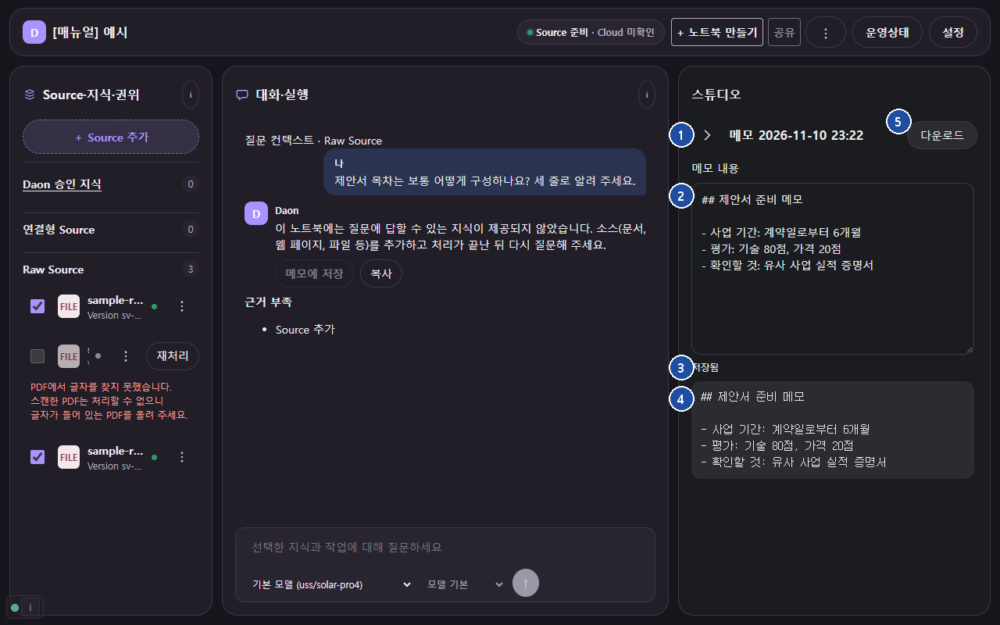

| 번호 | 항목 | 설명 | 비활성 조건 |
| --- | --- | --- | --- |
| ① | 메모 제목 | 만든 시각. 왼쪽 › 로 목록으로 돌아감 | 없음 |
| ② | **메모 내용** | 마크다운으로 쓰는 본문 | 없음 |
| ③ | 저장 상태 | **저장됨**, **저장 중…**, **저장하지 못했습니다** | 없음 |
| ④ | 미리보기 칸 | 입력한 글을 그대로 보여 줌 | 없음 |
| ⑤ | **다운로드** | MD, TXT로 내려받기 | 없음 |

#### 주의·오류

| 화면 메시지 | 원인 | 조치 |
| --- | --- | --- |
| **저장하지 못했습니다** | 저장 실패 | 내용을 복사해 두고 잠시 뒤 다시 입력 |
| "메모에 저장하지 못했습니다. 잠시 후 다시 시도해 주세요." | 답변 저장 실패 | 다시 **메모에 저장** |

#### 관련

1-5 질문하고 근거 확인하기, 2-5 대화와 근거, 2-6 스튜디오

### 2-9 노트북 메뉴

#### 기능·목적

노트북 전체에 적용하는 설정입니다. 답변·산출물 지시(맞춤설정), 노트북 복사, 내 채팅 기록 삭제를 합니다.

#### 쓸 수 있는 사람

노트북에 접근할 수 있는 사용자. 채팅 기록 삭제는 본인 기록만 지웁니다.

#### 사용 순서

1. 작업 화면 위쪽 ⋮(노트북 메뉴)을 누릅니다.
2. **채팅 설정**: 답변에 쓰는 모델을 정합니다.
3. **맞춤설정**: **맞춤설정 지시**에 원하는 답변 방식(예: 존댓말, 결론 먼저)을 적고 **저장**합니다. 이후 질문과 새 산출물부터 적용됩니다.
4. **노트북 복사**: **새 노트북 이름**을 정하고 **복사할 항목**(**메모**, **산출물**, **맞춤설정**)을 고른 뒤 **복사**합니다.
5. **채팅 기록 삭제**: 확인 창에서 **삭제**를 누릅니다. 메모와 산출물은 남습니다.

#### 화면 구성

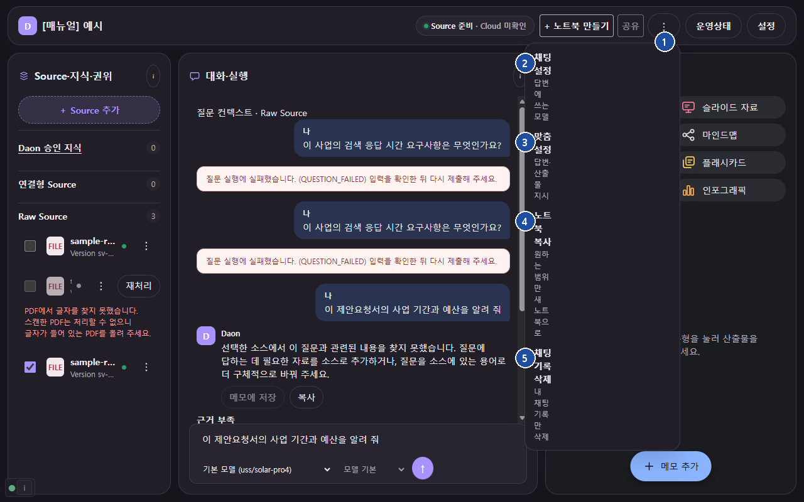

| 번호 | 항목 | 설명 | 비활성 조건 |
| --- | --- | --- | --- |
| ① | ⋮ | 노트북 메뉴 열기 | 없음 |
| ② | **채팅 설정** | 답변에 쓰는 모델 | 없음 |
| ③ | **맞춤설정** | 답변·산출물 지시. 최대 4000자 | 불러오는 중 |
| ④ | **노트북 복사** | 고른 범위만 새 노트북으로 복사 | 복사할 항목을 하나도 고르지 않았을 때 |
| ⑤ | **채팅 기록 삭제** | 내 채팅 기록만 삭제 | 없음 |

#### 주의·오류

| 화면 메시지 | 원인 | 조치 |
| --- | --- | --- |
| "다른 곳에서 먼저 수정했습니다. 닫았다가 다시 열어 최신 내용을 확인해 주세요." | 맞춤설정이 동시에 바뀜 | 다시 열어 확인 후 저장 |
| "항목이 너무 많아 한 번에 복사할 수 없습니다. 복사할 항목을 줄여 주세요." | 복사 항목 과다 | 항목을 줄여 다시 복사 |

노트북 복사는 자료(Source)와 채팅 기록을 복사하지 않습니다. 새 노트북의 소유자는 복사한 사람입니다. 노트북 삭제는 이 메뉴가 아니라 노트북 홈의 카드 ⋮에서 합니다(2-2).

#### 관련

2-2 노트북 홈, 2-5 대화와 근거, 3-3 모델 연결

### 2-10 알림·전달함

#### 기능·목적

내게 온 업무 알림과 처리할 수 있는 요청을 확인합니다.

#### 쓸 수 있는 사람

로그인한 사용자. 지금 권한으로 볼 수 있는 항목만 보입니다. 메뉴에는 이 화면 링크가 없으며 `/notifications` 주소나 알림 링크로 엽니다.

#### 사용 순서

1. `/notifications`를 엽니다. 탭은 **알림**, **전달함**, **운영 상태**입니다.
2. 항목의 **원 요청 열기**로 관련 화면을 엽니다.
3. 확인한 알림은 **읽음 처리**를 누릅니다.
4. **전달함**에서 **다음 페이지**로 더 봅니다.

#### 화면 구성

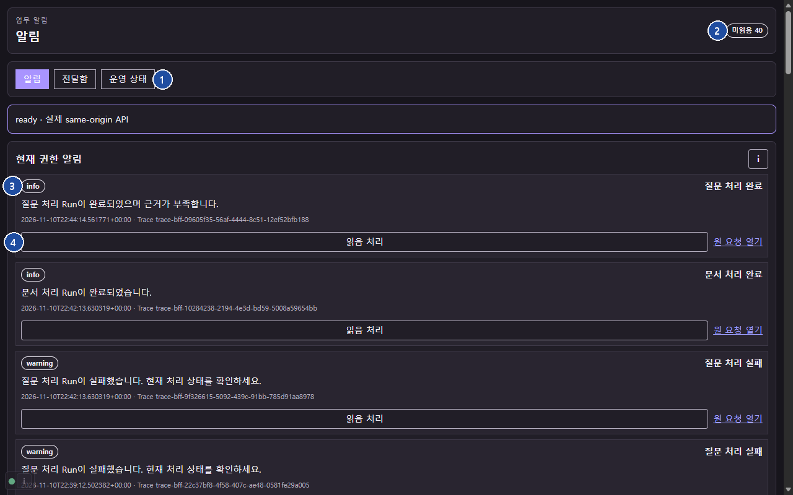

| 번호 | 항목 | 설명 | 비활성 조건 |
| --- | --- | --- | --- |
| ① | **알림**, **전달함**, **운영 상태** | 화면 전환 | 없음 |
| ② | 미읽음 수 | 읽지 않은 알림 개수 | 없음 |
| ③ | 알림 항목, **원 요청 열기** | 알림 내용과 관련 화면 링크 | 권한이 없으면 링크 대신 거부 표시 |
| ④ | **읽음 처리** | 읽은 알림 표시 | 이미 읽었거나 처리 결과가 확정되지 않았을 때 |

#### 주의·오류

| 화면 메시지 | 원인 | 조치 |
| --- | --- | --- |
| "알림 서비스를 사용할 수 없습니다." | 서비스 연결 문제 | **다시 시도** |
| "읽음 처리 결과 미확정 · 다시 조회해 확인해 주세요." | 처리 결과를 확인하지 못함 | 목록을 다시 열어 확인 |

#### 관련

3-9 운영 상태

### 2-11 내 설정

#### 기능·목적

화면 테마를 바꾸고, 사용자 설명서를 읽거나 내려받고, 내 계정의 비밀번호·세션을 관리합니다.

#### 쓸 수 있는 사람

로그인한 사용자. 계정 설정(`/settings/account`)은 메뉴 링크가 없어 주소로 엽니다.

#### 사용 순서

1. 화면 설정: 노트북 홈 **설정** → **화면 설정** → **테마**에서 **시스템 설정**, **밝게**, **어둡게** 중 하나를 고릅니다. **화면 설정 초기화**는 화면 설정만 되돌리며 노트북 데이터는 지우지 않습니다.
2. 사용자 설명서: **설정** → **사용자 설명서** → 문서를 눌러 읽거나 **DOCX**·**PDF**로 내려받습니다.
3. 계정 설정: `/settings/account`에서 **비밀번호 변경**(**현재 비밀번호**, 새 비밀번호, **새 비밀번호 확인**), **표시 이름 저장**, 장치·세션 철회를 합니다.

#### 화면 구성

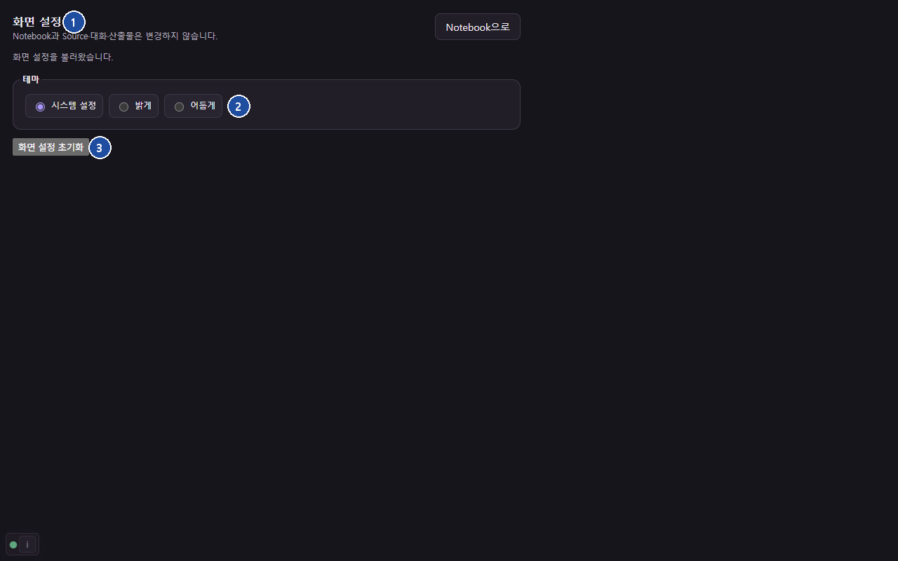

| 번호 | 항목 | 설명 | 비활성 조건 |
| --- | --- | --- | --- |
| ① | **화면 설정** | 테마 설정 화면 | 없음 |
| ② | **테마** | **시스템 설정**, **밝게**, **어둡게** | 저장 중 |
| ③ | **화면 설정 초기화** | 화면 설정만 초기값으로 | 저장 중 |

#### 주의·오류

| 화면 메시지 | 원인 | 조치 |
| --- | --- | --- |
| "화면 설정을 저장하지 못했습니다. 이전 설정을 유지합니다." | 저장 실패 | 잠시 뒤 다시 선택 |
| "사용자 설명서를 처리하지 못했습니다." | 설명서 파일 확인 실패 | **다시 시도** |
| "새 비밀번호가 일치하지 않습니다." | 확인 칸 불일치 | 같은 값 입력 |

계정 설정에서 비밀번호를 바꾸면 모든 세션이 끝나고 새 비밀번호로 다시 로그인해야 합니다.

#### 관련

2-1 로그인·가입·비밀번호 재설정, 1-1 이 설명서 읽는 법

## 3부 관리자

3부는 시스템 관리자가 쓰는 화면입니다. 노트북 홈 **설정** 메뉴에서 **조직 정책**, **사용자 관리**, **음성 엔진**은 시스템 관리자에게만 보입니다. **지식 연결**, **작성 템플릿**, **내려받기 정책**은 관리 설정 화면 위쪽 링크로 이동합니다.

Workspace와 역할: 현재 제품에서 작업을 공유하는 경계는 Workspace입니다. Workspace 안에 Notebook이 있고, Notebook에 Source를 올리고, Studio로 산출물을 만듭니다. Workspace 관리자는 서버 권한 모델에서 보기·질문·생성·편집·검토와 Workspace 내부 정책·멤버 권한 관리 권한을 가지며, 편집자·검토자·승인자·열람자는 그보다 좁은 권한을 가집니다. Workspace 관리자 역할만으로는 `사용자 관리` 메뉴나 `/admin`을 사용할 수 없습니다. 일반 사용자가 공동 작업자를 초대하거나 Workspace 권한을 변경하는 사용자 화면은 없으며, 역할 변경은 시스템 관리자가 3-1에서 합니다. 시스템 관리자는 Workspace 역할과 별개인 보호 권한으로, 전체 계정을 검색하고 일반 사용자를 중지하거나 재활성화합니다.

### 3-1 사용자 관리

#### 기능·목적

일반 사용자를 등록하고 승인·수정·중지·삭제합니다. 사용자의 Workspace 역할도 바꿉니다.

#### 쓸 수 있는 사람

시스템 관리자만 `사용자 관리`를 씁니다. 일반 사용자는 메뉴가 보이지 않으며, 일반 사용자가 `/admin`에 직접 접근하면 HTTP 403 `FORBIDDEN`으로 거부되고 사용자 목록은 표시되지 않습니다.

#### 사용 순서

1. 노트북 홈 **설정** → **사용자 관리**를 누릅니다(`/admin`).
2. 사용자 검색: **사용자 ID 또는 이메일 검색** 칸에 로그인 ID, 사용자 ID 또는 이메일을 넣습니다. 상태 필터(**전체 상태**)에서 **활성**, **중지**, **이메일 인증 대기**, **승인 대기** 중 하나를 고르고 **조회**를 누릅니다.
3. 사용자 행을 두 번 눌러 **사용자 수정** 창을 엽니다. **이메일**, **상태**, **변경할 역할**과 **변경 사유**를 바꾸고 **수정**을 누릅니다.
4. 중지: **상태**를 **중지**로 바꿔 저장합니다. 재활성화는 **상태**를 **활성**으로 바꿔 저장합니다.
5. 새 사용자: **사용자 등록** → **사용자 ID**, **이메일**, **초기 비밀번호** → **등록**.
6. 가입 승인: **승인 대기** 사용자의 수정 창에서 **승인**을 누릅니다.
7. 삭제: 행을 체크하고 **선택 삭제**를 누릅니다.

#### 화면 구성

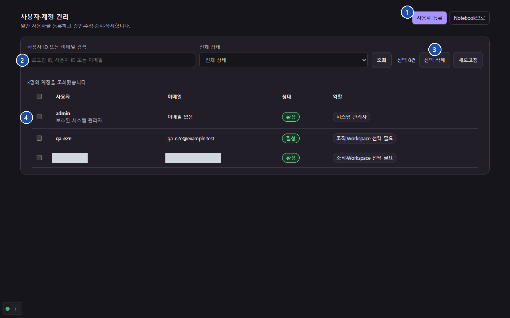

| 번호 | 항목 | 설명 | 비활성 조건 |
| --- | --- | --- | --- |
| ① | **사용자 등록** | 새 사용자 만들기 | 없음 |
| ② | **사용자 ID 또는 이메일 검색**, **전체 상태**, **조회** | 사용자 검색과 상태 필터 | 없음 |
| ③ | **선택 삭제**, **새로고침** | 체크한 계정 삭제 | 아무것도 체크하지 않았을 때 |
| ④ | 사용자 목록 | **사용자**, **이메일**, **상태**, **역할** | 보호 admin 행은 체크할 수 없음 |

각 행에는 등록 이메일 주소 전체가 보입니다. 이메일 미등록 계정은 `이메일 없음`으로 표시됩니다. 등록 이메일 주소 전체는 로그인한 시스템 관리자의 `/admin` 목록에서만 보이며 다른 화면에는 나오지 않습니다. 비밀번호, hash, token은 보이지 않습니다. 이메일 인증 대기 계정은 상태 변경을 할 수 없습니다. 상태는 **활성**과 **중지** 사이에서만 바꿀 수 있고, 본인 계정의 상태와 역할은 바꿀 수 없습니다.

보호된 초기 시스템 관리자:

- 로그인 ID는 `admin`이며 이메일은 없습니다. 목록에서 **보호된 시스템 관리자**로 표시되고 보호됨 상태라 수정 창이 읽기 전용입니다.
- 보호 admin은 삭제하거나 중지할 수 없습니다. 보호된 admin의 중지 요청은 HTTP 409 `PROTECTED_ADMIN_ACCOUNT`로 거부됩니다.
- 최초 시작 또는 운영자가 서버 콘솔에서 초기화한 직후에만 `admin/admin`으로 로그인합니다. 로그인하면 `/password-change`의 **새 비밀번호 설정** 화면으로 이동하며, 비밀번호를 바꾸기 전에는 Notebook 데이터가 보이지 않습니다.
- 비밀번호 변경 성공 직후 모든 기존 Session과 refresh family가 폐기되고 `admin/admin`은 즉시 무효가 됩니다.
- 보호 admin은 이메일이 없어 메일 재설정을 쓸 수 없습니다. 비밀번호를 잊었다면 운영자가 API 컨테이너 서버 콘솔에서 `python -m daon2_user_api.admin_cli reset-initial-password`를 한 번 실행합니다. 성공하면 `INITIAL_ADMIN_PASSWORD_RESET`과 종료 코드 0이 나옵니다. runtime 실패는 `INITIAL_ADMIN_PASSWORD_RESET_FAILED:<오류 코드>`를 표시하고 종료 코드 1로 끝납니다. 잘못된 인자는 usage를 표시하고 종료 코드 2로 끝납니다. 명령은 비밀번호·hash·token을 출력하지 않으며, 실패 원인을 확인하기 전에 반복 실행하지 않습니다.

#### 주의·오류

| 화면 메시지 | 원인 | 조치 |
| --- | --- | --- |
| "유효한 이메일을 입력하세요." | 이메일 형식 오류 | 형식에 맞게 입력 |
| "변경할 수 없는 계정 상태입니다." | 허용되지 않는 상태 변경 | **활성**·**중지** 사이로만 변경 |
| `ADMIN_USERS_UNAVAILABLE` | 목록을 불러오지 못함 | **다시 시도** |
| "이메일 변경은 먼저 수정으로 저장하세요. 초기화 메일은 저장된 이메일로만 발송됩니다." | 이메일을 바꾼 채 **비밀번호 초기화** | 먼저 **수정**으로 저장 |

사용자를 중지하면 그 사용자의 기존 Session이 끝납니다. 이 화면은 비밀번호를 보여 주거나 직접 지정하지 않습니다(**비밀번호 초기화**는 저장된 이메일로 초기화 메일을 보냅니다).

#### 관련

2-1 로그인·가입·비밀번호 재설정, 3-8 라이선스

### 3-2 조직 정책과 외부 전송 정책

#### 기능·목적

자료와 질문을 외부 모델로 보내도 되는지 정하는 외부 전송 정책을 관리합니다. 조직 정책과 Workspace 정책을 따로 저장하며, 조직 정책이 Workspace보다 우선합니다.

#### 쓸 수 있는 사람

설정 경로는 `/settings/organization`입니다. 조직 정책 저장은 시스템 관리자 또는 조직의 관리 권한이 확인된 사용자, Workspace 정책 저장은 정책 관리 권한이 있는 사용자가 합니다. 저장할 때마다 현재 비밀번호로 추가 인증(Step-up)을 합니다. Workspace에서는 조직의 외부 전송 정책을 읽기 전용으로 확인합니다(작업 화면 **설정** → **조직 정책**).

#### 사용 순서

1. 노트북 홈 **설정** → **조직 정책**을 누릅니다.
2. **1. 조직 정책** 또는 **2. Workspace 정책**을 고릅니다.
3. **정책 모드**(**외부 전송 차단**, **추가 인증 후 허용**, **추가 인증 없이 허용**)와 아래 항목을 정합니다.
4. **현재 비밀번호**를 넣고 **정책 저장**을 누릅니다.
5. 두 범위를 모두 같은 값으로 저장해야 최종 정책이 열립니다. 위쪽 최종 정책 표시를 다시 확인합니다.

#### 화면 구성

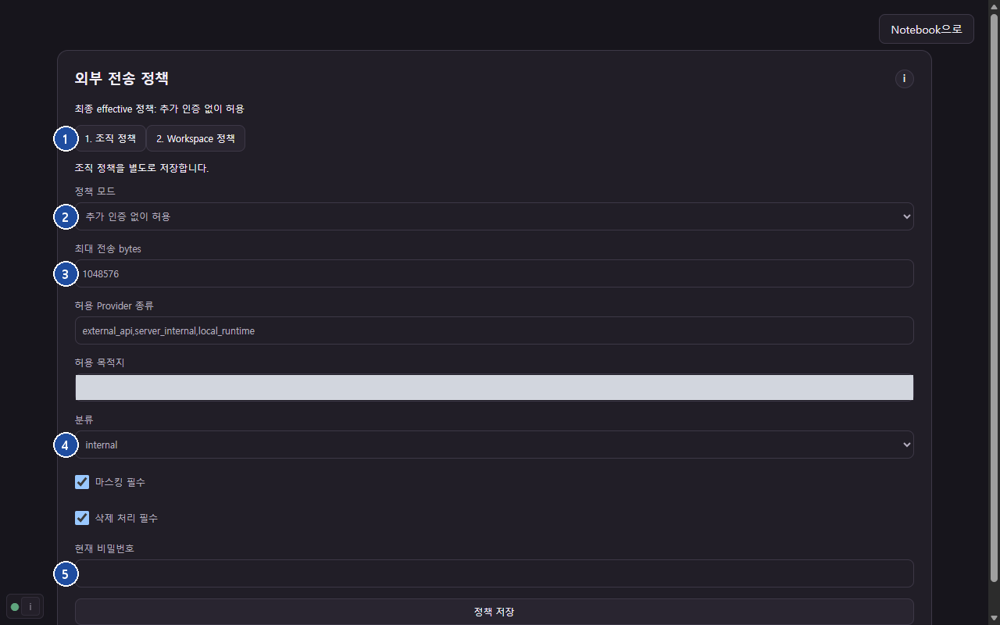

| 번호 | 항목 | 설명 | 비활성 조건 |
| --- | --- | --- | --- |
| ① | **1. 조직 정책**, **2. Workspace 정책** | 저장할 범위 | 저장 중 |
| ② | **정책 모드** | 차단 또는 허용 방식 | Workspace는 조직 차단을 완화할 수 없음 |
| ③ | **최대 전송 bytes**, **허용 Provider 종류**, **허용 목적지** | 보낼 수 있는 양과 대상. 종류와 목적지는 쉼표로 구분 | 없음 |
| ④ | **분류**, **마스킹 필수**, **삭제 처리 필수**, **필수 승인자** | 데이터 분류와 처리 조건 | 허용 방식에 따라 **필수 승인자** 숨김 |
| ⑤ | **현재 비밀번호**, **정책 저장** | 추가 인증 후 저장 | 비밀번호가 비었거나 상위 정책을 완화하려 할 때 |

새 설치의 초기 정책은 외부 전송 차단입니다. 허용 목적지는 운영 담당자가 확인한 주소만 넣으며, 이 설명서에는 목적지 주소를 적지 않습니다. 질문 전송은 internal 분류로 판정되므로 정책 **분류**가 internal이어야 외부 전송이 통과합니다.

#### 주의·오류

| 화면 메시지 | 원인 | 조치 |
| --- | --- | --- |
| "조직 차단 정책이 적용되어 Workspace에서 완화할 수 없습니다." | 조직이 차단 | 조직 정책부터 변경 |
| "정책을 저장하지 못했습니다." + `EGRESS_POLICY_PAYLOAD_INVALID` | 종류·목적지 오타 등 | 쉼표 구분과 철자 확인 |
| "정책을 저장하지 못했습니다." + 충돌 코드 | 다른 곳에서 먼저 변경(ETag 충돌) | 새로고침 후 다시 저장 |

정책 변경에는 현재 권한, 추가 인증, ETag 충돌 검사가 적용됩니다. 저장 뒤 Workspace 적용 결과를 다시 확인하고, 다른 Provider로 우회하지 않습니다.

#### 관련

2-5 대화와 근거, 3-3 모델 연결, 3-6 TTS 음성 엔진

### 3-3 모델 연결

#### 기능·목적

답변과 자료 처리에 쓰는 모델 Provider 연결을 등록·시험하고, 허용 모델과 Workspace 기본 모델을 정합니다.

#### 쓸 수 있는 사람

연결의 Endpoint·허용 모델·공용 여부는 시스템 관리자만 바꿉니다. 일반 사용자는 연결을 조회하고, 비공용 연결에 본인 계정의 개인 Key를 등록하며, 텍스트 기본 모델을 확인합니다. 노트북 홈 **설정** → **LLM 설정**(`/settings/model-connections`) 또는 작업 화면 **설정** → **LLM 설정**으로 엽니다.

#### 사용 순서

1. **연결 추가**를 누릅니다.
2. **호환 방식**을 고릅니다. **OpenAI 호환**은 Chat Completions, **Anthropic 호환**은 Messages 규격입니다. 이 호환 연결은 내부적으로 CUSTOM으로 구분됩니다. Media Bridge는 CUSTOM의 OpenAI 호환 연결로 등록합니다.
3. **Provider 표시 이름**, **연결 이름**, **두 글자 약어**, **Endpoint**, **인증 유형**을 넣고 **API Key 또는 Client Key**를 입력합니다.
4. **모델 목록 조회**로 모델을 불러오고 **사용 허용 모델**에서 최대 4개를 고릅니다. 목록에 없으면 **모델 ID 직접 입력**을 씁니다.
5. **연결 시험 및 저장**을 누릅니다. 시험에도 짧은 Provider 요청과 비용이 생길 수 있습니다.
6. 아래 **텍스트 생성 기본 모델**에서 연결과 모델을 고르고 **기본 모델 저장**을 누릅니다.

#### 화면 구성

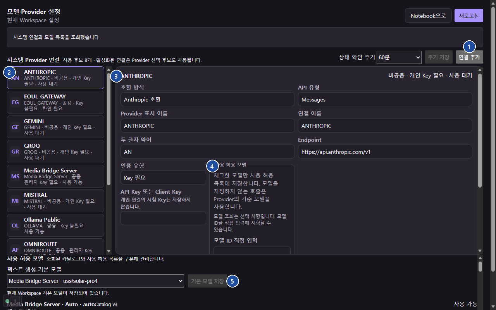

| 번호 | 항목 | 설명 | 비활성 조건 |
| --- | --- | --- | --- |
| ① | **연결 추가**, **상태 확인 주기** | 새 연결, 자동 상태 확인 주기 | 관리자 외 |
| ② | 연결 목록 | 공용·비공용, Key 필요 여부, 사용 가능 여부 | 없음 |
| ③ | **호환 방식**, **Endpoint**, **인증 유형**, **API Key 또는 Client Key**, **라우터 Auto 사용** | 연결 설정 | 관리자 외 |
| ④ | **사용 허용 모델**, **모델 목록 조회**, **모델 조회** | 허용 모델(최대 4개)과 카탈로그 새로고침 | 저장 전에는 **모델 조회** 꺼짐 |
| ⑤ | **텍스트 생성 기본 모델**, **기본 모델 저장** | 이 Workspace의 기본 모델 | 고르지 않았거나 저장된 값과 같을 때 |

버튼 차이:

| 버튼 | 동작 |
| --- | --- |
| **저장** | Provider를 호출하지 않고 설정만 저장. 결과는 확인 전 상태로 남음 |
| **연결 시험** | 입력한 값으로 연결만 확인. 저장하지 않음 |
| **연결 시험 및 저장** | 시험에 성공하면 저장 |
| **변경 취소** | 저장된 값으로 되돌림 |

Key 규칙:

- 공용 연결은 관리자 Key를, 비공용 연결은 본인 계정의 개인 Key를 씁니다. 비공용 연결에 개인 Key가 없을 때 시스템 Key로 fallback하는 경로는 없습니다.
- 일반 사용자는 **내 계정 키 시험 및 저장**, **내 계정 키 삭제**로 본인 Key만 관리합니다.
- 키 교체만 필요하면 저장된 Endpoint 재입력이나 worker 재생성은 필요 없습니다.
- Key 원문은 다시 보이지 않습니다. Key나 Provider 응답 원문을 캡처·문의 글에 붙이지 않습니다.

라우터 Auto: 라우터의 Auto는 모델 목록에서 고르는 하나의 모델입니다. OmniRoute는 `auto`, OpenRouter는 `openrouter/auto`를 씁니다. OpenAI 호환 연결은 시스템 관리자가 **라우터 Auto 사용**을 켜고 **Auto 모델 ID**를 지정할 수 있습니다. 조회 목록에 없는 Auto에는 논리 모델 표시가 붙습니다. 하위 Provider 선택·우선순위는 Gateway가 맡습니다.

기존 연결: 새 연결은 **OpenAI 호환**, **Anthropic 호환**으로 만듭니다. 이전부터 저장된 Ollama, OpenRouter, OmniRoute, Media Bridge 같은 연결은 "기존 Provider 방식"으로 보이며 계속 씁니다. 이전 배포에서 Provider 키를 환경변수로 쓰던 경우에만 운영자가 키를 연결 저장소로 1회 이관한 뒤, 환경변수 키 의존을 없앱니다.

모델 카드의 이미지 이해·문서 분석 표시는 기능 표시일 뿐, 이 화면에서 기본값을 고를 수 있다는 뜻은 아닙니다. 기본 모델은 텍스트 생성만 고릅니다. 문서 전용 모델이 없으면 PDF는 글자를 뽑아 텍스트 생성 모델로 처리합니다.

**추론 수준 확인**은 허용 모델마다 어떤 추론 수준을 받아 주는지 작은 요청으로 다시 확인합니다.

#### 주의·오류

| 화면 메시지 | 원인 | 조치 |
| --- | --- | --- |
| "Provider가 Key를 거부했습니다(인증 실패)" | Key가 틀리거나 만료 | Key 확인 후 다시 시험 |
| "두 글자 약어는 영문 대문자 2자여야 합니다." | 약어 형식 오류 | 대문자 2자 입력 |
| "저장된 시스템 Key가 없어 저장할 수 없습니다" | 공용 연결에 Key 없음 | Key 입력 후 저장 |
| "다른 변경과 충돌했습니다. 새로고침 후 다시 시도해 주세요." | 동시 변경 | **새로고침** 후 다시 |
| "연결 시험에 실패했습니다." | Endpoint·Key·네트워크 문제 | 설정 확인. 시험은 설정을 바꾸지 않음 |

#### 관련

2-4 Source 추가 창과 Source 상태, 2-5 대화와 근거, 3-2 조직 정책과 외부 전송 정책

### 3-4 지식 연결

#### 기능·목적

Daon2-RAG, Daon2, 법령 같은 MCP 지식 서버를 등록하고 시험하며 호출 한도를 정합니다. 등록한 지식은 노트북의 **Daon 승인 지식**과 문서 작성에서 씁니다.

#### 쓸 수 있는 사람

시스템 관리자. 다른 사용자는 "관리자만 지식 연결을 관리할 수 있습니다."가 보입니다. 관리 설정 화면 위쪽의 **지식 연결** 링크로 엽니다.

#### 사용 순서

1. **연결 추가**를 누릅니다.
2. **종류**, **이름**, **서버 주소**, **인증 방식**을 넣고 필요하면 허용 도구·허용 컬렉션을 고른 뒤 **등록**합니다.
3. 새 행의 **연결 확인**을 누릅니다.
4. 필요하면 **한도**에서 동시 호출 수 등을 정하고 **저장**합니다.
5. 쓰지 않는 연결은 **해제**합니다. 이 연결로 만든 산출물의 저장된 근거는 남습니다.

#### 화면 구성

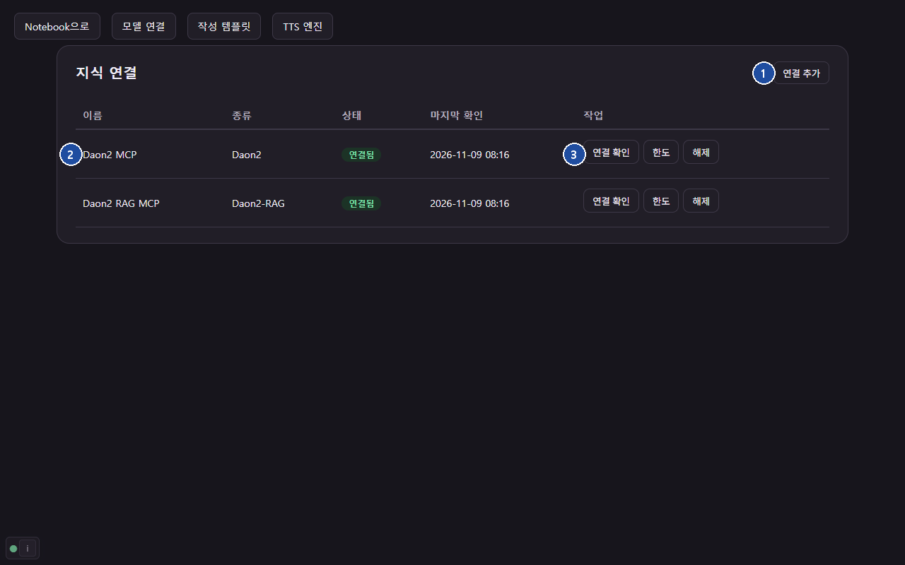

| 번호 | 항목 | 설명 | 비활성 조건 |
| --- | --- | --- | --- |
| ① | **연결 추가** | 등록 창 열기 | 관리자 외 |
| ② | 연결 목록 | 이름, 종류, 상태(**연결됨**, **확인 전**, **확인 실패** 등), 마지막 확인 | 없음 |
| ③ | **연결 확인**, **한도**, **해제** | 연결 시험, 호출 한도, 연결 해제 | 확인 중 |

#### 주의·오류

| 화면 메시지 | 원인 | 조치 |
| --- | --- | --- |
| "사설 주소는 이 환경에서 연결할 수 없습니다." | 허용되지 않는 서버 주소 | 공개 접근 가능한 주소 사용 |
| "요청을 처리하지 못했습니다. 잠시 후 다시 시도해 주세요." | 일시 오류 | 잠시 뒤 다시 |

#### 관련

2-4 Source 추가 창과 Source 상태, 2-7 문서 작성 마법사

### 3-5 문서 작성 템플릿

#### 기능·목적

조직에서 쓰는 문서 작성 템플릿을 등록·수정하고 켜거나 끕니다. 저장할 때마다 새 버전이 됩니다.

#### 쓸 수 있는 사람

시스템 관리자. 관리 설정 화면 위쪽의 **작성 템플릿** 링크로 엽니다.

#### 사용 순서

1. **새 템플릿**을 누릅니다.
2. **제목**, **설명**, **템플릿 정의(JSON)**를 넣습니다. **JSON 파일 가져오기**나 **예시 채우기**를 써도 됩니다.
3. **검증 후 저장**을 누릅니다.
4. 목록에서 **편집**, **비활성**·**활성**, **내보내기**를 합니다.

#### 화면 구성

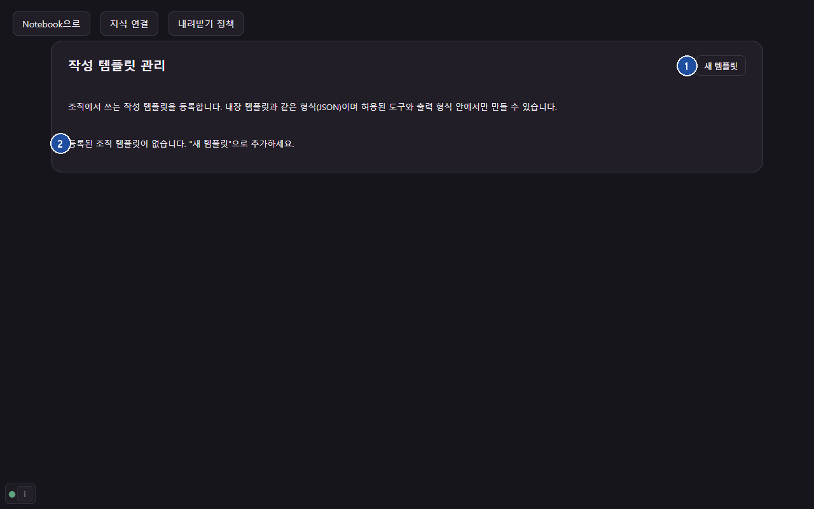

| 번호 | 항목 | 설명 | 비활성 조건 |
| --- | --- | --- | --- |
| ① | **새 템플릿** | 템플릿 등록 창 | 관리자 외 |
| ② | 템플릿 목록 | 제목, ID, 버전, 상태(**사용 중**, **비활성**), 섹션 수. 등록 전에는 안내 문구만 보임 | 없음 |
| 목록 각 줄 | **편집**, **비활성**·**활성**, **내보내기** | 수정(새 버전), 켜고 끄기, JSON 내보내기 | 없음 |

#### 주의·오류

| 화면 메시지 | 원인 | 조치 |
| --- | --- | --- |
| "JSON 형식이 올바르지 않습니다." | JSON 문법 오류 | 형식 확인 |
| "같은 ID의 템플릿이 이미 있습니다. 목록에서 편집하세요." | ID 중복 | 기존 템플릿을 편집 |

#### 관련

2-7 문서 작성 마법사, 3-4 지식 연결

### 3-6 TTS 음성 엔진

#### 기능·목적

오디오·동영상 개요의 음성을 만드는 TTS 서버를 등록하고, 기본 엔진과 목소리를 정합니다.

#### 쓸 수 있는 사람

시스템 관리자. 노트북 홈 **설정** → **음성 엔진**으로 엽니다.

#### 사용 순서

1. **엔진 추가**를 누릅니다.
2. **식별자**, **이름**, **서버 주소**, **API 키**, **전송 구분**, 두 화자의 기본 목소리를 넣고 **등록**합니다.
3. **연결 확인**을 누르면 고를 수 있는 목소리가 채워집니다.
4. **수정**으로 목소리를 고르고, 기본으로 쓸 엔진은 **기본으로**를 누릅니다.

#### 화면 구성

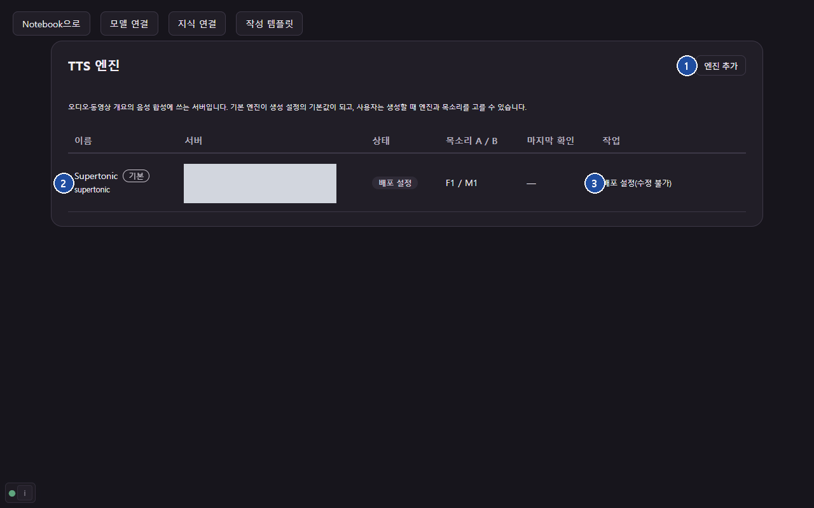

| 번호 | 항목 | 설명 | 비활성 조건 |
| --- | --- | --- | --- |
| ① | **엔진 추가** | 등록 창 | 관리자 외 |
| ② | 엔진 목록 | 이름, 서버, 상태, 목소리 A·B, 마지막 확인 | 없음 |
| ③ | 작업: **연결 확인**, **기본으로**, **수정**, **사용**·**사용 안 함**, **해제** | 시험, 기본 지정, 수정, 켜고 끄기, 해제 | 상태가 **사용 안 함**이면 연결 확인 꺼짐. 배포할 때 설정된 엔진(**배포 설정**)은 화면에서 고칠 수 없음 |

외부 API로 등록한 엔진은 3-2 외부 전송 정책의 허용 목적지에 서버 주소가 있어야 합니다. 서버 내부로 등록한 엔진은 조직이 직접 운영하는 서버입니다.

#### 주의·오류

| 화면 메시지 | 원인 | 조치 |
| --- | --- | --- |
| "식별자는 영문 소문자·숫자·-·_ 로 1~32자여야 합니다." | 식별자 형식 오류 | 형식에 맞게 입력 |
| "음성 서버가 키를 거부했습니다." | API 키 오류 | 키 확인 후 수정 |

#### 관련

2-6 스튜디오, 3-2 조직 정책과 외부 전송 정책

### 3-7 내려받기 정책

#### 기능·목적

조직 구성원이 스튜디오 산출물을 내려받기 전에 비밀번호를 한 번 더 확인하게 합니다.

#### 쓸 수 있는 사람

시스템 관리자. 작성 템플릿 화면 위쪽의 **내려받기 정책** 링크로 엽니다.

#### 사용 순서

1. **산출물 내려받기에 추가 인증 요구**를 체크합니다.
2. **저장**을 누릅니다.

#### 화면 구성

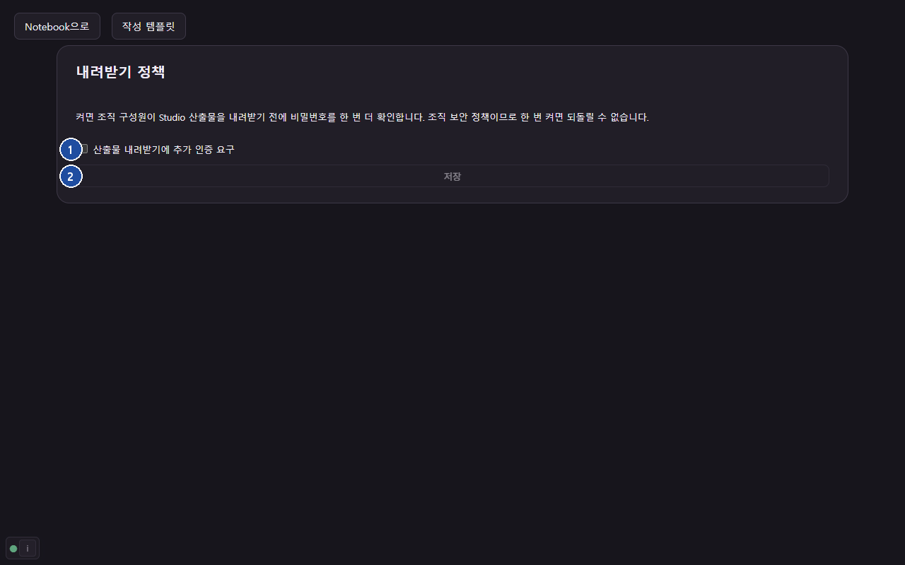

| 번호 | 항목 | 설명 | 비활성 조건 |
| --- | --- | --- | --- |
| ① | **산출물 내려받기에 추가 인증 요구** | 켜면 내려받을 때 비밀번호 확인 | 이미 켜져 있을 때 |
| ② | **저장** | 정책 저장 | 체크하지 않았거나 이미 켜져 있을 때 |

#### 주의·오류

| 화면 메시지 | 원인 | 조치 |
| --- | --- | --- |
| "저장하지 못했습니다. 잠시 후 다시 시도해 주세요." | 저장 실패 | 잠시 뒤 다시 |

이 정책은 조직 보안 정책이라 한 번 켜면 되돌릴 수 없습니다. 켜기 전에 조직과 합의합니다.

#### 관련

1-8 내려받기와 로그아웃, 2-6 스튜디오

### 3-8 라이선스

#### 기능·목적

Edition, 상태, 허용 기능, 사용 한도를 확인하고 서명된 라이선스 문서를 적용합니다.

#### 쓸 수 있는 사람

로그인한 사용자는 누구나 읽기 전용으로 봅니다. 서버가 `can_apply=true`로 판정한 경우에만 라이선스 등록·교체·적용 입력이 보입니다. 시스템 관리자 또는 현재 조직의 관리 권한이 검증된 사용자가 대상이며, Workspace 역할만으로 적용 권한이 생기지는 않습니다.

#### 사용 순서

1. **설정** → **라이선스**를 엽니다.
2. **현재 라이선스**, **허용 기능**, **사용 한도**를 확인합니다.
3. 적용 권한이 있으면 승인된 JSON 라이선스 문서를 고르고 **현재 비밀번호**를 넣은 뒤 **Step-up 후 검증·적용**을 누릅니다.
4. 제품, 기간, 서명 검증 결과를 확인합니다.

#### 화면 구성

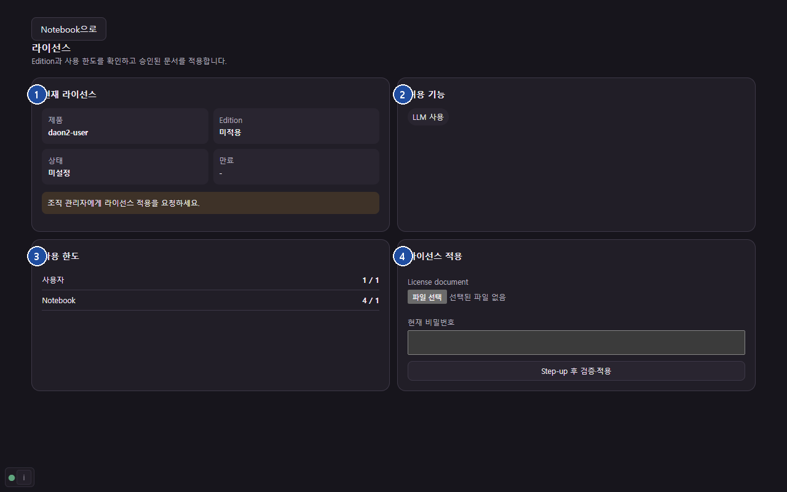

| 번호 | 항목 | 설명 | 비활성 조건 |
| --- | --- | --- | --- |
| ① | **현재 라이선스** | 제품, Edition, 상태(**정상**, **만료 예정**, **만료**, **한도 도달** 등), 만료일 | 없음 |
| ② | **허용 기능** | LLM 사용 여부 | 없음 |
| ③ | **사용 한도** | 사용자 수와 Notebook 수의 사용량/한도 | 없음 |
| ④ | **라이선스 적용** | 문서 선택, 비밀번호, **Step-up 후 검증·적용** | 적용 권한이 없으면 보이지 않음, 검증 중 |

Daon User 라이선스의 적용 대상은 사용자 수와 Notebook 수입니다. LLM 사용은 수량 한도가 아니라 허용 기능입니다. 라이선스가 없어도 기본 사용이 가능하며, 기본값은 사용자 1명, Notebook 1개, LLM 사용 가능입니다. 한도에 도달해도 로그인과 기존 데이터 조회·내보내기는 유지됩니다.

#### 주의·오류

| 화면 메시지 | 원인 | 조치 |
| --- | --- | --- |
| "라이선스 요청을 처리하지 못했습니다." + `LICENSE_APPLY_FAILED` | 문서·서명·비밀번호 검증 실패 | 문서와 비밀번호 확인 |
| "라이선스 요청을 처리하지 못했습니다." + `LICENSE_UNAVAILABLE` | 서버 확인 실패 | **다시 시도** |

라이선스 원문과 비밀번호를 로그나 문의 글에 붙이지 않습니다.

#### 관련

2-2 노트북 홈, 3-1 사용자 관리

### 3-9 운영 상태

#### 기능·목적

시스템과 Workspace의 운영 상태와 백업을 확인하고, 백업 요청과 복구를 합니다.

#### 쓸 수 있는 사람

시스템 관리자와 백업·복구 권한이 있는 사용자. 알림 화면의 **운영 상태** 탭이나 알림 링크로 `/operations`를 엽니다. 작업 화면 위쪽 **운영상태** 버튼은 같은 정보의 요약 창을 엽니다.

#### 사용 순서

1. `/operations`를 엽니다. 위쪽 **다시 조회**로 최신 상태를 봅니다.
2. 구성요소(Provider 설정, API, DB·Object Storage, 동기화, 작업 Queue)의 상태가 준비·주의·오류 중 무엇인지 확인합니다.
3. 백업: **백업 자료 선택** → 노트북과 자료 선택 → **선택 자료 백업 요청**.
4. 복구: 백업을 열고 **등록 복원 목적지 조회** → 목적지 선택 → **등록 목적지 Preview 준비** → **현재 비밀번호** → **인증 후 실행 확정**.

#### 화면 구성

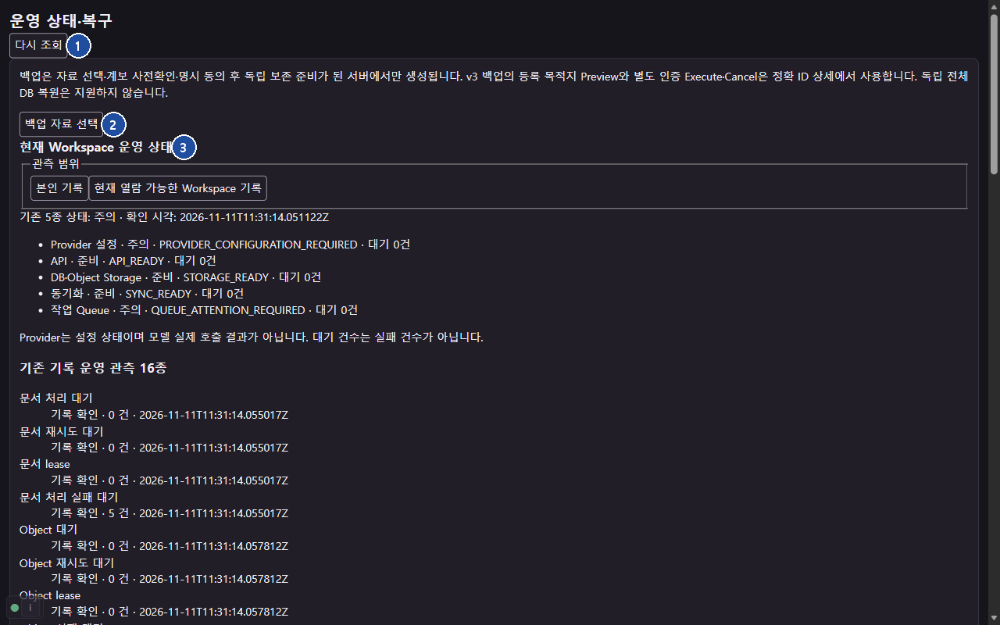

| 번호 | 항목 | 설명 | 비활성 조건 |
| --- | --- | --- | --- |
| ① | **다시 조회** | 상태 새로고침 | 처리 중 |
| ② | **백업 자료 선택** | 백업할 노트북과 자료 고르기 | 권한이 없으면 꺼짐 |
| ③ | 운영 상태 | 구성요소별 상태와 관측 기록. **관측 범위**에서 **본인 기록** 또는 Workspace 기록 선택. 백업 목록은 아래쪽에 보임 | 권한에 따라 범위가 다름 |

이 화면은 브라우저 창이 가려지거나 최소화되면 안전을 위해 내용을 숨기고 "현재 세션과 복구 대상을 확인하고 있습니다."만 보입니다. 창을 앞으로 가져오면 다시 조회합니다.

작업 화면 **운영상태** 창에서는 **LLM 설정 열기**, **동기화 설정 열기**, **상태 새로고침** 같은 안전한 복구 동작만 씁니다. 내부 주소나 포트를 직접 넣어 우회하지 않습니다.

#### 주의·오류

| 화면 메시지 | 원인 | 조치 |
| --- | --- | --- |
| "현재 권한으로 이 복구 대상에 접근할 수 없습니다." | 권한 없음 | 권한 있는 담당자에게 요청 |
| "요청을 확인하고 있습니다. 중복 전송하지 마세요." | 요청 처리 중 | 기다린 뒤 결과 확인 |

#### 관련

2-3 작업 화면, 2-10 알림·전달함, 3-3 모델 연결

## 부록

### 부록 A 오류 메시지별 조치

| 화면 메시지 | 어디서 | 조치 |
| --- | --- | --- |
| `EMAIL_VERIFICATION_REQUIRED`, `EMAIL_TOKEN_INVALID`, `PASSWORD_POLICY_FAILED` | 로그인·가입 | 2-1 |
| `LICENSE_RESOURCE_LIMIT_REACHED` | 노트북 만들기 | 3-8 |
| "PDF에서 글자를 찾지 못했습니다." | Source 상태 | 2-4 |
| "기본 모델이 지정되지 않았습니다." | Source 상태 | 3-3 후 2-4 **재처리** |
| "선택한 모델을 사용할 수 없어 답변하지 못했습니다." | 대화 | 2-5 |
| "조직 정책이 외부 전송을 허용하지 않습니다." | 스튜디오·대화 | 3-2 |
| "소스 처리에 실패했습니다. Source 목록에서 사유를 확인하고 재처리해 주세요." | 문서 작성 | 2-4 |
| "한 번에 보내기에 내용이 너무 많습니다." | 문서 작성 확정 | 2-7 |
| "Provider가 Key를 거부했습니다(인증 실패)" | 모델 연결 | 3-3 |
| `PROTECTED_ADMIN_ACCOUNT` | 사용자 관리 | 3-1 |
| `EGRESS_POLICY_PAYLOAD_INVALID` | 외부 전송 정책 | 3-2 |

### 부록 B 용어집

Daon을 쓸 때 지키는 핵심 원칙입니다.

- 질문에 사용할 Source를 사용자가 명시적으로 선택합니다.
- 근거 질문은 Citation을 원문과 함께 검토합니다.
- Provider 연결과 실제 질문 실행 지원을 구분합니다.
- 외부 전송은 조직 정책을 통과한 경우에만 수행합니다.
- 모델과 설정을 자동으로 임의 변경하지 않습니다.
- 미지원 형식이나 기능은 성공을 가장하지 않고 안전하게 중단합니다.
- Version, Run과 산출물의 계보를 보존합니다.

용어:

- Raw Source: 사용자가 직접 등록한 파일이나 텍스트
- Daon 승인 지식: Daon 2, Daon 2.5, Daon 3에서 생산·등록된 지식 패키지
- 연결형 Source: MCP나 Connector를 통해 참조하는 외부 Source
- Source Version: 특정 시점 Source의 변경 불가능한 Version
- Evidence: 질문 처리에 실제 사용된 근거 조각
- Citation: 답변에서 Evidence 위치를 가리키는 참조
- Notebook(노트북): 업무 하나의 자료·질문·산출물을 담는 작업 단위
- Workspace: 접근 권한과 작업 범위를 묶는 단위. Notebook은 Workspace 안에 있습니다
- 산출물: 스튜디오가 만든 보고서·슬라이드·퀴즈 등의 결과물
- 리비전(버전): 산출물을 고칠 때마다 새로 쌓이는 판. 이전 판은 지워지지 않습니다
- 요구사항 대응표: 문서 작성에서 요구사항마다 본문이 어떻게 대응하는지 보여 주는 표
- 외부 전송 정책: 자료와 질문을 외부 모델로 보낼 수 있는지 정하는 조직·Workspace 정책

### 부록 C 찾아보기

| 하고 싶은 일 | 화면 |
| --- | --- |
| 가입, 로그인, 비밀번호 재설정 | 2-1 |
| 노트북 만들기·지우기 | 2-2 |
| 자료 올리기, 처리 실패 확인, 재처리 | 2-4 |
| 질문하고 근거 보기 | 2-5 |
| 모델·추론 수준 바꾸기 | 2-5, 2-9 |
| 보고서·슬라이드·퀴즈 만들기 | 2-6 |
| 산출물을 말로 고치기(대화로 수정) | 2-6 |
| 산출물 내려받기 | 2-6, 1-8 |
| 제안서 초안 만들기, 여러 RFP 파일 쓰기 | 2-7 |
| 메모 남기기 | 2-8 |
| 답변 방식 지시(맞춤설정), 노트북 복사, 채팅 기록 삭제 | 2-9 |
| 알림 확인 | 2-10 |
| 화면 테마, 설명서 내려받기, 내 비밀번호 바꾸기 | 2-11 |
| 사용자 등록·중지·역할 변경 | 3-1 |
| 외부 전송 허용·차단 | 3-2 |
| 모델 Provider 연결, 기본 모델 지정 | 3-3 |
| 지식 서버 연결 | 3-4 |
| 문서 작성 템플릿 관리 | 3-5 |
| 음성 엔진 등록 | 3-6 |
| 내려받기 추가 인증 켜기 | 3-7 |
| 라이선스 적용 | 3-8 |
| 운영 상태·백업·복구 | 3-9 |

### 부록 D 현재 제공 범위와 제한

- 이 설명서는 Web 화면만 설명합니다. Windows·모바일 앱은 조직이 별도로 제공한 경우에만 쓰며, 사용 범위는 제공한 운영 안내를 따릅니다.
- PDF는 글자가 들어 있는 문서만 처리합니다. 스캔 PDF와 암호 PDF는 처리하지 않습니다. 표는 글자만 읽어 칸 구조가 흐트러질 수 있습니다.
- 작업 화면 위쪽 **공유**와 노트북 복사의 자료(Source) 복사는 준비 중입니다.
- 오디오·동영상 개요는 관리자가 음성 엔진을 등록했을 때만 만들 수 있습니다.
- 스튜디오 산출물의 **형식**은 처음 만들 때의 기본값으로 정해지며, **설정 변경 후 다시 생성**으로는 바뀌지 않습니다.
- 문서 작성의 요구사항 분석은 자료 전체를 읽지만, 아주 긴 문서는 정해진 분량까지만 읽고 그 사실을 확인 화면에 알립니다.
- 비밀번호, Token, API Key, 내부 주소를 기록하거나 공유하지 않습니다.
