# Daon 사용자 설명서

- Release: 2.0.0
- 문서 업데이트: 2026-11-24
- 언어: 한국어(ko-KR)
- 대상: 처음 쓰는 사용자, 업무 담당자, 시스템 관리자
- 범위: Web 화면. 공개 범위는 로그인·가입 화면과 이 설명서이며, Notebook·Source·질문·스튜디오·설정은 로그인 후 조직 전용 범위입니다.

> 이 설명서는 세 부분으로 되어 있습니다. 처음이면 1부를 순서대로 따라 하세요. 이미 익숙하면 2부(화면별 설명)와 부록 C(찾아보기)에서 필요한 화면을 바로 찾으세요. 3부는 시스템 관리자용입니다.

## 1부 처음 시작하기

1부는 첫 업무를 끝까지 해 보는 순서입니다. 각 단계는 "무엇을 하는지 → 따라 하기 → 끝났는지 확인 → 자세히" 순서로 되어 있습니다.

### 1-1 이 설명서 읽는 법

- 처음 쓰는 사용자: 1-2부터 1-8까지 순서대로 따라 합니다. 끝나면 노트북 하나에 자료를 올리고, 질문하고, 스튜디오 산출물과 제안서 초안을 만들어 내려받은 상태가 됩니다.
- 익숙한 사용자: 2부에서 화면 이름으로 찾습니다. 모든 화면 설명은 같은 순서(기능·목적 → 쓸 수 있는 사람 → 사용 순서 → 화면 구성 → 주의·오류 → 관련)로 되어 있습니다.
- 하고 싶은 일은 알지만 화면을 모르면 부록 C 찾아보기를 봅니다. 화면에 뜬 오류 문구는 부록 A에서 찾습니다.
- 굵은 글씨는 화면에 보이는 버튼·메뉴·항목 이름입니다. 화면 그림의 ①②③ 번호는 그 아래 표의 번호와 같습니다.

자세히: 2-3 작업 화면

### 1-2 가입과 로그인

무엇을 하는지: 계정을 만들고 로그인해 노트북 홈으로 들어갑니다.

1. 로그인 화면에서 **가입하기**를 누릅니다.
2. **사용자 ID**, **메일 주소**, **비밀번호**(12자 이상)를 입력하고 **가입**을 누릅니다.
3. 메일로 받은 인증 토큰을 **이메일 인증 토큰**에 입력하고 **이메일 인증**을 누릅니다. 메일이 오지 않으면 **인증 재전송**을 누릅니다.
4. **사용자 ID**와 **비밀번호**를 입력하고 **로그인**을 누릅니다.

끝났는지 확인: 노트북 홈(**Daon Notebook**)이 열립니다.

자세히: 2-1 로그인·가입·비밀번호 재설정, 조직에 들어가려면 2-12 조직 가입

### 1-3 노트북 만들기

무엇을 하는지: 업무 하나를 담을 노트북을 만듭니다. 자료, 질문, 산출물은 모두 노트북 안에 쌓입니다.

1. 노트북 홈에서 **새 Notebook**을 누릅니다.
2. **제목**을 입력합니다. 설명(선택)은 비워 두어도 됩니다.
3. **만들기**를 누릅니다.

끝났는지 확인: 새 노트북이 열리고 왼쪽 **Source·지식·권위**, 가운데 **대화·실행**, 오른쪽 **스튜디오**가 보입니다.

자세히: 2-2 노트북 홈

### 1-4 자료(Source) 올리기

무엇을 하는지: 질문과 산출물의 근거가 될 자료를 노트북에 올립니다. 자료 하나하나를 Source라고 부릅니다.

1. 왼쪽 위 **Source 추가**를 누릅니다.
2. **파일 업로드** 탭에서 **파일을 선택하세요**를 눌러 PDF·DOCX·XLSX·TXT 같은 파일을 고릅니다. 글을 바로 넣으려면 **복사한 텍스트** 탭에 붙여 넣고 **텍스트 등록**을 누릅니다.
3. **Raw Source** 목록에 올린 자료가 생기고 상태가 **처리 중**에서 **사용 가능**으로 바뀔 때까지 기다립니다.

끝났는지 확인: 자료 줄 앞의 체크 칸이 켜져 있고 상태가 **사용 가능**입니다. **처리 실패**가 보이면 그 아래 빨간 사유를 읽고 **재처리**를 누릅니다.

자세히: 2-4 Source 추가 창과 Source 상태, 소스가 많으면 2-18 소스 묶음, 조직의 승인 지식·문서에서 자료를 찾아 더하려면 2-19 빠른 찾기

### 1-5 질문하고 근거 확인하기

무엇을 하는지: 올린 자료를 근거로 질문하고, 답변이 자료의 어디에서 나왔는지 확인합니다.

1. 질문에 쓸 자료의 체크 칸이 켜져 있는지 확인합니다.
2. 가운데 아래 입력 칸에 질문을 쓰고 Enter를 누릅니다.
3. 답변 아래 Citation 링크를 눌러 근거가 된 자료 위치를 엽니다.
4. 남겨 둘 답변은 **메모에 저장**을 누릅니다.

끝났는지 확인: 답변 아래에 Citation이 있고, 눌렀을 때 자료 원문이 보입니다. **근거 부족**이 붙은 답변은 자료에서 근거를 찾지 못한 것이니 자료나 질문을 바꿔 다시 묻습니다. 답변이 어떤 자료와 판정을 거쳐 나왔는지는 답변 아래 **답변 과정**을 펼쳐 봅니다.

자세히: 2-5 대화와 근거, 답변 과정은 2-13 답변 과정 보기, 질문 도구는 2-15 질문 도구 켜고 끄기, 노트북 개요는 2-16 노트북 개요와 추천 질문

### 1-6 스튜디오로 자료 만들기와 대화로 고치기

무엇을 하는지: 자료를 바탕으로 보고서·슬라이드·퀴즈 같은 산출물을 만들고, 말로 지시해 고칩니다.

1. 오른쪽 **스튜디오**에서 **보고서** 타일을 누릅니다. 기본 설정으로 바로 만들어집니다. **형식**·언어 등을 골라서 만들려면 타일에 마우스를 올리면 오른쪽에 나타나는 연필을 눌러 설정 창에서 고르고 **만들기**를 누릅니다.
2. 목록에 **생성 중…** 카드가 생기고, 끝나면 카드 제목을 눌러 내용을 엽니다.
3. 아래 **대화로 수정** 칸에 "둘째 문단을 더 짧게"처럼 고칠 곳을 쓰고 **보내기**를 누릅니다.
4. **고치기 전**·**고친 뒤**를 비교하고 **반영** 또는 **취소**를 누릅니다.

끝났는지 확인: 카드에 완료된 산출물이 있고, 반영한 내용이 본문에 보입니다.

자세히: 2-6 스튜디오, 슬라이드·동영상을 만들기 전에 장·장면 목록을 고치려면 2-17 만들기 전에 구성 확인(슬라이드·동영상)

### 1-7 문서 작성으로 제안서 만들기

무엇을 하는지: 제안요청서(RFP)를 읽어 요구사항을 뽑고, 요구사항에 맞춘 제안서 초안을 씁니다.

1. 스튜디오에서 **문서 작성**을 누르고 **작성 템플릿**에서 제안서 템플릿을 고른 뒤 **시작**을 누릅니다.
2. 제안요청서로 쓸 자료를 체크합니다. 파일이 여러 개면 모두 체크합니다. **다음**을 누릅니다.
3. **분석 중** 단계가 끝나면 **요구사항 확인** 표에서 잘못 뽑힌 항목을 고치거나 지웁니다. **출처 파일** 칸에서 어느 파일에서 나온 요구사항인지 봅니다.
4. **확정하고 초안 만들기**를 누르고, **작성 중** 단계가 끝날 때까지 기다립니다.

끝났는지 확인: **완료** 단계에서 **본문**과 **요구사항 대응표** 탭이 보입니다.

자세히: 2-7 문서 작성 마법사

### 1-8 내려받기와 로그아웃

무엇을 하는지: 만든 산출물을 파일로 내려받고 안전하게 로그아웃합니다.

1. 산출물을 연 상태에서 **다운로드**를 누르고 형식(DOCX, PDF 등)을 고릅니다. 문서 작성 결과는 완료 화면의 **다운로드** 버튼을 씁니다.
2. 조직이 내려받기 추가 인증을 켜 두었다면 **현재 비밀번호**를 넣고 **인증 후 내려받기**를 누릅니다.
3. 작업을 마치면 위쪽 **설정**에서 **로그아웃**을 누릅니다.

끝났는지 확인: 파일이 내려받아지고, 로그아웃 뒤 로그인 화면으로 돌아옵니다.

자세히: 2-6 스튜디오

## 2부 화면별 설명

모든 화면 설명은 같은 순서로 되어 있습니다. 화면 그림의 번호는 "화면 구성" 표의 번호와 같습니다.

### 2-1 로그인·가입·비밀번호 재설정

#### 기능·목적

Daon에 들어오는 첫 화면입니다. 로그인, 가입, 이메일 인증, 비밀번호 재설정을 합니다. 이미 로그인되어 있으면 노트북 홈으로 바로 이동합니다.

#### 쓸 수 있는 사람

누구나 쓸 수 있습니다. 가입한 뒤 이메일 인증을 끝내야 로그인할 수 있습니다.

#### 사용 순서

1. 가입: **가입하기** → **사용자 ID**, **메일 주소**, **비밀번호** 입력 → **가입**.
2. 이메일 인증: **이메일 인증 토큰** 입력 → **이메일 인증**. 다시 받으려면 **인증 재전송**.
3. 로그인: **사용자 ID**, **비밀번호** 입력 → **로그인**.
4. 비밀번호를 잊었을 때: **비밀번호를 잊으셨나요?** → **사용자 ID 또는 메일 주소** 입력 → **재설정 메일 요청** → 받은 **재설정 토큰**과 **새 비밀번호** 입력 → **비밀번호 재설정**.
5. 비밀번호 변경을 요구받으면 `/password-change`의 **새 비밀번호 설정** 화면에서 **현재 비밀번호**, **새 비밀번호**, **새 비밀번호 확인**을 넣고 **비밀번호 변경**을 누릅니다.

#### 화면 구성

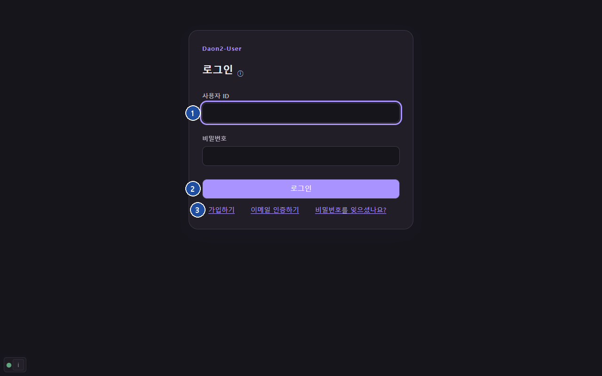

| 번호 | 항목 | 설명 | 비활성 조건 |
| --- | --- | --- | --- |
| ① | **사용자 ID**, **비밀번호** | 가입할 때 정한 ID와 비밀번호 | 요청 처리 중 |
| ② | **로그인** | 로그인하고 노트북 홈으로 이동 | 요청 처리 중 |
| ③ | **가입하기**, **이메일 인증하기**, **비밀번호를 잊으셨나요?** | 가입, 인증, 재설정 화면으로 전환 | 없음 |

#### 주의·오류

| 화면 메시지 | 원인 | 조치 |
| --- | --- | --- |
| `EMAIL_VERIFICATION_REQUIRED` | 이메일 인증 전 | 인증 토큰을 입력해 인증 |
| `EMAIL_TOKEN_INVALID` | 인증 토큰이 틀리거나 만료 | **인증 재전송** 후 새 토큰 입력 |
| `PASSWORD_POLICY_FAILED` | 비밀번호가 12자 미만 등 규칙 위반 | 규칙에 맞게 다시 입력 |
| `AUTHENTICATION_REQUIRED` | ID 또는 비밀번호 불일치 | 다시 입력 |
| "새 비밀번호가 일치하지 않습니다." | 확인 칸이 다름 | 같은 값을 두 번 입력 |

인증되지 않은 상태에서 노트북 주소를 직접 열었을 때 내용이 보이면 정상이 아닙니다. 브라우저를 닫고 운영 담당자에게 알립니다.

#### 관련

1-2 가입과 로그인, 2-11 내 설정(계정 설정), 3-1 사용자 관리(보호 admin)

### 2-2 노트북 홈

#### 기능·목적

내 노트북 목록입니다. 노트북을 찾고, 만들고, 열고, 지웁니다. 공통 설정 메뉴도 여기에 있습니다.

#### 쓸 수 있는 사람

로그인한 사용자. 설정 메뉴의 **조직 정책**, **사용자 관리**, **조직 관리**, **음성 엔진**은 시스템 관리자에게만 보입니다. **조직 가입**은 모든 사용자에게 보입니다.

#### 사용 순서

1. 찾기: **Notebook 제목 검색**에 제목을 입력합니다. 정렬은 **최근 수정** 또는 **제목**.
2. 만들기: **새 Notebook** → **제목**, 설명(선택) → **만들기**. 빈 노트북이 바로 열립니다.
3. 열기: 노트북 카드를 누릅니다.
4. 지우기: 카드의 ⋮ → **노트북 삭제** → 노트북 제목을 똑같이 입력 → **영구 삭제**. 되돌릴 수 없습니다.

#### 화면 구성

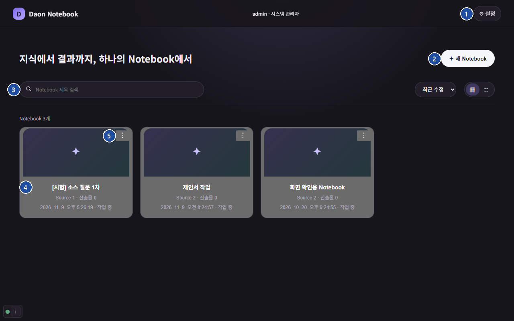

| 번호 | 항목 | 설명 | 비활성 조건 |
| --- | --- | --- | --- |
| ① | **설정** | **화면 설정**, **라이선스**, **사용자 설명서**, **LLM 설정**, **조직 가입**, **작업 범위 새로고침**, **로그아웃**. 관리자에게는 **조직 정책**, **사용자 관리**, **조직 관리**, **음성 엔진**이 더 보임 | 없음 |
| ② | **새 Notebook** | 새 노트북 만들기 | 없음 |
| ③ | **Notebook 제목 검색**, **최근 수정**·**제목** | 찾기와 정렬 | 없음 |
| ④ | 노트북 카드 | 제목, Source·산출물 개수, 상태(**비어 있음**, **작업 중**, **확인 필요**) | 없음 |
| ⑤ | 카드 ⋮ | **노트북 삭제** | 없음 |

#### 주의·오류

| 화면 메시지 | 원인 | 조치 |
| --- | --- | --- |
| "Notebook을 불러오지 못했습니다." | 서버 연결 문제 | **다시 시도** |
| `LICENSE_RESOURCE_LIMIT_REACHED` | 라이선스의 Notebook 수 한도 도달 | 3-8 라이선스 확인 |
| `DELETE_SHARED_DATA_BLOCKED` | 다른 노트북과 함께 쓰는 자료가 있음 | 공유 자료를 먼저 정리 |
| `NOTEBOOK_DELETION_IN_PROGRESS` | 이미 삭제 중 | 잠시 뒤 목록 새로고침 |

**영구 삭제** 버튼은 입력한 제목이 노트북 제목과 같아야 켜집니다.

#### 관련

1-3 노트북 만들기, 2-3 작업 화면, 2-9 노트북 메뉴

### 2-3 작업 화면

#### 기능·목적

노트북 안에서 일하는 화면입니다. 왼쪽에서 자료를 관리하고, 가운데에서 질문하고, 오른쪽 스튜디오에서 산출물을 만듭니다.

#### 쓸 수 있는 사람

그 노트북에 접근할 수 있는 사용자. 화면에서 편집·열람 권한을 따로 나누어 보여 주지는 않으며, 서버가 동작마다 권한을 다시 확인합니다.

#### 사용 순서

1. 왼쪽 **Source·지식·권위**에서 자료를 올리고 쓸 자료를 체크합니다(2-4).
2. 가운데 **대화·실행**에서 질문하고 근거를 확인합니다(2-5).
3. 오른쪽 **스튜디오**에서 산출물을 만듭니다(2-6).
4. 위쪽 **설정**에서 모델·정책·라이선스·설명서를 열거나 **로그아웃**합니다. 좁은 화면에서는 아래 **Source**·**대화**·**Studio** 탭으로 영역을 바꿉니다.

#### 화면 구성

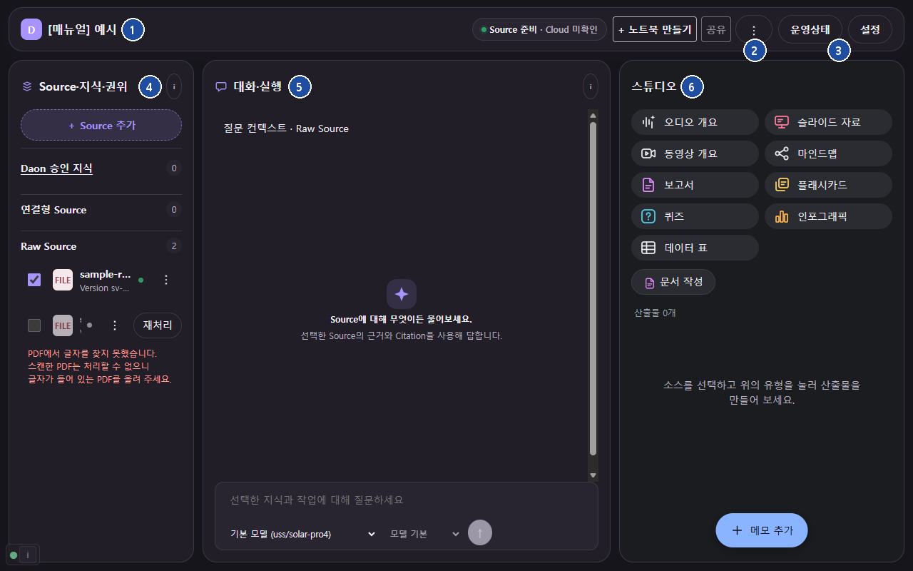

| 번호 | 항목 | 설명 | 비활성 조건 |
| --- | --- | --- | --- |
| ① | 노트북 제목, 상태 표시 | Source 상태(**Source 준비**, **Source 확인 필요** 등)와 연결 상태 | 없음 |
| ② | **노트북 만들기**, **공유**, ⋮ | ⋮은 노트북 메뉴(2-9) | **공유**는 준비 중이라 항상 꺼짐 |
| ③ | **운영상태**, **설정** | 설정 메뉴: **LLM 설정**, **출력·버전**, **동기화·승인**, **조직 정책**, **라이선스**, **사용자 설명서**, **음성 엔진**, **조직 가입**, **조직 관리**, **로그아웃** | 없음 |
| ④ | **Source·지식·권위** | 자료 목록과 **Source 추가** | 없음 |
| ⑤ | **대화·실행** | 질문과 답변 | 없음 |
| ⑥ | **스튜디오** | 산출물 타일과 카드 | 없음 |

설정 메뉴의 **출력·버전**은 산출물 유형별 기본 형식을 정하고, **동기화·승인**은 대기 중인 동기화 항목을 확인해 고른 것만 승인합니다. **조직 정책**은 이 Workspace에 적용된 외부 전송 정책을 읽기 전용으로 보여 줍니다(3-2).

#### 주의·오류

| 화면 메시지 | 원인 | 조치 |
| --- | --- | --- |
| "현재 권한으로 Workspace를 열 수 없습니다." | 이 노트북에 접근 권한이 없음 | 노트북 홈으로 돌아가 다른 노트북 선택 |
| "Source를 불러오지 못했습니다. 운영상태에서 연결을 확인해 주세요." | 서버 연결 문제 | **운영상태** 확인 후 **다시 시도** |

#### 관련

1-1 이 설명서 읽는 법, 2-4, 2-5, 2-6, 2-9, 3-9 운영 상태

### 2-4 Source 추가 창과 Source 상태

#### 기능·목적

질문과 산출물의 근거 자료(Source)를 올리고 처리 상태를 확인합니다. 처리에 실패한 자료는 사유를 보고 다시 처리합니다.

#### 쓸 수 있는 사람

노트북에 접근할 수 있는 사용자.

#### 사용 순서

1. **Source 추가**를 누릅니다.
2. 탭을 고릅니다: **파일 업로드**, **웹사이트**, **Drive**, **복사한 텍스트**, **MCP 연결**.
3. 파일은 **파일을 선택하세요**로 고르고, 텍스트는 붙여 넣은 뒤 **텍스트 등록**, 웹사이트는 **공개 HTTPS URL**을 넣고 수집 권한 확인 칸을 체크한 뒤 **웹사이트 가져오기**를 누릅니다.
4. **Raw Source** 목록에서 상태가 **사용 가능**이 될 때까지 기다립니다.
5. 질문과 산출물에 쓸 자료만 체크 칸을 켜 둡니다. 자료가 많으면 묶음으로 나눠 묶음째 켜고 끌 수 있습니다(2-18).
6. **처리 실패**나 **모델 대기**이면 아래 빨간 사유를 읽고 **재처리**를 누릅니다. **처리 방식**을 고르고 **설정 확인·재처리**를 누릅니다.

#### 화면 구성

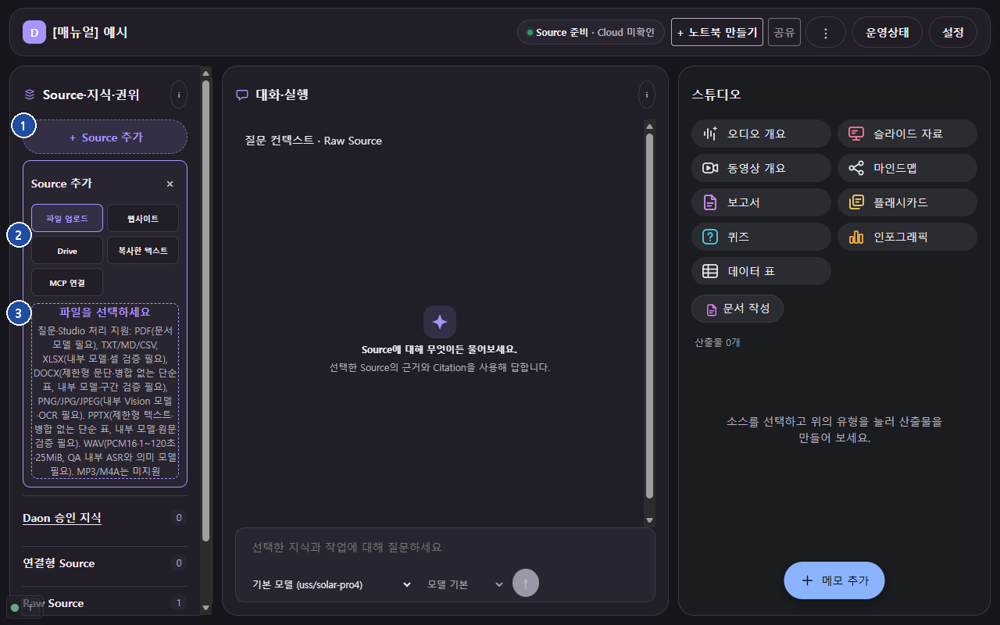

| 번호 | 항목 | 설명 | 비활성 조건 |
| --- | --- | --- | --- |
| ① | **Source 추가** | 자료를 올리는 창 열기 | 없음 |
| ② | **파일 업로드**, **웹사이트**, **Drive**, **복사한 텍스트**, **MCP 연결** | 자료 종류별 탭 | 없음 |
| ③ | **파일을 선택하세요** | 지원 형식: PDF, TXT·MD·CSV, XLSX, DOCX, PPTX, PNG·JPG, WAV. MP3·M4A는 지원하지 않음 | 처리 중 |

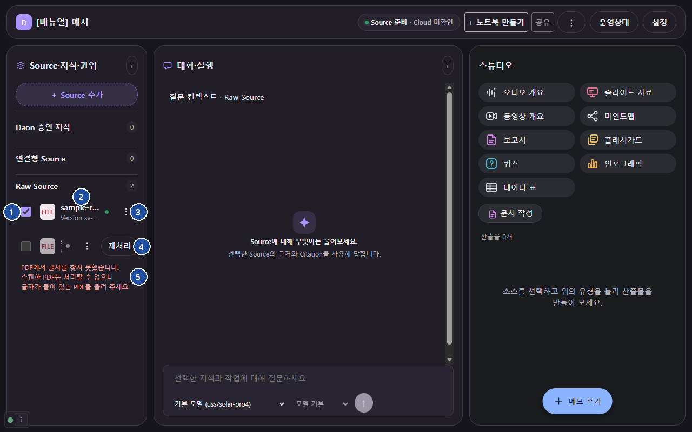

| 번호 | 항목 | 설명 | 비활성 조건 |
| --- | --- | --- | --- |
| ① | 체크 칸 | 켜진 자료만 질문과 산출물에 씀 | 자료가 **사용 가능**이 아닐 때 |
| ② | 자료 이름, 상태 | 상태: **등록됨**, **처리 중**, **색인 중**, **사용 가능**, **모델 대기**, **검토 필요**, **처리 실패** 등 | 없음 |
| ③ | ⋮ | **Notebook에서 제거**(원본은 보존), **Source 삭제 요청** | 없음 |
| ④ | **재처리** | 실패한 자료를 다시 처리 | 실패·모델 대기·검토 필요 자료에만 보임 |
| ⑤ | 실패 사유 | 처리하지 못한 이유와 조치 | 실패·모델 대기 자료에만 보임 |

**Daon 승인 지식**과 **연결형 Source** 묶음은 관리자가 연결한 지식과 외부 연결 자료입니다. **Daon 승인 지식**은 고른 것만 질문에 씁니다.

조직의 승인 지식·문서에서 자료를 찾아 노트북에 더하려면 **Source 추가** 아래 **자료 찾기**를 씁니다(2-19). 찾은 문서는 텍스트 소스로 들어오며 2 MiB까지 추가할 수 있습니다.

#### 주의·오류

| 화면 메시지 | 원인 | 조치 |
| --- | --- | --- |
| "PDF에서 글자를 찾지 못했습니다. 스캔한 PDF는 처리할 수 없으니 글자가 들어 있는 PDF를 올려 주세요." | 스캔본 PDF | 글자가 들어 있는 PDF로 다시 올림 |
| "암호가 걸린 PDF는 처리할 수 없습니다. 암호를 해제한 파일을 올려 주세요." | 암호 PDF | 암호를 풀어 다시 올림 |
| "기본 모델이 지정되지 않았습니다. 설정의 모델 연결에서 기본 모델을 지정하세요." | Workspace 기본 모델 없음 | 3-3에서 기본 모델 저장 후 **재처리** |
| "처리하지 못했습니다. 재처리를 눌러 다시 시도해 주세요." | 그 밖의 일시 오류 | **재처리** |
| "다른 Notebook에서도 사용하는 자료입니다. Notebook에서 제거를 사용하세요." | 공유 자료 삭제 시도 | **Notebook에서 제거** 사용 |

한 번에 올릴 수 있는 파일은 25MiB 이하입니다. PDF는 글자가 들어 있는 문서만 처리합니다. 표는 글자만 읽으므로 칸 구조가 흐트러질 수 있습니다.

#### 관련

1-4 자료(Source) 올리기, 2-5 대화와 근거, 2-18 소스 묶음, 2-19 빠른 찾기, 3-3 모델 연결

### 2-5 대화와 근거

#### 기능·목적

체크한 자료를 근거로 질문하고 답변을 받습니다. 답변의 Citation을 눌러 근거 위치를 확인하고, 필요한 답변은 메모로 남깁니다.

#### 쓸 수 있는 사람

노트북에 접근할 수 있는 사용자. 채팅 기록은 본인만 봅니다.

#### 사용 순서

1. 질문에 쓸 자료를 체크합니다. 자료가 없으면 일반 상담으로 답합니다.
2. 필요하면 입력 칸 위에서 모델과 추론 수준(**모델 기본**, **낮음**, **보통**, **높음** 등)을 고릅니다. 승인 지식·지식 연결을 켜고 끄려면 모델 선택 옆 **도구**를 누릅니다(2-15).
3. 입력 칸에 질문을 쓰고 Enter를 누르거나 보내기 버튼을 누릅니다.
4. 답변 아래 Citation 링크(쪽, 이미지 영역, 지식 구간 등)를 눌러 근거 원문을 봅니다.
5. **메모에 저장** 또는 **복사**를 누릅니다.
6. 답변이 만들어진 순서를 보려면 답변 아래 **답변 과정**을 펼칩니다(2-13).

#### 화면 구성

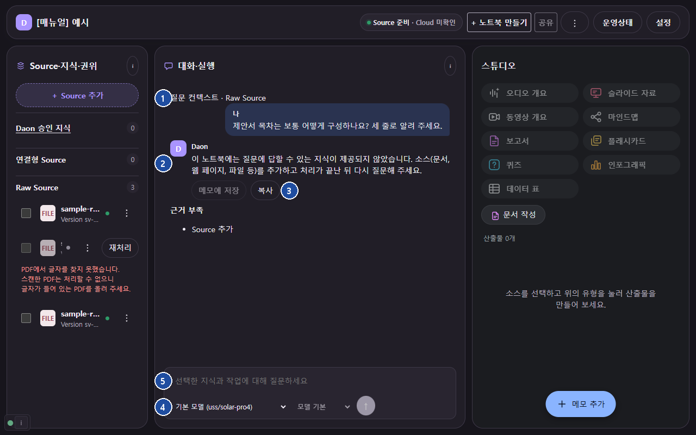

| 번호 | 항목 | 설명 | 비활성 조건 |
| --- | --- | --- | --- |
| ① | 질문 범위 표시 | **Raw Source**, **일반 상담** 등 지금 질문이 쓰는 자료 범위 | 없음 |
| ② | 답변, Citation, 표시 | **근거 부족**, **승인 지식 사용** 같은 답변 성격 표시. 그림은 근거를 찾지 못한 경우로, 답변 아래 **근거 부족**과 할 일(**Source 추가**)이 보이고 Citation은 없음. 근거를 찾으면 답변 끝에 Citation 링크가 붙음 | 없음 |
| ③ | **메모에 저장**, **복사** | 답변을 메모로 저장하거나 복사 | **근거 부족** 답변, 저장 중 |
| ④ | 모델·추론 수준 | 이 노트북에서 쓸 모델과 추론 수준. 다른 모델로 자동 전환하지 않음 | 모델을 고르기 전에는 추론 수준 꺼짐 |
| ⑤ | 입력 칸과 보내기 | 질문 입력 | 답변 대기 중, 입력이 비었을 때 |

질문 한 번에 쓸 수 있는 자료는 최대 8개입니다. 더 많이 체크하면 앞의 8개를 씁니다. 소스 묶음 체크칸(2-18)으로 켠 자료도 같습니다.

#### 주의·오류

| 화면 메시지 | 원인 | 조치 |
| --- | --- | --- |
| "선택한 모델을 사용할 수 없어 답변하지 못했습니다." | 고른 모델을 지금 쓸 수 없음 | 다른 모델을 골라 다시 질문 |
| "질문 실행에 실패했습니다." | 일시 오류 등 | 입력을 확인하고 다시 질문 |
| "추가 인증 비밀번호를 입력해 주세요." | 외부 전송에 추가 인증 필요 | 비밀번호 입력 후 **인증 후 질문 제출** |
| **근거 부족** | 자료에서 근거를 찾지 못함 | 자료 체크나 질문을 바꿔 다시 질문 |

Citation 원문과 답변을 함께 확인한 뒤 업무에 씁니다. 답변만 보고 판단하지 않습니다.

#### 관련

1-5 질문하고 근거 확인하기, 2-8 메모, 2-13 답변 과정 보기, 2-15 질문 도구 켜고 끄기, 2-16 노트북 개요와 추천 질문, 3-2 조직 정책과 외부 전송 정책

### 2-6 스튜디오

#### 기능·목적

체크한 자료로 산출물을 만듭니다. 산출물은 오디오 개요, 슬라이드, 동영상 개요, 마인드맵, 보고서, 플래시카드, 퀴즈, 인포그래픽, 데이터 표입니다. 완성된 산출물은 열어 보고, 편집하고, 말로 고치고, 내려받습니다.

#### 쓸 수 있는 사람

노트북에 접근할 수 있는 사용자. 오디오·동영상 개요는 관리자가 음성 엔진을 등록했을 때만 켜집니다.

#### 사용 순서

1. 타일을 누르면 기본 설정으로 바로 만듭니다. 설정을 골라서 만들려면 타일에 마우스를 올리면(터치 화면에서는 항상) 오른쪽에 나타나는 연필을 눌러 설정 창에서 고르고 **만들기**를 누릅니다. 이미 만든 산출물은 카드 ⋮ → **설정 변경 후 다시 생성**으로 설정을 바꿔 다시 만듭니다.
2. 카드가 **생성 중…**으로 보이며, 만드는 중에도 질문을 계속할 수 있습니다. 멈추려면 **취소**.
3. 완료된 카드를 누르면 산출물이 열립니다. **편집**으로 직접 고치거나 아래 **대화로 수정**으로 말로 고칩니다.
4. **다운로드**에서 형식을 골라 내려받습니다.
5. 카드 ⋮로 **공유**, **이름 바꾸기**, **프롬프트 및 소스 보기**, **다시 생성**, **설정 변경 후 다시 생성**, **삭제**를 합니다.

#### 화면 구성

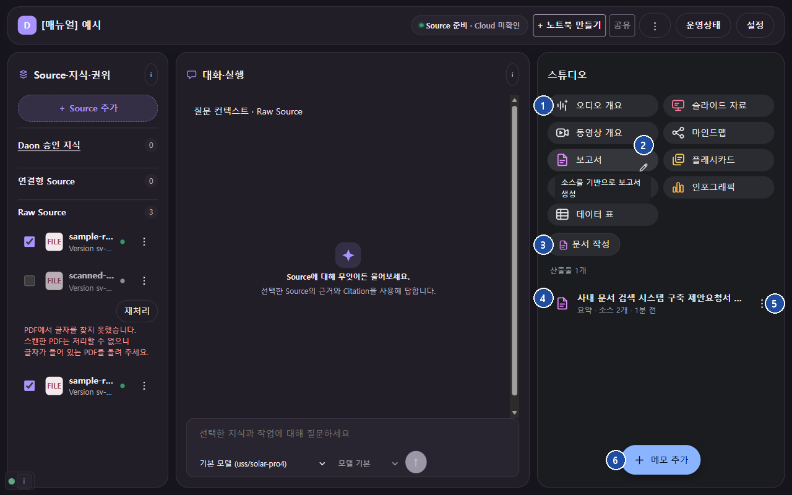

| 번호 | 항목 | 설명 | 비활성 조건 |
| --- | --- | --- | --- |
| ① | 타일(**보고서**, **슬라이드 자료**, **마인드맵** 등) | 누르면 기본 설정으로 바로 생성. 마우스를 올리면 설명과 설정용 연필이 보임 | 자료 없음, 체크한 자료 없음, 자료 처리 중, 제공하지 않는 유형 |
| ② | 연필 | 설정 창을 열어 형식 등을 골라 만들기. 타일에 마우스를 올리면(터치 화면에서는 항상) 보임 | 타일이 꺼져 있을 때 |
| ③ | **문서 작성** | 제안서 등 문서 작성(2-7) | 서버가 지원할 때만 보임 |
| ④ | 카드 | 상태: **생성 중…**, 대기 중, 실패(**다시 시도**), **소스가 변경됨**, **취소됨**, **구성 확인 필요**(2-17) | 없음 |
| ⑤ | 카드 ⋮ | **공유**, **이름 바꾸기**, **다운로드**, **프롬프트 및 소스 보기**, **다시 생성**, **설정 변경 후 다시 생성**, **삭제** | 완료 전에는 **공유**·**다운로드** 꺼짐 |
| ⑥ | **메모 추가** | 빈 메모(2-8) | 없음 |

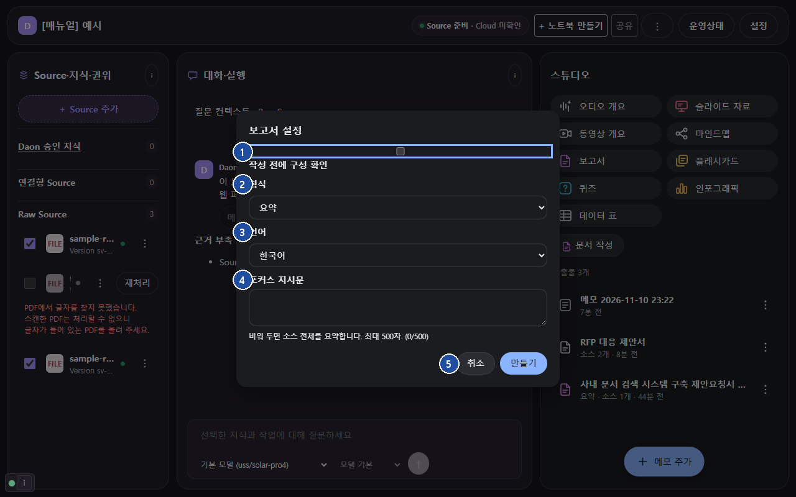

| 번호 | 항목 | 설명 | 비활성 조건 |
| --- | --- | --- | --- |
| ① | **작성 전에 구성 확인** | 켜면 본문을 쓰기 전에 구성(목차)을 먼저 보여 주고 확인받음. 슬라이드 자료·동영상 개요에서는 **만들기 전에 구성 확인**으로 보임(2-17) | 구성 확인을 지원하는 유형(보고서·슬라이드 자료·동영상 개요)에서만 보임 |
| ② | **형식** | 보고서: **요약**, **브리핑**, **블로그**, **스터디 가이드**, **사용자 정의** | 없음 |
| ③ | **언어** | **한국어** 또는 **English** | 없음 |
| ④ | **포커스 지시문** | 비워 두면 자료 전체를 요약. 최대 500자 | 없음 |
| ⑤ | **취소**, **만들기** | 이 설정으로 생성 | 없음 |

플래시카드·퀴즈 등은 유형에 따라 **길이**, **난이도**, **개수** 칸이 더 보이며, 비워 두면 **자동**입니다.

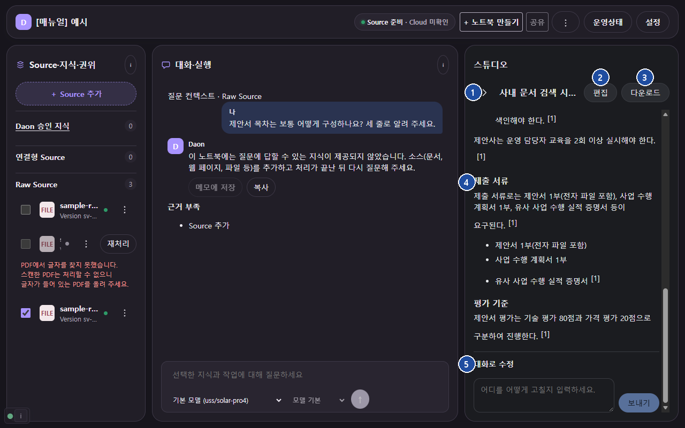

| 번호 | 항목 | 설명 | 비활성 조건 |
| --- | --- | --- | --- |
| ① | 목록으로 | 카드 목록으로 돌아가기 | 없음 |
| ② | **편집** | 보고서·슬라이드·플래시카드·퀴즈를 직접 고쳐 새 버전으로 저장 | 완료 전 |
| ③ | **다운로드** | 형식 선택 | 완료 전 |
| ④ | 본문 | 유형별 보기(아래 표) | 없음 |
| ⑤ | **대화로 수정** | 고칠 곳을 말로 쓰고 **보내기** → **고치기 전**·**고친 뒤** 비교 → **반영** 또는 **취소** | 수정안을 만드는 중 |

| 유형 | 보기에서 하는 일 | 내려받기 형식 |
| --- | --- | --- |
| 보고서 | 인용 번호를 눌러 근거 보기 | DOCX, PDF, MD |
| 데이터 표 | **열 표시**로 열 고르기 | XLSX, CSV, PDF |
| 마인드맵 | **확대**·**축소**·**맞춤**, **이 개념으로 질문** | SVG, PNG, JSON |
| 플래시카드 | **이전**·**다음**·**섞기**, **알아요**·**모르겠어요**, **모르는 카드만** | CSV, JSON, PDF |
| 퀴즈 | **제출**, **결과 보기**, **틀린 문항만 다시** | CSV, JSON, PDF |
| 슬라이드 | **발표자 노트** 보기 | PPTX, PDF |
| 인포그래픽 | 그림 보기 | PNG, SVG, PDF |
| 오디오 개요 | **재생 속도**, **스크립트** | MP3 |
| 동영상 개요 | **챕터**, **한국어 자막** | MP4, VTT |
| 메모 | 본문 편집, 아래 미리보기 칸 | MD, TXT |

#### 주의·오류

| 화면 메시지 | 원인 | 조치 |
| --- | --- | --- |
| "사용할 수 있는 소스가 없습니다. 소스 처리가 끝났는지 확인하세요." | 체크한 자료가 처리 전 | 2-4에서 상태 확인 |
| "조직 정책이 외부 전송을 허용하지 않습니다." | 외부 전송 정책이 막음 | 3-2 정책 확인을 관리자에게 요청 |
| "음성 서버에 연결하지 못했습니다. 잠시 후 다시 시도하세요." | 음성 엔진 연결 문제 | 잠시 뒤 다시 생성, 반복되면 관리자에게 알림 |
| "인증하지 못했습니다. 비밀번호를 확인해 주세요." | 내려받기 추가 인증 실패 | 비밀번호 다시 입력 |
| "처리하지 못했습니다. 잠시 후 다시 시도하세요." | 일시 오류 | **다시 시도** |

**공유**는 노트북에 접근할 수 있는 사람에게만 보이는 안내이며, 공개 링크는 만들 수 없습니다. 삭제한 산출물은 되돌릴 수 없습니다. 긴 문서 전체를 대화로 고치면 시간이 오래 걸려 실패할 수 있으니, 고칠 부분을 좁혀 지시합니다.

#### 관련

1-6 스튜디오로 자료 만들기와 대화로 고치기, 1-8 내려받기와 로그아웃, 2-7 문서 작성 마법사, 2-17 만들기 전에 구성 확인(슬라이드·동영상), 2-20 심층 조사, 3-6 TTS 음성 엔진, 3-7 내려받기 정책

### 2-7 문서 작성 마법사

#### 기능·목적

제안요청서(RFP) 같은 기준 자료를 읽고 템플릿에 맞춰 문서 초안을 씁니다. 제안서 템플릿은 요구사항을 뽑아 확인받은 뒤 요구사항에 맞춘 본문을 씁니다.

#### 쓸 수 있는 사람

노트북에 접근할 수 있는 사용자. 서버가 문서 작성을 지원할 때 스튜디오에 **문서 작성** 버튼이 보입니다.

#### 사용 순서

1. 스튜디오에서 **문서 작성**을 누릅니다. **목표 분량**을 고르고 **작성 템플릿**에서 템플릿을 고른 뒤 **시작**을 누릅니다.
2. **입력** 단계: 질문에 답합니다. 제안요청서 질문에서는 쓸 자료를 체크합니다(최대 10개). **다음**을 누릅니다.
3. **분석 중** 단계: 자료 전체를 구간별로 읽어 요구사항을 뽑습니다. 긴 문서는 몇 분 걸립니다.
4. **확인** 단계: **요구사항 확인** 표에서 항목을 고치거나 지우고 **요구사항 추가**로 빠진 것을 넣습니다. **작성 계획**과 **출력 형식**을 확인하고 **확정하고 초안 만들기**를 누릅니다.
5. **작성 중** 단계: 소목차별로 씁니다. 필요하면 **일시 정지** 후 **본문 수정**이나 **이 소목차 다시 쓰기**를 하고 **이어서 작성**을 누릅니다.
6. **완료** 단계: 탭에서 결과를 보고 다운로드 버튼으로 내려받습니다.

#### 화면 구성

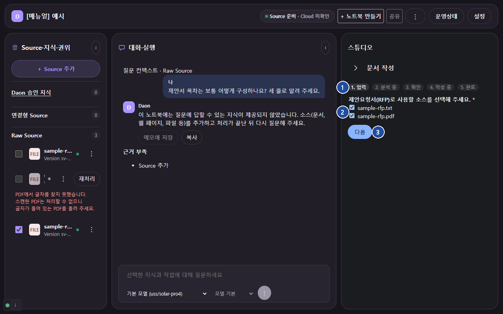

| 번호 | 항목 | 설명 | 비활성 조건 |
| --- | --- | --- | --- |
| ① | 작성 단계 | 1. **입력**, 2. **분석 중**, 3. **확인**, 4. **작성 중**, 5. **완료** | 없음 |
| ② | 자료 체크 칸 | 제안요청서로 쓸 자료. 여러 파일 선택 가능 | 처리가 끝난 자료만 보임 |
| ③ | **다음** | 답을 저장하고 다음 단계로 | 처리 중 |

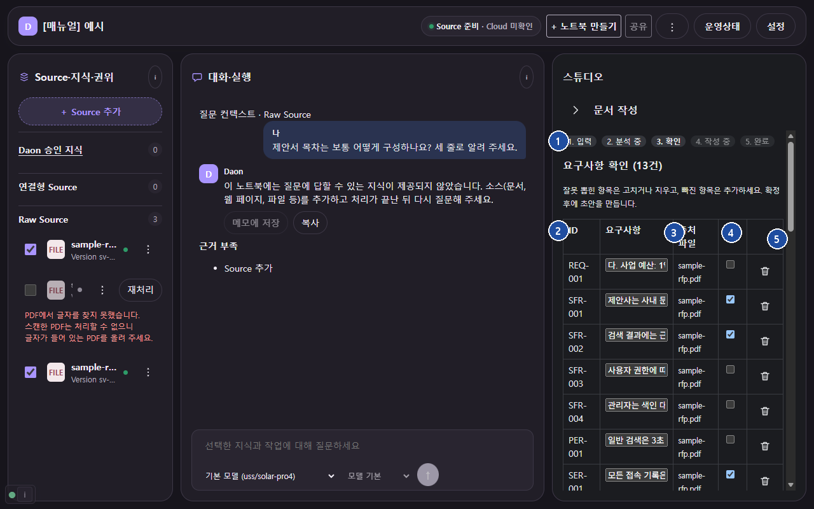

| 번호 | 항목 | 설명 | 비활성 조건 |
| --- | --- | --- | --- |
| ① | 작성 단계 | 지금 단계(**확인**)가 진하게 보임 | 없음 |
| ② | **요구사항 확인** 표 | ID와 요구사항 내용. 칸을 눌러 고침 | 없음 |
| ③ | **출처 파일** | 그 요구사항이 나온 파일 | 출처가 있는 요구사항이 있을 때만 보임 |
| ④ | **필수** | 반드시 대응할 요구사항 표시 | 없음 |
| ⑤ | 삭제(휴지통) | 요구사항이 아닌 줄 지우기 | 없음 |
| 아래쪽 | **요구사항 추가** | 빠진 요구사항 넣기 | 없음 |
| 아래쪽 | **작성 계획** | 절 순서와 소목차, 절마다 배정된 요구사항 수. 위·아래 화살표와 삭제로 순서 조정 | 없음 |
| 아래쪽 | **출력 형식** | DOCX, PPTX | 없음 |
| 아래쪽 | **확정하고 초안 만들기** | 확정하고 작성 시작 | 요구사항이 없거나 출력 형식을 고르지 않았을 때 |

그림 아래쪽 항목은 표를 내려(스크롤) 보면 나옵니다.

완료 화면의 탭은 **본문**, **요구사항 대응표**, **점검**, **가정·미결**입니다. 본문의 **[작성 필요]**는 사람이 채워야 할 곳입니다. 완료한 문서는 **다시 열어 고치기**나 **대화로 수정**으로 고칠 수 있습니다.

#### 주의·오류

| 화면 메시지 | 원인 | 조치 |
| --- | --- | --- |
| "사용할 수 있는 소스가 없습니다. 먼저 제안요청서를 소스로 추가하세요." | 노트북에 자료가 없음 | 2-4에서 자료 올리기 |
| "소스 처리에 실패했습니다. Source 목록에서 사유를 확인하고 재처리해 주세요." | 자료 처리 실패 | 2-4에서 사유 확인 후 **재처리** |
| "소스를 처리하는 중입니다. 처리가 끝나면 여기에서 선택할 수 있습니다." | 자료 처리 중 | 처리가 끝나면 다시 열기 |
| "구간 n개는 모델 분석에 실패해 규칙으로만 찾았습니다." | 일부 구간의 모델 분석 실패 | 표에서 빠진 요구사항을 추가 |
| "한 번에 보내기에 내용이 너무 많습니다. 항목을 줄여 다시 시도하세요." | 확정 내용이 너무 큼 | 불필요한 요구사항을 지우고 다시 확정 |
| "자료가 없거나 검증에 걸린 내용이 있습니다. 확인하고 고친 뒤 이어서 작성해 주세요." | 소목차에 근거 자료가 부족함(**확인 필요** 표시) | 해당 소목차를 읽고 고친 뒤 **이어서 작성**. 소목차마다 여러 번 멈출 수 있음 |

요구사항은 규칙과 모델로 뽑으므로 요구사항이 아닌 줄이 섞일 수 있습니다. 확정 전에 꼭 표를 검토합니다.

#### 관련

1-7 문서 작성으로 제안서 만들기, 2-6 스튜디오, 3-5 문서 작성 템플릿

### 2-8 메모

#### 기능·목적

노트북에 남겨 둘 글을 적습니다. 직접 쓰거나 답변을 메모로 저장합니다.

#### 쓸 수 있는 사람

노트북에 접근할 수 있는 사용자. 메모는 노트북을 보는 모든 사람에게 보입니다.

#### 사용 순서

1. 스튜디오 아래 **메모 추가**를 누르면 빈 메모가 열립니다. 제목은 만든 시각(내 컴퓨터 시각)으로 붙습니다.
2. **메모 내용** 칸에 씁니다. 입력을 멈추면 자동으로 저장되고 **저장됨**이 보입니다.
3. 입력 칸 아래 미리보기 칸에 같은 글이 그대로 보입니다. 마크다운 기호(#, -)는 서식으로 바뀌지 않고 글자 그대로 보입니다.
4. 답변을 메모로 남기려면 답변 아래 **메모에 저장**을 누릅니다. **다운로드**로 MD·TXT 파일로 내려받습니다.
5. 메모를 질문과 산출물의 근거로 쓰려면 메모 아래 **소스로 사용**을 누릅니다(2-14).

#### 화면 구성

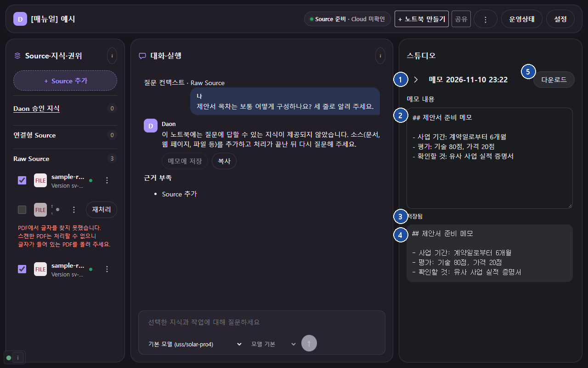

| 번호 | 항목 | 설명 | 비활성 조건 |
| --- | --- | --- | --- |
| ① | 메모 제목 | 만든 시각. 왼쪽 › 로 목록으로 돌아감 | 없음 |
| ② | **메모 내용** | 마크다운으로 쓰는 본문 | 없음 |
| ③ | 저장 상태 | **저장됨**, **저장 중…**, **저장하지 못했습니다** | 없음 |
| ④ | 미리보기 칸 | 입력한 글을 그대로 보여 줌 | 없음 |
| ⑤ | **다운로드** | MD, TXT로 내려받기 | 없음 |

#### 주의·오류

| 화면 메시지 | 원인 | 조치 |
| --- | --- | --- |
| **저장하지 못했습니다** | 저장 실패 | 내용을 복사해 두고 잠시 뒤 다시 입력 |
| "메모에 저장하지 못했습니다. 잠시 후 다시 시도해 주세요." | 답변 저장 실패 | 다시 **메모에 저장** |

#### 관련

1-5 질문하고 근거 확인하기, 2-5 대화와 근거, 2-6 스튜디오, 2-14 메모를 소스로 쓰기

### 2-9 노트북 메뉴

#### 기능·목적

노트북 전체에 적용하는 설정입니다. 답변·산출물 지시(맞춤설정), 노트북 복사, 내 채팅 기록 삭제를 합니다.

#### 쓸 수 있는 사람

노트북에 접근할 수 있는 사용자. 채팅 기록 삭제는 본인 기록만 지웁니다.

#### 사용 순서

1. 작업 화면 위쪽 ⋮(노트북 메뉴)을 누릅니다.
2. **채팅 설정**: 답변에 쓰는 모델을 정합니다.
3. **맞춤설정**: **맞춤설정 지시**에 원하는 답변 방식(예: 존댓말, 결론 먼저)을 적고 **저장**합니다. 이후 질문과 새 산출물부터 적용됩니다.
4. **노트북 복사**: **새 노트북 이름**을 정하고 **복사할 항목**(**메모**, **산출물**, **맞춤설정**)을 고른 뒤 **복사**합니다.
5. **채팅 기록 삭제**: 확인 창에서 **삭제**를 누릅니다. 메모와 산출물은 남습니다.

#### 화면 구성

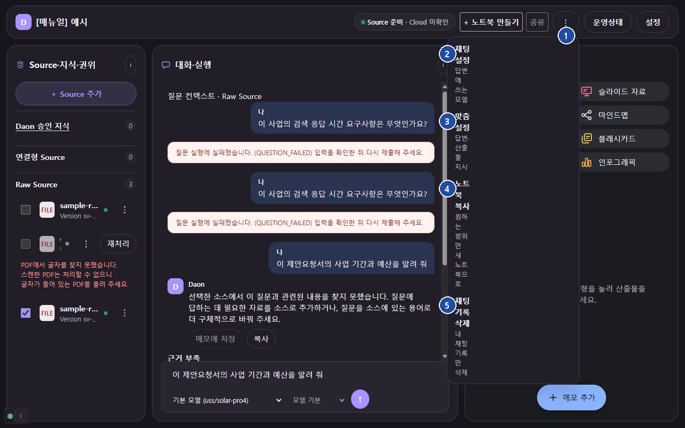

| 번호 | 항목 | 설명 | 비활성 조건 |
| --- | --- | --- | --- |
| ① | ⋮ | 노트북 메뉴 열기 | 없음 |
| ② | **채팅 설정** | 답변에 쓰는 모델 | 없음 |
| ③ | **맞춤설정** | 답변·산출물 지시. 최대 4000자 | 불러오는 중 |
| ④ | **노트북 복사** | 고른 범위만 새 노트북으로 복사 | 복사할 항목을 하나도 고르지 않았을 때 |
| ⑤ | **채팅 기록 삭제** | 내 채팅 기록만 삭제 | 없음 |

#### 주의·오류

| 화면 메시지 | 원인 | 조치 |
| --- | --- | --- |
| "다른 곳에서 먼저 수정했습니다. 닫았다가 다시 열어 최신 내용을 확인해 주세요." | 맞춤설정이 동시에 바뀜 | 다시 열어 확인 후 저장 |
| "항목이 너무 많아 한 번에 복사할 수 없습니다. 복사할 항목을 줄여 주세요." | 복사 항목 과다 | 항목을 줄여 다시 복사 |

노트북 복사는 자료(Source)와 채팅 기록을 복사하지 않습니다. 새 노트북의 소유자는 복사한 사람입니다. 노트북 삭제는 이 메뉴가 아니라 노트북 홈의 카드 ⋮에서 합니다(2-2).

#### 관련

2-2 노트북 홈, 2-5 대화와 근거, 3-3 모델 연결

### 2-10 알림·전달함

#### 기능·목적

내게 온 업무 알림과 처리할 수 있는 요청을 확인합니다.

#### 쓸 수 있는 사람

로그인한 사용자. 지금 권한으로 볼 수 있는 항목만 보입니다. 메뉴에는 이 화면 링크가 없으며 `/notifications` 주소나 알림 링크로 엽니다.

#### 사용 순서

1. `/notifications`를 엽니다. 탭은 **알림**, **전달함**, **운영 상태**입니다.
2. 항목의 **원 요청 열기**로 관련 화면을 엽니다.
3. 확인한 알림은 **읽음 처리**를 누릅니다.
4. **전달함**에서 **다음 페이지**로 더 봅니다.

#### 화면 구성

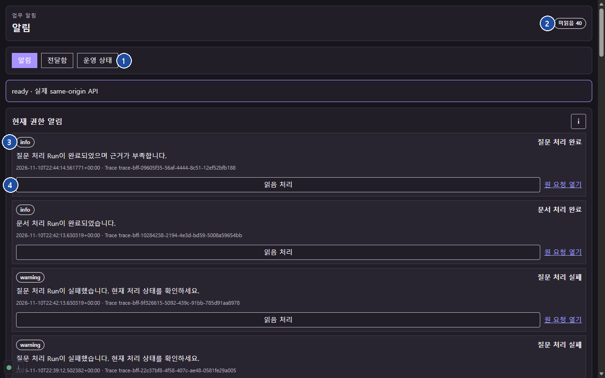

| 번호 | 항목 | 설명 | 비활성 조건 |
| --- | --- | --- | --- |
| ① | **알림**, **전달함**, **운영 상태** | 화면 전환 | 없음 |
| ② | 미읽음 수 | 읽지 않은 알림 개수 | 없음 |
| ③ | 알림 항목, **원 요청 열기** | 알림 내용과 관련 화면 링크 | 권한이 없으면 링크 대신 거부 표시 |
| ④ | **읽음 처리** | 읽은 알림 표시 | 이미 읽었거나 처리 결과가 확정되지 않았을 때 |

#### 주의·오류

| 화면 메시지 | 원인 | 조치 |
| --- | --- | --- |
| "알림 서비스를 사용할 수 없습니다." | 서비스 연결 문제 | **다시 시도** |
| "읽음 처리 결과 미확정 · 다시 조회해 확인해 주세요." | 처리 결과를 확인하지 못함 | 목록을 다시 열어 확인 |

#### 관련

3-9 운영 상태

### 2-11 내 설정

#### 기능·목적

화면 테마를 바꾸고, 사용자 설명서를 읽거나 내려받고, 내 계정의 비밀번호·세션을 관리합니다.

#### 쓸 수 있는 사람

로그인한 사용자. 계정 설정(`/settings/account`)은 메뉴 링크가 없어 주소로 엽니다.

#### 사용 순서

1. 화면 설정: 노트북 홈 **설정** → **화면 설정** → **테마**에서 **시스템 설정**, **밝게**, **어둡게** 중 하나를 고릅니다. **화면 설정 초기화**는 화면 설정만 되돌리며 노트북 데이터는 지우지 않습니다.
2. 사용자 설명서: **설정** → **사용자 설명서** → 문서를 눌러 읽거나 **DOCX**·**PDF**로 내려받습니다.
3. 계정 설정: `/settings/account`에서 **비밀번호 변경**(**현재 비밀번호**, 새 비밀번호, **새 비밀번호 확인**), **표시 이름 저장**, 장치·세션 철회를 합니다.

#### 화면 구성

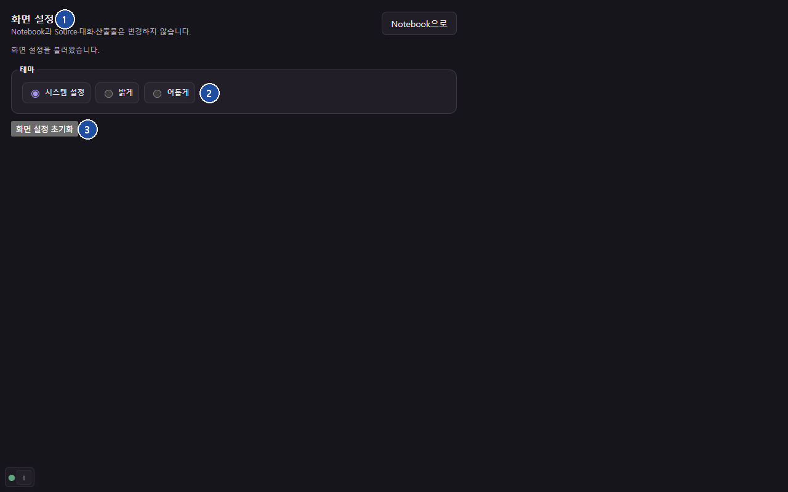

| 번호 | 항목 | 설명 | 비활성 조건 |
| --- | --- | --- | --- |
| ① | **화면 설정** | 테마 설정 화면 | 없음 |
| ② | **테마** | **시스템 설정**, **밝게**, **어둡게** | 저장 중 |
| ③ | **화면 설정 초기화** | 화면 설정만 초기값으로 | 저장 중 |

#### 주의·오류

| 화면 메시지 | 원인 | 조치 |
| --- | --- | --- |
| "화면 설정을 저장하지 못했습니다. 이전 설정을 유지합니다." | 저장 실패 | 잠시 뒤 다시 선택 |
| "사용자 설명서를 처리하지 못했습니다." | 설명서 파일 확인 실패 | **다시 시도** |
| "새 비밀번호가 일치하지 않습니다." | 확인 칸 불일치 | 같은 값 입력 |

계정 설정에서 비밀번호를 바꾸면 모든 세션이 끝나고 새 비밀번호로 다시 로그인해야 합니다.

#### 관련

2-1 로그인·가입·비밀번호 재설정, 1-1 이 설명서 읽는 법

### 2-12 조직 가입

#### 기능·목적

조직 관리자에게 받은 초대코드로 조직 가입을 신청하고, 신청 결과를 확인합니다.

#### 쓸 수 있는 사람

로그인한 모든 사용자. 노트북 홈이나 작업 화면의 **설정** → **조직 가입**으로 엽니다.

#### 사용 순서

1. **설정** → **조직 가입**을 엽니다.
2. 조직 관리자에게 따로 받은 코드를 **초대코드**에 넣고 **가입 신청**을 누릅니다.
3. **본인 가입 신청** 목록에 **승인 대기**로 나옵니다. 관리자가 승인하면 **승인됨**, 거부하면 **거부됨**으로 바뀝니다.
4. 결과를 확인하려면 **상태 새로고침**을 누릅니다.

#### 화면 구성

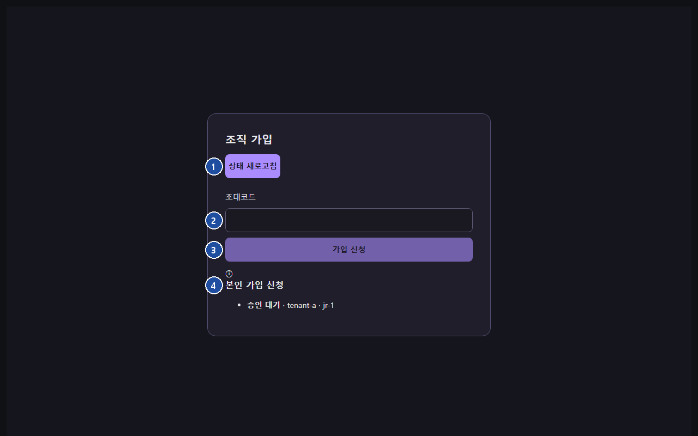

| 번호 | 항목 | 설명 | 비활성 조건 |
| --- | --- | --- | --- |
| ① | **상태 새로고침** | 내 신청 상태를 다시 조회 | 처리 중 |
| ② | **초대코드** | 받은 코드 입력. 코드는 저장하지 않음 | 처리 중 |
| ③ | **가입 신청** | 신청 보내기 | 코드가 비었거나 처리 중 |
| ④ | **본인 가입 신청** | 내 신청 목록(상태·조직·신청 번호) | 없음 |

신청만으로 접근 권한이 생기지 않습니다. 승인 뒤 쓸 수 있는 작업공간과 역할은 조직 관리자가 정합니다(3-10). 신청이 거부되면 유효한 초대코드로 새로 신청합니다.

#### 주의·오류

| 화면 메시지 | 원인 | 조치 |
| --- | --- | --- |
| "유효하지 않거나 만료된 초대코드입니다." | 코드 오타, 기간 만료 | 조직 관리자에게 새 코드를 요청 |
| "이미 승인 대기 중인 신청이 있습니다. 상태를 조회하세요." | 같은 신청이 이미 있음 | **상태 새로고침** |
| "초대코드를 입력해 주세요." | 코드가 비어 있음 | 코드 입력 |
| "로그인 후 조직 가입을 신청할 수 있습니다." | 로그인 상태가 아님 | 다시 로그인 |
| "조직 가입 신청을 처리하지 못했습니다. 상태를 다시 조회하세요." | 요청 실패 또는 결과 불명 | **상태 새로고침**으로 먼저 확인하고 같은 신청을 다시 보내지 않음 |

#### 관련

1-2 가입과 로그인, 3-10 조직 관리

### 2-13 답변 과정 보기

#### 기능·목적

답변이 어떤 순서로 만들어졌는지 확인합니다. 답변 아래 **답변 과정**을 펼치면 질문 범위, 근거 찾기, 외부 전송, 모델, 검증 다섯 단계에서 시스템이 한 일이 보입니다. 답변을 업무에 쓰기 전에 어떤 자료를 근거로 골랐고 외부 전송이 어떻게 판정되었는지 확인할 때 씁니다.

#### 쓸 수 있는 사람

질문한 본인. 답변 과정은 채팅 기록과 함께 저장되므로 채팅 기록처럼 본인만 봅니다.

#### 사용 순서

1. 답변 아래 **답변 과정** 버튼을 누릅니다. 처음에는 접혀 있습니다.
2. 펼쳐진 다섯 단계를 위에서부터 읽습니다.
3. **근거 찾기** 단계의 근거 이름(예: "보험약관.pdf · 3쪽")을 누르면 그 소스의 근거 위치가 열립니다. 답변 끝 Citation을 누른 것과 같습니다.
4. 다시 **답변 과정**을 누르면 접힙니다.

노트북을 닫았다가 다시 열어도 이전 답변의 과정이 그대로 보입니다.

#### 화면 구성

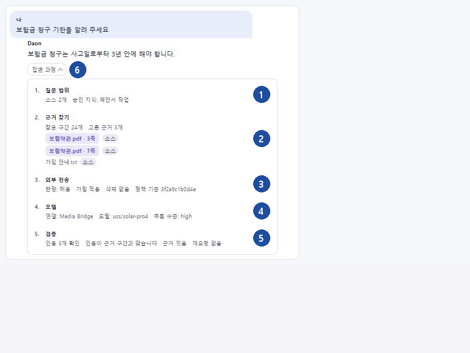

그림은 시험 화면(하네스)에서 예시 자료로 촬영했습니다. 자료 이름·모델 이름·정책 기준 값은 예시입니다.

| 번호 | 항목 | 설명 | 비활성 조건 |
| --- | --- | --- | --- |
| ① | **질문 범위** | 이 질문에 쓴 소스 개수, 승인 지식 이름, 켠 질문 도구(2-15) | 없음 |
| ② | **근거 찾기** | 찾은 구간 수, 그중 답변 근거로 고른 수, 고른 근거 목록. 근거 옆 표시(**소스**, **승인 지식**, **지식 연결**, **법령**)는 근거가 나온 곳 | 열 수 없는 근거는 누를 수 없는 글자로 보임 |
| ③ | **외부 전송** | 외부 전송 판정(**허용**, **차단**, **필요 없음**), 가림·삭제 적용 여부, 판정에 쓴 정책 기준 | 없음 |
| ④ | **모델** | 답변에 쓴 연결, 모델, 추론 수준 | 모델을 부르지 않았으면 "모델을 호출하지 않았습니다" |
| ⑤ | **검증** | 확인한 인용 수, 인용이 근거 구간과 맞는지, 근거가 있는지, 다시 요청했는지 | 검증하지 않았으면 "검증하지 않았습니다" |
| ⑥ | **답변 과정** | 다섯 단계를 펼치고 접기 | 없음 |

단계에 따라 다음처럼 보입니다.

- 근거가 부족한 답변: **검증** 단계에 **확인 필요**가 강조되고 **근거 부족**이 보입니다.
- 외부 전송이 막혀 질문이 실패한 경우: 빨간 오류 카드 안에 **답변 과정**이 있고, 펼치면 **외부 전송** 단계에 **확인 필요**가 강조되며 판정이 **차단**으로 보입니다. 이때 모델과 검증 단계는 실행되지 않습니다.
- 이 기능이 생기기 전의 예전 답변: 펼치면 **과정 기록 없음**만 보입니다.

답변 과정에는 시스템이 실제로 한 일(고른 자료, 판정, 쓴 모델, 검증 결과)만 보입니다. 모델의 내부 생각, 모델에 보낸 프롬프트 원문, 키 같은 비밀값은 보이지 않습니다.

#### 주의·오류

| 화면 메시지 | 원인 | 조치 |
| --- | --- | --- |
| **과정 기록 없음** | 과정을 기록하기 전에 받은 답변 | 같은 질문을 다시 하면 새 답변에 과정이 기록됨 |
| **확인 필요**(**검증** 단계) | 자료에서 근거를 찾지 못했거나 인용이 근거 구간과 맞지 않음 | 근거를 직접 열어 확인하고, 자료 체크나 질문을 바꿔 다시 질문 |
| **확인 필요**(**외부 전송** 단계) | 조직 정책이 외부 전송을 막음 | 3-2 정책 확인을 관리자에게 요청 |

답변 과정은 답변을 확인하는 보조 수단입니다. 판단은 근거 원문을 열어 보고 합니다.

#### 관련

1-5 질문하고 근거 확인하기, 2-5 대화와 근거, 3-2 조직 정책과 외부 전송 정책, 3-3 모델 연결

### 2-14 메모를 소스로 쓰기

#### 기능·목적

스튜디오에 적은 메모를 노트북 소스로 추가합니다. 소스가 된 메모는 다른 자료처럼 처리된 뒤 질문과 스튜디오 산출물의 근거로 쓸 수 있습니다. 메모를 고친 내용은 사용자가 반영할 때만 소스에 들어갑니다.

#### 쓸 수 있는 사람

노트북을 편집할 수 있는 사용자. 보기 권한만 있으면 **소스로 사용**·**소스에 반영** 버튼이 보이지 않습니다.

#### 사용 순서

1. 스튜디오에서 메모를 엽니다(2-8).
2. 메모 아래 **소스로 사용**을 누릅니다.
3. 왼쪽 **Raw Source** 목록에 **메모** 표시가 붙은 소스가 생기고, 다른 자료처럼 **처리 중**에서 **사용 가능**으로 바뀝니다.
4. 메모를 고친 뒤 소스에도 넣으려면 **소스에 반영**을 누릅니다. 소스의 새 버전이 만들어지고 다시 처리됩니다. 메모와 소스가 같으면 버튼이 **소스와 같음**으로 보이고 누를 수 없습니다.
5. 소스 목록의 **메모** 표시를 누르면 그 소스를 만든 메모가 열립니다.

#### 화면 구성

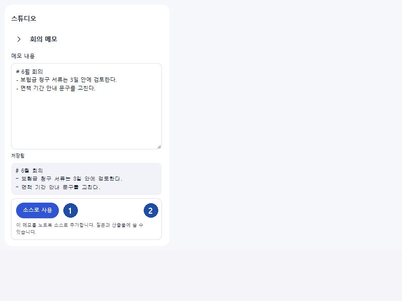

이 절의 두 그림은 시험 화면(하네스)에서 예시 자료로 촬영했습니다. 노트북·메모·자료 이름은 예시입니다.

| 번호 | 항목 | 설명 | 비활성 조건 |
| --- | --- | --- | --- |
| ① | **소스로 사용**, **소스에 반영**, **소스와 같음** | 아직 소스가 없으면 **소스로 사용**, 메모가 소스와 달라졌으면 **소스에 반영**, 같으면 **소스와 같음** | 메모를 저장하는 중, 소스로 만드는 중·반영하는 중, **소스와 같음**일 때 |
| ② | 안내 문구 | 버튼을 누르면 일어나는 일과 처리 결과("소스로 만들었습니다. 소스 목록에서 처리 상태를 확인하세요." 등) | 없음 |

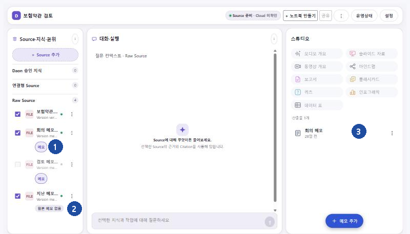

| 번호 | 항목 | 설명 | 비활성 조건 |
| --- | --- | --- | --- |
| ① | **메모** 표시 | 메모로 만든 소스. 누르면 원본 메모가 열림 | 없음 |
| ② | **원본 메모 없음** | 이 소스를 만든 메모가 삭제됨. 소스는 그대로 쓸 수 있음 | 누를 수 없음 |
| ③ | 원본 메모 카드 | 스튜디오 목록의 메모. 열어서 고친 뒤 **소스에 반영** | 없음 |

메모 소스를 반영하면 그 소스로 만든 스튜디오 산출물 카드에 **소스가 변경됨**이 보입니다(2-6). 새 내용으로 만들려면 산출물을 다시 생성합니다. 메모를 지워도 소스는 지워지지 않고 **원본 메모 없음**으로 남습니다. 소스를 더 쓰지 않으려면 소스 목록의 ⋮에서 정리합니다(2-4).

#### 주의·오류

| 화면 메시지 | 원인 | 조치 |
| --- | --- | --- |
| "메모가 너무 깁니다…"로 시작하는 문구 | 메모가 2 MiB(소스로 쓸 수 있는 크기)를 넘음 | 메모를 줄이거나 나눠서 다시 시도 |
| "메모가 비어 있어 소스로 쓸 수 없습니다. 내용을 적은 뒤 다시 시도하세요." | 메모 내용이 비어 있음 | 내용을 적은 뒤 다시 시도 |
| "소스의 첫 버전을 아직 처리하고 있습니다. 처리가 끝난 뒤 다시 반영하세요." | 처음 만든 소스가 아직 **처리 중** | **사용 가능**이 된 뒤 **소스에 반영** |
| "이미 이 메모로 만든 소스가 있습니다. 메모를 고친 뒤에는 "소스에 반영"을 누르세요." | 같은 메모로 소스를 또 만들려 함 | **소스에 반영** 사용 |
| "이 노트북을 편집할 권한이 없습니다. 메모를 소스로 쓰려면 편집 권한이 필요합니다." | 편집 권한 없음 | 노트북 관리자에게 권한 요청 |
| "처리하지 못했습니다. 잠시 후 다시 시도하세요." | 일시 오류 | 잠시 뒤 다시 시도 |

소스로 쓸 수 있는 메모는 텍스트 소스와 같이 2 MiB까지입니다. 메모 자체도 처음 만들 때 본문 200,000바이트(한글로 약 6만 자)까지, 고쳐 저장할 때 2 MiB까지만 담을 수 있으므로, 저장된 메모는 대부분 그대로 소스로 쓸 수 있습니다.

메모를 고치기만 해서는 소스가 바뀌지 않습니다. 질문과 산출물에 새 내용을 쓰려면 반드시 **소스에 반영**을 누릅니다. 메모는 노트북을 보는 모든 사람에게 보이고, 소스가 된 메모도 노트북의 다른 소스와 같이 쓰입니다.

#### 관련

2-4 Source 추가 창과 Source 상태, 2-6 스튜디오, 2-8 메모

### 2-15 질문 도구 켜고 끄기

#### 기능·목적

질문할 때 체크한 소스 말고 무엇을 더 찾아볼지 정합니다. 입력 칸 아래 **도구** 버튼을 누르면 **승인 지식**과 관리자가 붙인 지식 연결(예: 문서 근거, Daon2 지식, 법령)이 목록으로 보이고, 도구마다 켜고 끌 수 있습니다. 소스 안에서만 답을 받고 싶거나 특정 지식 연결을 빼고 묻고 싶을 때 씁니다. 웹 검색 도구는 없습니다.

#### 쓸 수 있는 사람

노트북을 볼 수 있는 사용자. 선택은 사용자마다 따로 저장되므로 내가 끈 도구가 다른 사람의 질문에 영향을 주지 않습니다.

#### 사용 순서

1. 입력 칸 아래 모델 선택 옆 **도구** 버튼을 누릅니다. 버튼의 숫자 배지는 지금 켜진 도구 수입니다.
2. **질문 도구** 목록에서 도구 옆 스위치를 눌러 켜거나 끕니다. 누르는 즉시 저장되고 다음 질문부터 적용됩니다. 따로 저장 버튼은 없습니다.
3. 바깥을 누르거나 Esc를 누르거나 **도구** 버튼을 다시 눌러 목록을 닫습니다.
4. 질문을 보냅니다. 답변 아래 Citation 칩 앞에 근거가 나온 곳(**승인 지식**, **문서 근거**, **법령**, 소스 이름)이 붙습니다.
5. 어떤 도구를 켜고 물었는지는 답변 아래 **답변 과정**의 **질문 범위** 단계에서 확인합니다(2-13).

선택은 노트북별로 기억합니다. 노트북을 닫았다가 다시 열어도 같은 선택이 남고, 다른 노트북의 선택은 따로입니다.

#### 화면 구성

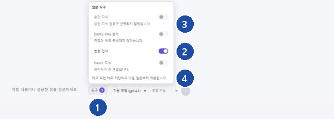

그림은 시험 화면(하네스)에서 예시 자료로 촬영했습니다. 도구 이름과 모델 이름은 예시이며, 실제 지식 연결 이름은 관리자가 붙인 이름으로 보입니다.

| 번호 | 항목 | 설명 | 비활성 조건 |
| --- | --- | --- | --- |
| ① | **도구** 버튼, 숫자 배지 | 질문 도구 목록을 열고 닫음. 배지는 켜진 도구 수 | 도구 목록을 불러오는 중, 불러오지 못했을 때 |
| ② | 스위치 | 도구를 켜고 끔. 누르면 바로 저장 | 저장하는 중, 답변을 기다리는 중 |
| ③ | 흐린 도구와 이유 | 지금 쓸 수 없는 도구. 이름 아래에 이유가 보임("승인 지식 범위가 선택되지 않았습니다.", "연결이 아직 준비되지 않았습니다.", "관리자가 끈 연결입니다.") | 항상 누를 수 없음 |
| ④ | 안내 문구 | "켜고 끄면 바로 저장되고 다음 질문부터 적용됩니다." | 없음 |

도구를 모두 끄면 목록에 "켜진 도구가 없어 소스만으로 답합니다."가 보이고, 질문은 체크한 소스만 근거로 답합니다. 꺼진 도구는 화면이 보낸 값이 아니라 서버에 저장된 선택으로 판단하므로, 꺼 둔 지식 연결은 질문 중에 호출되지 않습니다.

처음에는 승인 지식 범위가 있으면 **승인 지식**이 켜져 있고, 관리자가 허용하고 준비된 지식 연결도 켜져 있습니다. 승인 지식 범위는 노트북에서 고르고, 지식 연결은 관리자가 3-4에서 관리합니다.

#### 주의·오류

| 화면 메시지 | 원인 | 조치 |
| --- | --- | --- |
| "도구 목록을 불러오지 못했습니다." | 서버 연결 문제 | **다시 시도** |
| "저장하지 못해 이전 선택으로 되돌렸습니다. 잠시 후 다시 시도해 주세요." | 저장 중 일시 오류 | 잠시 뒤 다시 켜거나 끔 |
| "승인 지식 범위가 선택되지 않았습니다." | 이 노트북에 승인 지식 범위가 없음 | 승인 지식 범위를 고른 뒤 켬 |
| "연결이 아직 준비되지 않았습니다." | 지식 연결 설정이 끝나지 않음 | 관리자에게 3-4 지식 연결 확인 요청 |
| "관리자가 끈 연결입니다." | 관리자가 그 연결을 꺼 둠 | 필요하면 관리자에게 요청 |
| "이 노트북에서 쓸 수 있는 도구가 없습니다." | 승인 지식과 지식 연결이 모두 없음 | 소스만으로 질문하거나 관리자에게 문의 |

도구를 켜도 근거를 찾지 못하면 그 도구의 Citation은 붙지 않습니다. 도구에서 온 근거도 Citation을 눌러 원문을 확인한 뒤 씁니다.

#### 관련

1-5 질문하고 근거 확인하기, 2-5 대화와 근거, 2-13 답변 과정 보기, 3-4 지식 연결

### 2-16 노트북 개요와 추천 질문

#### 기능·목적

노트북을 처음 연 사람이 내용을 바로 파악하고 첫 질문을 쉽게 하도록 돕습니다. 준비된 소스가 처음 생기면 대화 영역 위쪽에 **노트북 개요**가 자동으로 만들어집니다. 개요는 소스 근거만으로 쓴 요약 한 문단(문장마다 인용 칩)과 **추천 질문** 세 개입니다.

#### 쓸 수 있는 사람

노트북을 볼 수 있는 사용자. 개요는 노트북마다 하나로 모든 사용자에게 같게 보입니다. **다시 만들기**는 노트북을 편집할 수 있는 사용자만 쓸 수 있습니다.

#### 사용 순서

1. 소스를 올리고 처리가 끝나기를 기다립니다(2-4). 처음으로 **사용 가능**한 소스가 생기면 대화 영역 위에 "개요를 만드는 중입니다…"가 보입니다.
2. 잠시 뒤 요약과 추천 질문이 나타납니다. 따로 누를 것은 없습니다.
3. 요약 끝의 인용 칩(1, 2…)을 누르면 그 문장의 근거가 된 소스가 열립니다.
4. 추천 질문을 누르면 그 질문이 입력 칸에 채워집니다. 자동으로 보내지 않으니 확인하거나 고친 뒤 보냅니다.
5. 소스를 추가·삭제하거나 새 버전이 생기면 개요 위에 "소스가 바뀌었습니다."가 보입니다. 지금 소스로 새 개요를 원하면 **다시 만들기**를 누릅니다. 누를 때만 새로 만들고, 저절로 다시 만들지는 않습니다.
6. 개요가 자리를 차지하면 오른쪽 위 **개요 접기**를 누릅니다. 접은 상태는 노트북별로 기억하며, **개요 펼치기**로 다시 엽니다.

#### 화면 구성

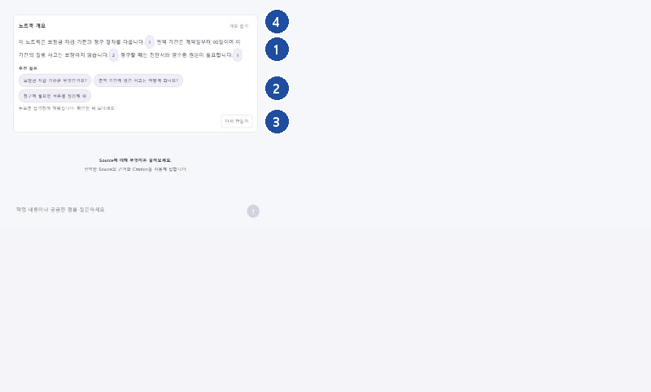

이 절의 두 그림은 시험 화면(하네스)에서 예시 자료로 촬영했습니다. 요약 문장과 추천 질문은 예시입니다.

| 번호 | 항목 | 설명 | 비활성 조건 |
| --- | --- | --- | --- |
| ① | 요약, 인용 칩 | 소스 근거로 쓴 요약 한 문단. 칩을 누르면 근거 소스가 열림 | 없음 |
| ② | **추천 질문** | 소스로 답할 수 있는 질문 세 개. 누르면 입력 칸에 채워짐(보내지 않음) | 없음 |
| ③ | **다시 만들기** | 지금 소스로 개요를 새로 만듦 | 요청하는 중. 편집 권한이 없으면 쓸 수 없음 |
| ④ | **개요 접기**, **개요 펼치기** | 개요를 접고 펼침 | 없음 |

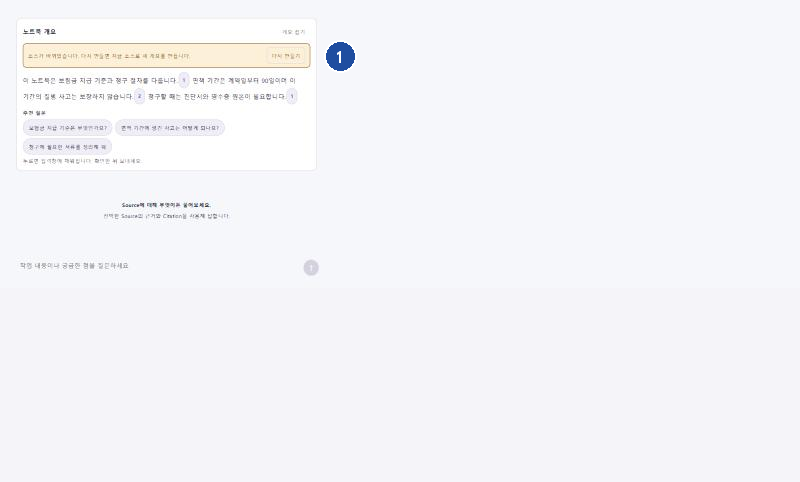

| 번호 | 항목 | 설명 | 비활성 조건 |
| --- | --- | --- | --- |
| ① | 안내와 **다시 만들기** | "소스가 바뀌었습니다. 다시 만들면 지금 소스로 새 개요를 만듭니다." 이전 개요는 다시 만들 때까지 그대로 보임 | 요청하는 중 |

상태에 따라 다음처럼 보입니다.

- 준비된 소스가 없음: 개요 없이 기존 빈 대화 화면이 보입니다.
- 만드는 중: "개요를 만드는 중입니다…"와 자리 표시가 보이고, 끝나면 저절로 바뀝니다.
- 외부 전송 정책으로 막힘: 개요 대신 "외부 전송 정책으로 개요를 만들 수 없습니다."와 시작 제안(**이렇게 시작해 보세요**)만 보입니다.
- 만들지 못함: 실패 문구와 **다시 시도**가 보입니다.

#### 주의·오류

| 화면 메시지 | 원인 | 조치 |
| --- | --- | --- |
| "외부 전송 정책으로 개요를 만들 수 없습니다." | 조직 정책이 모델 전송을 막음 | 3-2 정책 확인을 관리자에게 요청. 질문은 정책에 따라 따로 판정됨 |
| "소스에서 근거를 확인한 문장이 없어 개요를 만들지 못했습니다." | 근거를 확인한 요약 문장이 없음 | 소스를 확인하고 **다시 시도** |
| "모델에 연결하지 못해 개요를 만들지 못했습니다. 잠시 후 다시 시도하세요." | 모델 연결 문제 | 잠시 뒤 **다시 시도**, 계속되면 3-3 확인 요청 |
| "준비된 소스가 없어 개요를 만들 수 없습니다. 소스 처리가 끝난 뒤 다시 시도하세요." | **사용 가능**한 소스가 없음 | 소스 처리가 끝난 뒤 다시 시도 |
| "이미 개요를 만들고 있습니다. 끝나면 이곳에 보입니다." | 만드는 중에 다시 요청함 | 끝날 때까지 기다림 |
| "이 노트북을 편집할 권한이 없어 개요를 다시 만들 수 없습니다." | 편집 권한 없음 | 노트북 관리자에게 요청 |
| "개요를 불러오지 못했습니다." | 서버 연결 문제 | **다시 시도** |

개요는 소스로 내용을 훑어보는 출발점입니다. 근거를 확인하지 못한 문장은 개요에 넣지 않지만, 업무에 쓸 때는 인용 칩으로 원문을 열어 확인합니다.

#### 관련

1-5 질문하고 근거 확인하기, 2-4 Source 추가 창과 Source 상태, 2-5 대화와 근거, 3-2 조직 정책과 외부 전송 정책

### 2-17 만들기 전에 구성 확인(슬라이드·동영상)

#### 기능·목적

슬라이드 자료와 동영상 개요를 만들기 전에 장·장면 목록을 먼저 받아 보고 고칠 수 있습니다. 설정 창에서 **만들기 전에 구성 확인**을 켜고 만들면, 바로 끝까지 만들지 않고 장 목록(슬라이드) 또는 장면 목록(동영상)에서 멈춥니다. 제목·요지를 고치고 순서를 바꾼 뒤 **이대로 만들기**를 누르면 고친 목록대로 만듭니다. 동영상은 확정하기 전에는 음성·영상을 만들지 않으므로, 구성이 마음에 들지 않을 때 시간을 아낄 수 있습니다.

#### 쓸 수 있는 사람

노트북에 접근할 수 있는 사용자(2-6과 같음). 동영상 개요는 관리자가 음성 엔진을 등록했을 때만 켜집니다(3-6).

#### 사용 순서

1. 스튜디오에서 **슬라이드 자료** 또는 **동영상 개요** 타일에 마우스를 올리고 연필을 눌러 설정 창을 엽니다(2-6).
2. **만들기 전에 구성 확인**을 체크하고 **만들기**를 누릅니다.
3. 잠시 뒤 카드에 **구성 확인 필요**가 붙습니다. 카드를 누르면 검토 화면이 열리고 위쪽에 **구성 검토 중**이 보입니다.
4. 검토 화면에서 고칩니다.
   - 슬라이드: 장마다 제목과 **요지**를 고칩니다. 요지 추가 버튼으로 요지를 더하고, 요지 옆 **지우기**로 뺍니다.
   - 동영상: 장면마다 제목, **내레이션**, **글머리**를 고칩니다. 내레이션은 그대로 음성으로 읽습니다. 글머리 추가 버튼으로 화면 글머리를 더합니다.
   - **위로**·**아래로**로 순서를 바꾸고, 항목 아래 **지우기**로 장·장면을 지웁니다. 맨 아래 장 추가 버튼(동영상은 장면 추가 버튼)으로 새 항목을 더합니다. 옆 숫자는 지금 개수와 최대 개수입니다(예: 4 / 30).
   - 필요하면 **문서 제목**도 고칩니다.
5. **이대로 만들기**를 누르면 목록으로 돌아가고, 카드가 **확정한 구성으로 생성 중…**으로 바뀝니다. 끝나면 카드를 눌러 결과를 엽니다. 확정한 목록으로 만든 동영상에는 장면별 근거가 표시되지 않습니다.
6. 지금 만들지 않으려면 검토 화면의 **취소**를 누릅니다. 만들지 않고 목록으로 돌아가며, 카드는 **구성 확인 필요**로 남아 나중에 다시 열어 확정할 수 있습니다. 멈춘 산출물을 없애려면 카드 ⋮ → **삭제**를 누릅니다.

#### 화면 구성

이 절의 그림은 시험 화면(하네스)에서 예시 자료로 촬영했습니다. 산출물 이름과 장·장면 내용은 예시입니다.

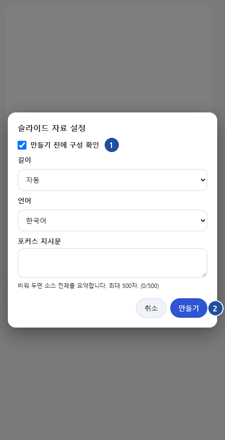

| 번호 | 항목 | 설명 | 비활성 조건 |
| --- | --- | --- | --- |
| ① | **만들기 전에 구성 확인** | 켜면 장·장면 목록에서 멈추고 확인받음. 보고서 설정 창에서는 같은 자리에 **작성 전에 구성 확인**이 보임 | 구성 확인을 지원하는 유형(보고서·슬라이드 자료·동영상 개요)에서만 보임 |
| ② | **만들기** | 이 설정으로 시작 | 없음 |

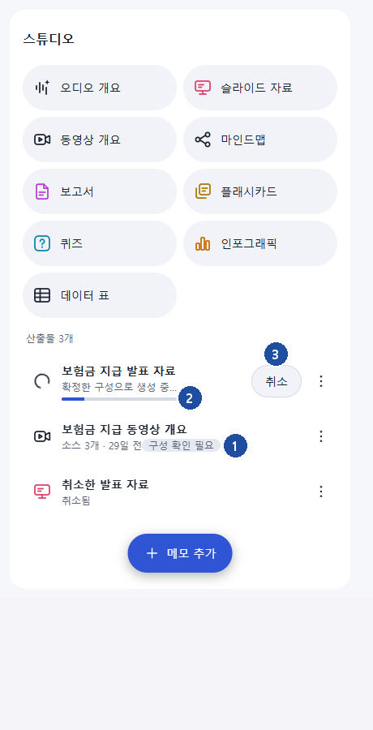

| 번호 | 항목 | 설명 | 비활성 조건 |
| --- | --- | --- | --- |
| ① | **구성 확인 필요** | 목록에서 멈춘 산출물. 카드를 누르면 검토 화면이 열림 | 없음 |
| ② | **확정한 구성으로 생성 중…** | 확정한 목록대로 만드는 중 | 없음 |
| ③ | **취소** | 확정 뒤 만드는 중인 산출물을 멈춤. 만들던 음성·영상은 남지 않고, 카드는 확정하기 전 목록으로 돌아가 다시 **구성 확인 필요**가 됨 | 만드는 중에만 보임 |

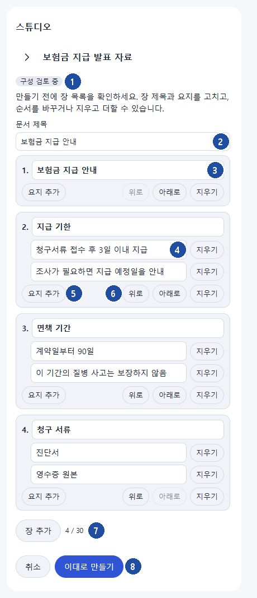

| 번호 | 항목 | 설명 | 비활성 조건 |
| --- | --- | --- | --- |
| ① | **구성 검토 중**, 안내 | 지금 검토 화면이라는 표시와 할 일 안내 | 없음 |
| ② | **문서 제목** | 만들 산출물의 제목. 최대 160자 | 없음 |
| ③ | 장 제목 | 장마다 하나. 비울 수 없음, 최대 100자 | 없음 |
| ④ | 요지 | 장 안에 들어갈 요점. 장마다 최대 5개, 하나에 최대 120자. 옆 **지우기**로 뺌 | 없음 |
| ⑤ | 요지 추가 | 요지 칸을 하나 더함 | 요지가 5개일 때 |
| ⑥ | **위로**, **아래로**, **지우기** | 장 순서 바꾸기, 장 지우기 | 맨 위 장의 **위로**, 맨 아래 장의 **아래로** |
| ⑦ | 장 추가, 개수 | 빈 장을 끝에 더함. 숫자는 지금 장 수 / 최대 30 | 30장일 때 |
| ⑧ | **취소**, **이대로 만들기** | **취소**는 만들지 않고 목록으로 나감. **이대로 만들기**는 이 목록대로 만듦 | 입력 오류가 있으면 **이대로 만들기** 꺼짐. 보내는 중 |

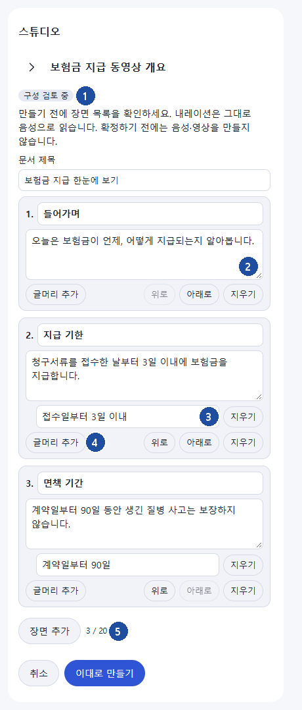

| 번호 | 항목 | 설명 | 비활성 조건 |
| --- | --- | --- | --- |
| ① | **구성 검토 중**, 안내 | "확정하기 전에는 음성·영상을 만들지 않습니다." | 없음 |
| ② | **내레이션** | 이 장면에서 읽을 말. 그대로 음성이 됨. 최대 600자 | 없음 |
| ③ | 글머리 | 장면 화면에 보일 요점. 장면마다 최대 5개, 하나에 최대 120자 | 없음 |
| ④ | 글머리 추가 | 글머리 칸을 하나 더함 | 글머리가 5개일 때 |
| ⑤ | 장면 추가, 개수 | 빈 장면을 끝에 더함. 숫자는 지금 장면 수 / 최대 20 | 20개일 때 |

장면 제목, **위로**·**아래로**·**지우기**, **문서 제목**, **취소**·**이대로 만들기**는 슬라이드 검토 화면과 같습니다.

확정한 구성으로 만든 동영상은 장면별 근거가 표시되지 않습니다. 보기 화면에 "확정한 구성으로 만든 동영상이라 장면별 근거 표시가 없습니다."가 보입니다. 근거를 확인하려면 체크한 소스를 직접 엽니다.

#### 주의·오류

| 화면 메시지 | 원인 | 조치 |
| --- | --- | --- |
| "2번 장 제목을 입력하세요." | 제목이 빈 장·장면이 있음 | 제목을 쓰거나 그 항목을 지움 |
| "3번 장 요지는 최대 120자까지 쓸 수 있습니다." | 요지·글머리·내레이션·제목이 글자 수 상한을 넘음 | 줄여 씀 |
| "장을 하나 이상 남겨 두세요." | 장·장면을 모두 지움 | 하나 이상 남김 |
| "장은 최대 30개까지 만들 수 있습니다." | 슬라이드 30장, 장면 20개를 넘음 | 줄임 |
| "구성 목록이 올바르지 않습니다. 빈 제목이나 개수·글자 수 상한을 넘은 항목을 고친 뒤 다시 확정하세요." | 서버가 확정 목록을 받지 않음 | 표시된 항목을 고친 뒤 다시 **이대로 만들기** |

입력 오류가 있는 동안 화면 아래에 문제 목록이 빨간 칸으로 보이고 **이대로 만들기**는 눌리지 않습니다. 문구의 번호와 "장"·"장면"은 실제 항목에 맞게 바뀝니다.

검토 화면의 **취소**는 산출물을 지우지도, **취소됨**으로 바꾸지도 않습니다. 확정 전에 멈춰 둔 동영상은 음성·영상 파일이 없습니다.

#### 관련

2-6 스튜디오, 3-6 TTS 음성 엔진

### 2-18 소스 묶음

#### 기능·목적

소스가 많을 때 왼쪽 **Raw Source** 목록을 이름 붙인 묶음(예: 약관, 청구 서류)으로 나눠 정리합니다. 묶음 머리글의 체크칸으로 안의 소스를 한 번에 켜고 끌 수 있습니다. 묶음은 정리를 돕는 것이고, 질문에 쓰이는 소스는 소스를 하나씩 체크한 것과 똑같습니다.

#### 쓸 수 있는 사람

노트북을 볼 수 있는 사용자는 묶음을 보고 묶음 체크칸을 씁니다. 묶음은 노트북마다 저장되어 노트북을 쓰는 사람 모두에게 같게 보입니다. 묶음을 만들고, 이름을 바꾸고, 지우고, 소스를 옮기는 일은 노트북을 편집할 수 있는 사용자만 합니다. 보기 권한이면 **묶음 만들기**, 묶음 ⋮, **묶음으로 이동** 버튼이 보이지 않습니다.

#### 사용 순서

1. **Raw Source** 목록 위 **묶음 만들기**를 누릅니다. 묶음 이름(1~80자)을 쓰고 **만들기**를 누릅니다. 새 묶음에는 "소스를 이 묶음으로 옮기세요"가 보입니다.
2. 옮길 소스 줄에 마우스를 올리면(터치 화면에서는 항상) 나타나는 **묶음으로 이동** 버튼을 누르고, 목록에서 묶음 이름을 고릅니다. 소스는 그 묶음 끝으로 옮겨집니다. 이미 묶음에 든 소스는 목록에 **묶음 밖으로**도 보입니다.
3. 묶음 머리글의 체크칸을 누르면 묶음 안의 **사용 가능** 소스가 모두 켜지거나 모두 꺼집니다. 일부만 켜져 있으면 체크칸이 가로줄로 보입니다.
4. 묶음 이름(옆 숫자는 안의 소스 수)을 누르면 접히고, 다시 누르면 펴집니다. 접은 상태는 이 브라우저에서 노트북별로 기억합니다.
5. 묶음 이름을 바꾸거나 묶음을 지우려면 머리글 오른쪽 ⋮ → **이름 바꾸기** 또는 **묶음 삭제**를 누릅니다. 삭제하면 확인 문구가 보이고 **삭제**를 누르면 지워집니다. 안의 소스는 **묶음 없음**으로 옮겨질 뿐 그대로 남습니다.
6. 질문합니다. 묶음 체크칸으로 켠 소스는 하나씩 체크한 것과 똑같이 질문 범위가 됩니다.

#### 화면 구성

이 절의 그림은 시험 화면(하네스)에서 예시 자료로 촬영했습니다. 묶음 이름과 소스 이름은 예시입니다.

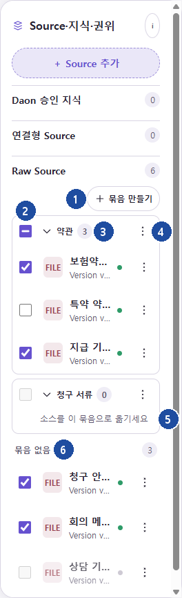

| 번호 | 항목 | 설명 | 비활성 조건 |
| --- | --- | --- | --- |
| ① | **묶음 만들기** | 이름을 넣어 새 묶음을 만듦. 노트북당 최대 50개 | 저장하는 중. 보기 권한이면 보이지 않음 |
| ② | 묶음 체크칸 | 세 가지로 보임: 모두 켜짐(체크), 일부만 켜짐(가로줄), 모두 꺼짐(빈 칸). 누르면 안의 **사용 가능** 소스를 모두 켜거나 끔 | 안에 **사용 가능** 소스가 없을 때 |
| ③ | 묶음 이름, 소스 수 | 누르면 접고 폄 | 없음 |
| ④ | 묶음 ⋮ | **이름 바꾸기**, **묶음 삭제** | 저장하는 중. 보기 권한이면 보이지 않음 |
| ⑤ | 빈 묶음 안내 | "소스를 이 묶음으로 옮기세요" | 없음 |
| ⑥ | **묶음 없음** | 어느 묶음에도 들지 않은 소스. 목록 맨 아래에 그대로 보임 | 없음 |

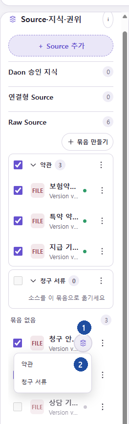

| 번호 | 항목 | 설명 | 비활성 조건 |
| --- | --- | --- | --- |
| ① | **묶음으로 이동** | 소스 줄에 마우스를 올리면(터치 화면에서는 항상) 보임 | 묶음이 하나도 없을 때, 저장하는 중. 보기 권한이면 보이지 않음 |
| ② | 묶음 목록, **묶음 밖으로** | 고른 묶음 끝으로 옮김. **묶음 밖으로**는 소스를 **묶음 없음**으로 뺌(묶음에 든 소스에만 보임) | 없음 |

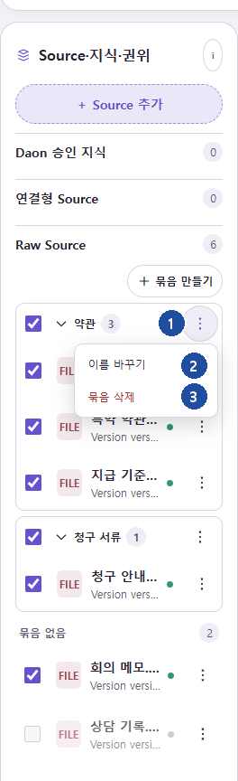

| 번호 | 항목 | 설명 | 비활성 조건 |
| --- | --- | --- | --- |
| ① | 묶음 ⋮ | 묶음 메뉴 열기 | 저장하는 중 |
| ② | **이름 바꾸기** | 이름 칸이 열림. 고친 뒤 **저장** | 없음 |
| ③ | **묶음 삭제** | "'약관' 묶음을 삭제할까요? 안의 소스는 '묶음 없음'으로 옮겨지고 소스 자체는 그대로 남습니다." 확인 후 **삭제** | 없음 |

소스 하나는 묶음 하나에만 들어갑니다. 노트북에서 제거하거나 삭제 요청한 소스는 묶음에서도 보이지 않습니다. 묶음이 하나도 없으면 목록은 예전처럼 한 줄로 보이고 위에 **묶음 만들기**만 보입니다. 소스 묶음은 **Raw Source** 목록 안에만 만듭니다. 위쪽 **Daon 승인 지식**·**연결형 Source**는 관리자가 연결한 것으로 소스 묶음과 다릅니다.

질문 한 번에 쓸 수 있는 소스는 묶음을 써도 최대 8개입니다. 8개보다 많이 켜고 질문하면 "질문에는 최대 8개 소스를 쓸 수 있습니다. 앞의 8개를 사용합니다."가 보이고 앞의 8개를 씁니다(2-5).

#### 주의·오류

| 화면 메시지 | 원인 | 조치 |
| --- | --- | --- |
| "묶음 이름은 1~80자로 입력하세요." | 이름이 비었거나 80자를 넘음 | 이름을 고쳐 다시 저장 |
| "묶음은 노트북당 50개까지 만들 수 있습니다." | 묶음이 이미 50개 | 쓰지 않는 묶음을 지운 뒤 만듦 |
| "묶음을 저장하지 못해 되돌렸습니다. 잠시 후 다시 시도하세요." | 저장 중 일시 오류. 화면은 바꾸기 전으로 돌아감 | 잠시 뒤 다시 시도 |
| "다른 곳에서 묶음이 바뀌어 최신 상태를 다시 불러왔습니다. 다시 시도하세요." | 다른 사람이 먼저 묶음을 바꿈 | 다시 불러온 목록을 보고 다시 시도 |
| "노트북에 없는 소스가 있어 저장하지 못했습니다. 목록을 다시 불러왔습니다." | 옮기려던 소스가 노트북에서 빠짐 | 다시 불러온 목록에서 다시 시도 |
| "이 노트북을 편집할 권한이 없어 묶음을 바꿀 수 없습니다." | 보기 권한 | 노트북 관리자에게 요청 |
| "묶음을 불러오지 못했습니다." | 서버 연결 문제 | **다시 시도** |

묶음을 지워도 소스와 소스의 체크 상태는 그대로입니다. 묶음 이름은 노트북을 쓰는 사람 모두에게 보이니 업무에 맞는 이름을 씁니다.

#### 관련

1-4 자료(Source) 올리기, 2-4 Source 추가 창과 Source 상태, 2-5 대화와 근거

### 2-19 빠른 찾기

#### 기능·목적

노트북에 아직 없는 자료를 조직의 승인 지식과 문서에서 찾아 노트북에 더합니다. 왼쪽 **Source 추가** 아래 **자료 찾기** 칸에 찾을 말을 쓰면 후보 목록이 나오고, 필요한 것만 골라 **선택한 자료 추가**를 누릅니다. 찾은 업무 패키지는 노트북의 승인 지식 범위에 붙고, 찾은 문서는 텍스트 소스로 들어옵니다. 사람이 고른 것만 추가하며 저절로 추가되는 것은 없습니다.

찾는 곳은 관리자가 연결한 내부 지식(승인 지식, 문서)뿐입니다. 웹 검색은 하지 않습니다.

#### 쓸 수 있는 사람

노트북을 볼 수 있는 사용자는 찾기를 할 수 있습니다. 찾은 자료를 추가하는 일은 노트북을 편집할 수 있는 사용자만 합니다. 보기 권한이면 처음 추가를 누를 때 추가되지 않고 "보기 권한으로는 자료를 찾을 수만 있고 추가할 수 없습니다."가 보이며, 그 뒤로 체크칸과 **선택한 자료 추가**가 보이지 않습니다. 관리자가 지식 연결(3-4)을 준비해 두어야 쓸 수 있습니다.

#### 사용 순서

1. 왼쪽 **자료 찾기** 칸에서 **빠른 찾기**가 골라져 있는지 확인합니다.
2. 검색칸("필요한 자료를 찾아보세요")에 찾을 말을 쓰고(최대 500자) **찾기**를 누르거나 Enter를 누릅니다.
3. 찾을 범위를 고릅니다. 처음에는 **승인 지식**과 **문서**가 모두 켜져 있고, 누르면 끄고 켭니다. 하나 이상 켜 두어야 찾을 수 있습니다.
4. "찾는 중…" 뒤에 "자료 4개를 찾았습니다."처럼 찾은 수와 후보 목록이 나옵니다(최대 20개). 후보마다 종류(**업무 패키지** 또는 **문서**), 출처, 이름, 찾은 이유, 앞부분 미리보기, 추가하면 어떻게 되는지(**승인 지식 범위에 추가** 또는 **텍스트 소스로 추가**)가 보입니다. 목록이 길면 목록 칸 안에서 스크롤합니다.
5. 추가할 후보의 체크칸을 켭니다. 아래에 고른 수(예: 1개 선택)가 보입니다.
6. **선택한 자료 추가**를 누릅니다. 고른 후보가 하나씩 **추가 중**을 거쳐 **추가됨**으로 바뀝니다.
   - 업무 패키지: 왼쪽 **Daon 승인 지식**에 나타납니다. 이미 범위에 있던 패키지는 그대로 **추가됨**이 됩니다.
   - 문서: **Raw Source** 목록에 **처리 중**으로 생기고, 다른 자료처럼 **사용 가능**이 되면 질문과 산출물에 씁니다.
7. 다 쓰면 **결과 닫기**를 누릅니다.

#### 화면 구성

이 절의 그림은 시험 화면(하네스)에서 예시 자료로 촬영했습니다. 노트북·업무 패키지·문서 이름은 예시입니다.

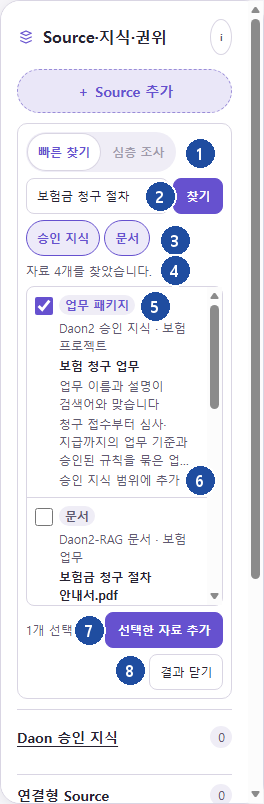

| 번호 | 항목 | 설명 | 비활성 조건 |
| --- | --- | --- | --- |
| ① | **빠른 찾기**, **심층 조사** | 찾는 방식. **심층 조사**는 2-20 | 찾는 중·추가 중 |
| ② | 검색칸, **찾기** | 찾을 말(최대 500자) | 검색칸이 비었거나 범위를 하나도 고르지 않았을 때, 찾는 중 |
| ③ | **승인 지식**, **문서** | 찾을 범위. **승인 지식**은 업무 패키지, **문서**는 승인 문서에서 찾음 | 찾는 중·추가 중 |
| ④ | 찾은 수 | "자료 4개를 찾았습니다." 없으면 "찾은 자료가 없습니다. 다른 말로 찾아보세요." | 없음 |
| ⑤ | 체크칸, 종류 | 추가할 후보 고르기. 종류는 **업무 패키지** 또는 **문서** | 추가 중. **추가됨**이 된 후보는 체크칸이 사라짐 |
| ⑥ | 추가 방식 | **승인 지식 범위에 추가**(업무 패키지) 또는 **텍스트 소스로 추가**(문서) | 없음 |
| ⑦ | 고른 수, **선택한 자료 추가** | 고른 후보를 노트북에 추가 | 고른 후보가 없을 때, 추가 중. 보기 권한으로 한 번 거절된 뒤에는 보이지 않음 |
| ⑧ | **결과 닫기** | 후보 목록 닫기. 검색어와 범위는 남음 | 추가 중 |

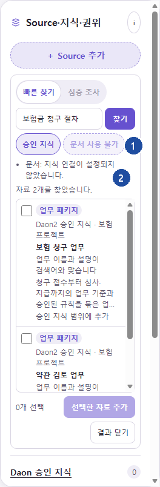

| 번호 | 항목 | 설명 | 비활성 조건 |
| --- | --- | --- | --- |
| ① | **사용 불가** | 지금 쓸 수 없는 범위. 칩이 흐리게 보임 | 없음 |
| ② | 이유 | 범위마다 쓸 수 없는 이유("문서: 지식 연결이 설정되지 않았습니다." 등). 나머지 범위의 결과는 그대로 보임 | 없음 |

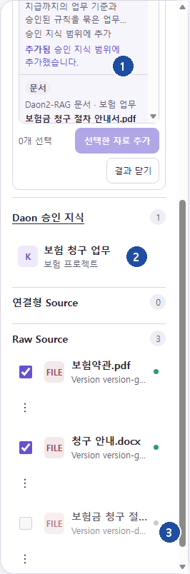

| 번호 | 항목 | 설명 | 비활성 조건 |
| --- | --- | --- | --- |
| ① | **추가됨** | "승인 지식 범위에 추가했습니다." 또는 "소스 목록에 처리 중으로 추가했습니다." | 없음 |
| ② | **Daon 승인 지식** | 추가한 업무 패키지가 보이고 옆 숫자가 늘어남 | 없음 |
| ③ | 새 소스 | 추가한 문서. **처리 중**이 끝나 **사용 가능**이 되면 체크해 씀 | 처리 중 |

문서는 추가한 때의 본문을 텍스트 소스로 넣습니다. 한 문서는 2 MiB까지 추가할 수 있습니다. 소스 요약(제목·요약·핵심 내용)은 본문 앞부분으로 만들고, 질문할 때 근거 찾기와 Citation은 본문 전체에서 합니다. 그래서 긴 문서의 뒷부분도 질문 근거로 찾힙니다.

노트북의 승인 지식 범위에는 업무 패키지를 최대 8개까지 둘 수 있습니다. 찾기 한 번으로 저절로 추가되는 것은 없고, 추가는 고른 후보만 합니다.

일부 범위에서 일시적으로 찾지 못하면 결과 위에 "문서 범위에서 찾지 못해 나머지 결과만 보여 드립니다."처럼 한 줄 안내가 보이고, 찾은 결과는 그대로 보입니다. 연결이 설정되지 않았거나 꺼진 범위는 칩이 **사용 불가**로 흐려지고 아래에 이유가 보입니다.

#### 주의·오류

| 화면 메시지 | 원인 | 조치 |
| --- | --- | --- |
| "찾을 범위를 하나 이상 고르세요." | 범위를 모두 끔 | **승인 지식**이나 **문서**를 켬 |
| "지식 연결이 설정되지 않았습니다.", "지식 연결이 아직 준비되지 않았습니다.", "지식 연결이 꺼져 있습니다.", "이 범위의 찾기 도구가 허용되지 않았습니다." | 그 범위의 지식 연결을 지금 쓸 수 없음 | 다른 범위로 찾거나 관리자에게 지식 연결(3-4) 확인 요청 |
| "고른 범위를 지금 쓸 수 없습니다. 관리자에게 지식 연결 확인을 요청해 주세요." | 고른 범위를 모두 쓸 수 없음 | 관리자에게 지식 연결 확인 요청 |
| "지식 연결이 응답하지 않아 자료를 찾지 못했습니다. 잠시 후 다시 시도해 주세요." | 연결 일시 오류 | 잠시 뒤 다시 **찾기** |
| "문서가 너무 커서 소스로 추가할 수 없습니다." | 문서가 2 MiB를 넘음 | 원본 문서를 나눠 등록하거나 필요한 부분을 **복사한 텍스트**로 등록 |
| "승인 지식 범위가 가득 찼습니다. 범위에서 업무 패키지를 빼고 다시 추가해 주세요." | 승인 지식 범위에 이미 8개 | 쓰지 않는 패키지를 범위에서 뺀 뒤 다시 추가 |
| "문서가 그사이 바뀌었습니다. 다시 찾아 추가해 주세요." | 찾은 뒤 원본 문서가 바뀜 | 다시 **찾기** 후 추가 |
| "자료를 더 이상 찾을 수 없습니다. 다시 찾아 주세요." | 찾은 뒤 자료가 없어졌거나 볼 수 없게 됨 | 다시 **찾기** |
| "문서를 텍스트로 읽을 수 없어 추가하지 못했습니다.", "문서에 추가할 내용이 없습니다." | 글자로 읽을 수 없거나 빈 문서 | 원본 파일을 받아 **Source 추가**로 올림(2-4) |

추가에 실패한 후보는 줄 아래에 빨간 문구가 보이고, 다른 후보의 추가는 계속됩니다. 자료 찾기는 질문 도구(2-15) 켜고 끄기와 따로 동작합니다. 질문 도구를 꺼 두어도 자료 찾기는 쓸 수 있습니다.

#### 관련

1-4 자료(Source) 올리기, 2-4 Source 추가 창과 Source 상태, 2-15 질문 도구 켜고 끄기, 2-20 심층 조사, 3-4 지식 연결

### 2-20 심층 조사

#### 기능·목적

질문 하나를 여러 번 나눠 찾아보고, 찾은 자료로 인용이 달린 조사 보고서를 스튜디오에 만듭니다. 질문을 최대 5개의 작은 질문으로 나눠 승인 지식·문서에서 차례로 찾은 뒤 보고서를 씁니다. 보고서의 문장마다 근거 번호(S1, S2…)가 붙고, 근거를 찾지 못한 문장은 **근거 부족**으로 표시됩니다. 보고서 아래 **사용한 자료**에서 필요한 것을 골라 노트북에 더할 수 있습니다.

찾는 곳은 빠른 찾기(2-19)와 같은 내부 지식뿐이며 웹 검색은 하지 않습니다. 노트북에 올린 소스는 조사 근거로 쓰지 않습니다.

#### 쓸 수 있는 사람

조사를 시작하고 사용한 자료를 추가하는 일은 노트북을 편집할 수 있는 사용자만 합니다. 보기 권한이면 **조사 시작**을 눌렀을 때 시작되지 않고 "보기 권한으로는 심층 조사를 시작할 수 없습니다."가 보입니다. **사용한 자료**에서 추가를 누르면 추가되지 않고 "보기 권한으로는 자료를 추가할 수 없습니다."가 보이며, 그 뒤로 체크칸과 **선택한 자료 추가**가 보이지 않습니다. 만들어진 보고서는 다른 스튜디오 산출물처럼 노트북을 볼 수 있는 사용자가 엽니다. 관리자가 지식 연결(3-4)을 준비해 두어야 하고, 이 노트북에서 쓸 수 없으면 **심층 조사** 버튼이 꺼져 있습니다.

#### 사용 순서

1. 왼쪽 **자료 찾기** 칸에서 **심층 조사**를 누릅니다.
2. 검색칸("조사할 질문을 적어 주세요")에 조사할 질문을 쓰고(최대 500자), 찾을 범위(**승인 지식**, **문서**)를 고릅니다.
3. **조사 시작**을 누릅니다. "조사를 시작했습니다. 스튜디오의 새 보고서 카드에서 진행을 볼 수 있습니다."가 보이고, 오른쪽 스튜디오 목록이 새 보고서 카드로 이동합니다.
4. 카드에 진행 문구가 차례로 보입니다: "조사 계획 세우는 중" → "자료 찾는 중 (1/3)" → "보고서 작성 중". 괄호 안 숫자는 지금 찾는 작은 질문 순서 / 전체 작은 질문 수입니다. 몇 분 걸릴 수 있으며, 그동안 질문 등 다른 일을 계속할 수 있습니다.
5. 멈추려면 카드의 **취소**를 누릅니다. 카드가 **취소됨**이 됩니다.
6. 끝나면 카드를 눌러 보고서를 엽니다. 문장 끝의 [S1] 같은 근거 번호를 누르면 근거 창이 열리고, 자료 이름·출처(예: "문서 근거 · 제안서 작업")·찾은 부분의 발췌가 보입니다. **근거 부족**이 붙은 문장은 찾은 자료로 확인되지 않은 문장입니다.
7. 보고서 아래 **사용한 자료**에서 노트북에 더할 자료의 체크칸을 켜고 **선택한 자료 추가**를 누릅니다. 추가 동작은 빠른 찾기(2-19)와 같습니다. 업무 패키지는 **Daon 승인 지식**에, 문서는 **Raw Source** 목록에 **처리 중**으로 들어갑니다.
8. 보고서는 다른 보고서처럼 **다운로드**에서 DOCX, PDF, MD로 내려받습니다(2-6).

#### 화면 구성

이 절의 그림은 시험 화면(하네스)에서 예시 자료로 촬영했습니다. 질문, 카드 이름, 보고서 내용, 자료 이름은 예시입니다.

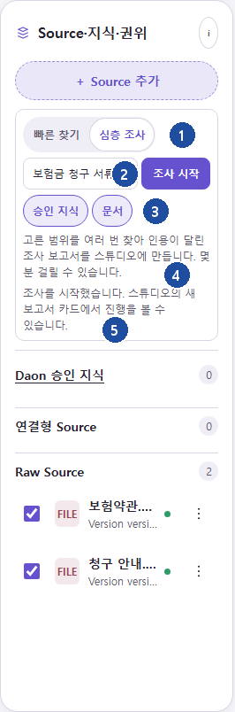

| 번호 | 항목 | 설명 | 비활성 조건 |
| --- | --- | --- | --- |
| ① | **심층 조사** | 심층 조사 방식으로 바꿈 | 이 노트북에서 심층 조사를 쓸 수 없을 때, 찾는 중·시작하는 중 |
| ② | 질문 칸, **조사 시작** | 조사할 질문(최대 500자). 누르면 **시작하는 중**이 보임 | 질문이 비었거나 범위를 하나도 고르지 않았을 때, 보기 권한으로 한 번 거절된 뒤 |
| ③ | **승인 지식**, **문서** | 조사할 범위 | 시작하는 중 |
| ④ | 안내 | "고른 범위를 여러 번 찾아 인용이 달린 조사 보고서를 스튜디오에 만듭니다. 몇 분 걸릴 수 있습니다." | 없음 |
| ⑤ | 시작 안내 | 스튜디오의 새 보고서 카드에서 진행을 보라는 안내 | 없음 |

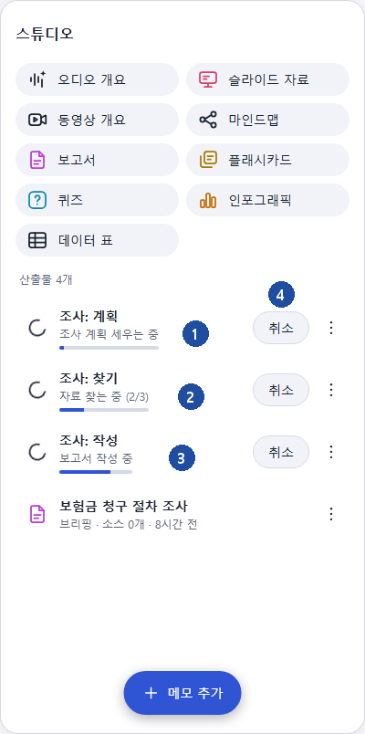

| 번호 | 항목 | 설명 | 비활성 조건 |
| --- | --- | --- | --- |
| ① | "조사 계획 세우는 중" | 질문을 작은 질문으로 나누는 단계 | 없음 |
| ② | "자료 찾는 중 (2/3)" | 작은 질문마다 자료를 찾는 단계. 숫자는 지금 순서 / 전체 수 | 없음 |
| ③ | "보고서 작성 중" | 찾은 자료로 보고서를 쓰는 단계 | 없음 |
| ④ | **취소** | 조사를 멈춤. 카드는 **취소됨** | 진행 중에만 보임 |

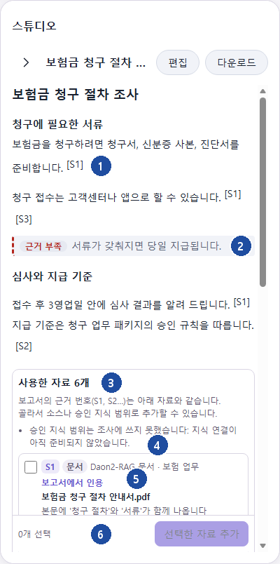

| 번호 | 항목 | 설명 | 비활성 조건 |
| --- | --- | --- | --- |
| ① | 근거 번호 [S1] | 문장의 근거. 누르면 근거 창이 열림. 번호는 아래 **사용한 자료**의 번호와 같음 | 없음 |
| ② | **근거 부족** | 찾은 자료로 확인되지 않은 문장. 근거 번호가 없음 | 없음 |
| ③ | **사용한 자료** | 조사에서 찾은 자료 목록과 개수 | 없음 |
| ④ | 쓰지 못한 범위 | "승인 지식 범위는 조사에 쓰지 못했습니다: 지식 연결이 아직 준비되지 않았습니다."처럼 조사에 쓰지 못한 범위와 이유 | 없음 |
| ⑤ | S1 표시, **보고서에서 인용** | 자료의 근거 번호. 보고서 본문에서 실제로 인용한 자료에는 **보고서에서 인용**이 붙음 | 없음 |
| ⑥ | 고른 수, **선택한 자료 추가** | 목록을 보는 동안 창 아래에 붙어 있음 | 고른 자료가 없을 때, 추가 중. 보기 권한으로 한 번 거절된 뒤에는 보이지 않음 |

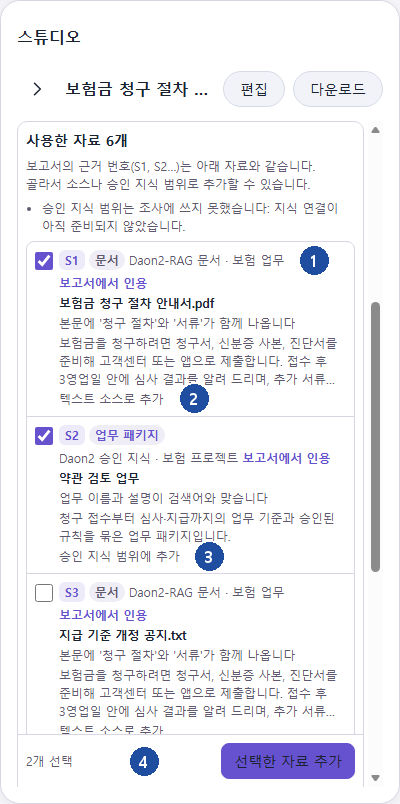

| 번호 | 항목 | 설명 | 비활성 조건 |
| --- | --- | --- | --- |
| ① | 체크칸 | 노트북에 더할 자료 고르기 | 추가 중. **추가됨**이 된 자료는 체크칸이 사라짐 |
| ② | **텍스트 소스로 추가** | 문서. 추가하면 **Raw Source**에 텍스트 소스로 들어감(최대 2 MiB) | 없음 |
| ③ | **승인 지식 범위에 추가** | 업무 패키지. 추가하면 **Daon 승인 지식**에 붙음(최대 8개) | 없음 |
| ④ | **선택한 자료 추가** | 고른 자료를 하나씩 추가 | 고른 자료가 없을 때, 추가 중 |

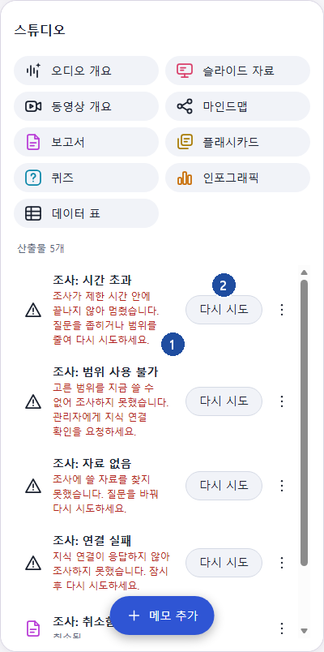

| 번호 | 항목 | 설명 | 비활성 조건 |
| --- | --- | --- | --- |
| ① | 실패 이유 | 카드에 실패 이유가 빨간 글로 보임(아래 표) | 없음 |
| ② | **다시 시도** | 같은 질문과 범위로 다시 조사 | 실패한 카드에만 보임 |

심층 조사는 스튜디오의 보고서로 만들어지며, 만들기 전에 구성 확인(2-17)은 쓰지 않습니다. 조사 보고서는 찾은 자료가 나중에 바뀌어도 카드에 바뀜 표시가 붙지 않습니다. 최신 내용이 필요하면 다시 조사합니다.

#### 주의·오류

| 화면 메시지 | 원인 | 조치 |
| --- | --- | --- |
| "조사가 제한 시간 안에 끝나지 않아 멈췄습니다. 질문을 좁히거나 범위를 줄여 다시 시도하세요." | 조사가 10분 안에 끝나지 않음 | 질문을 좁히거나 범위를 줄여 다시 조사 |
| "조사에 쓸 자료를 찾지 못했습니다. 질문을 바꿔 다시 시도하세요." | 찾은 자료가 없음 | 질문을 바꿔 다시 조사 |
| "고른 범위를 지금 쓸 수 없어 조사하지 못했습니다. 관리자에게 지식 연결 확인을 요청하세요." | 고른 범위를 모두 쓸 수 없음 | 관리자에게 지식 연결(3-4) 확인 요청 |
| "지식 연결이 응답하지 않아 조사하지 못했습니다. 잠시 후 다시 시도하세요." | 연결 일시 오류 | 잠시 뒤 **다시 시도** |
| "자료 찾기를 지금 쓸 수 없어 조사하지 못했습니다. 잠시 후 다시 시도하세요." | 자료 찾기 일시 오류 | 잠시 뒤 **다시 시도** |
| "질문을 확인해 주세요. 질문과 범위를 하나 이상 넣어야 합니다." | 질문이나 범위가 비었음 | 질문과 범위를 넣고 다시 **조사 시작** |
| "심층 조사를 지금 쓸 수 없습니다. 관리자에게 문의해 주세요." | 이 환경에서 조사 보고서를 만들 수 없음 | 관리자에게 문의 |
| "조사를 시작하지 못했습니다. 잠시 후 다시 시도해 주세요." | 일시 오류 | 잠시 뒤 다시 **조사 시작** |

조사 보고서는 모델로 쓰므로 다른 스튜디오 산출물처럼 조직의 외부 전송 정책(3-2)을 따릅니다. **근거 부족**이 붙은 문장은 그대로 업무에 쓰지 말고, 근거 번호가 붙은 문장도 근거 창에서 원문을 확인한 뒤 씁니다.

#### 관련

2-6 스튜디오, 2-19 빠른 찾기, 3-2 조직 정책과 외부 전송 정책, 3-4 지식 연결

### 2-21 웹 페이지

#### 기능·목적

노트북 소스를 근거로 한 장짜리 웹 페이지(HTML)를 스튜디오에 만듭니다. 사용자가 적은 **요청 글**(예: "고객에게 보장 내용을 안내하는 페이지")에 맞춰 모양을 자유롭게 짜되, 내용은 소스에서 근거가 확인된 것만 씁니다. 만들기는 두 단계로 진행됩니다. 먼저 근거 번호(S1, S2…)가 붙은 내용을 만들고, 근거를 확인한 내용만으로 페이지 모양을 입힙니다. 근거를 찾지 못한 문장은 페이지에 넣지 않고 근거 칸에 **근거 부족으로 뺀 내용**으로만 보여 줍니다.

페이지 안의 탭·펼치기·표 정렬은 앱이 넣는 고정 동작으로만 움직입니다. 입력값으로 새 숫자를 계산하는 기능, 외부 이미지·글꼴·주소를 불러오는 기능, 입력을 저장하는 폼은 들어가지 않습니다.

#### 쓸 수 있는 사람

다른 스튜디오 산출물(2-6)과 권한이 같습니다. 만들어진 페이지는 노트북을 볼 수 있는 사용자가 열고, 내려받기는 조직의 내려받기 정책(3-7)을 따릅니다.

#### 사용 순서

1. 오른쪽 스튜디오에서 **웹 페이지** 타일을 누릅니다.
2. 설정 창의 **요청 글** 칸에 어떤 페이지를 만들지 적습니다(필수, 최대 2000자). 비어 있으면 만들기 버튼이 꺼져 있습니다. 쓸 소스를 고르고 만들기를 누릅니다.
3. 카드에 진행 문구가 차례로 보입니다: "내용 만드는 중" → "페이지 만드는 중". 다른 산출물처럼 취소할 수 있습니다.
4. 끝나면 카드를 눌러 엽니다. 왼쪽 넓은 칸에 페이지가, 오른쪽 좁은 칸에 근거 목록이 보입니다. 좁은 화면에서는 위아래로 쌓이며, 두 칸은 각각 칸 안에서 스크롤합니다.
5. 페이지 안에서 근거가 붙은 부분을 누르면 근거 칸의 해당 번호로 이동하고 근거 창이 열립니다.
6. 근거를 찾지 못한 내용이 있으면 근거 칸 위에 "근거 부족으로 뺀 내용 N건"과 그 목록이 보입니다. 이 내용은 페이지에는 들어 있지 않습니다.
7. 고치려면 두 가지 방법이 있습니다.
   - 카드 ⋮ → **설정 변경 후 다시 생성**: 지난 요청 글이 채워진 설정 창이 열리고, 요청 글을 고쳐 새 판을 만듭니다.
   - 대화로 고치기(1-6, 2-6): 지시를 보내면 고친 안과 함께 바뀐 페이지 미리 보기가 만들어집니다. 미리 보기를 보고 적용하거나 버립니다. 고친 문장도 근거를 다시 확인하며, 근거가 없으면 페이지에서 빠집니다. 표·수치 카드는 대화로 고칠 수 없으니 바꾸려면 다시 생성합니다.
8. **다운로드**에서 HTML로 내려받습니다. **출처 목록 넣기**(기본 켬)를 켜 두면 페이지 맨 아래에 "출처" 목록(근거 번호, 자료 이름, 쪽/구간)이 붙습니다. 내려받은 파일은 외부 자원 없이 단독으로 열리며, 제안서 첨부나 고객 전달, 서버 게시에 쓸 수 있습니다.

#### 화면 구성

| 항목 | 설명 | 비활성 조건 |
| --- | --- | --- |
| **웹 페이지** 타일 | 웹 페이지 설정 창을 엶 | 다른 타일과 같음. 쓸 수 없으면 이유가 타일 안내에 보임 |
| **요청 글** | 만들 페이지에 대한 설명(최대 2000자). 아래에 글자 수가 보임 | 다시 만들기에서 지난 요청 글을 불러오는 동안 |
| 페이지 칸 | 만든 페이지. 탭·펼치기·표 정렬이 동작함 | 없음 |
| 근거 칸 | 근거 번호와 자료 이름·출처. 페이지에서 누른 번호가 강조됨 | 없음 |
| "근거 부족으로 뺀 내용 N건" | 페이지에 넣지 않은 내용과 그 목록 | 뺀 내용이 없으면 보이지 않음 |
| 고친 안 미리 보기 | 대화로 고치기에서 만든 바뀐 페이지 | 고친 안이 준비된 동안만 보임 |
| **출처 목록 넣기** | HTML 내려받기에 출처 목록을 붙일지 고름 | HTML 형식에서만 보임 |

#### 주의·오류

| 화면 메시지 | 원인 | 조치 |
| --- | --- | --- |
| "결과를 검증하지 못했습니다. 설정을 바꿔 다시 시도하세요." | 근거 확인된 내용이 하나도 없거나, 만든 페이지에 소스에 없는 숫자가 들어가거나 절 제목이 빠져 한 번 다시 만들어도 검사를 통과하지 못함 | 소스를 더 고르거나 요청 글을 좁혀 다시 생성 |
| "입력을 확인하세요." | 요청 글이 비었음 | 요청 글을 쓰고 다시 생성 |
| "수정안을 만들지 못했습니다. 지시를 바꿔 다시 시도하세요." | 대화로 고치기에서 표·수치 카드를 바꾸려 했거나 바뀐 페이지가 검사를 통과하지 못함 | 지시를 바꾸거나, 표·수치는 다시 생성으로 바꾸기 |

웹 페이지는 모델로 만들므로 다른 스튜디오 산출물처럼 조직의 외부 전송 정책(3-2)을 따릅니다. 페이지의 숫자·날짜·고유값은 근거와 대조하지만, 그대로 고객에게 보내기 전에 근거 칸에서 원문을 확인합니다.

#### 관련

1-6 스튜디오로 자료 만들기와 대화로 고치기, 2-6 스튜디오, 3-2 조직 정책과 외부 전송 정책, 3-7 내려받기 정책

### 2-22 데이터 집계

#### 기능·목적

노트북에 올린 표 파일(XLSX·CSV) 하나를 요청 글에 맞춰 집계하고, 집계표·차트·계산 근거를 스튜디오에 만듭니다(예: "월별·상품별 청구 건수와 지급액 합계, 전월 대비 증감률"). 모델은 요청 글과 열 이름·열 종류·행 수만 보고 집계 조건을 제안합니다. 실제 계산은 서버가 허용된 연산으로만 합니다. 셀 값은 모델에 보내지 않습니다.

집계한 숫자는 모두 **계산값**으로 표시되고, 칸을 누르면 어떤 파일·시트·범위(CSV는 행·열)에서 어떤 필터와 계산식으로 나왔는지 볼 수 있습니다. 묶음 열의 값은 **원본값**으로 표시됩니다.

1차에서 할 수 있는 것:

- 필터: 같음·다름·포함, 숫자 크다·작다·범위, 날짜 기간
- 묶기: 글자 열 값(최대 2개 열), 날짜 열의 월
- 집계: 건수, 합계, 평균
- 비교: 전월 대비 증감률
- 정렬, 상위 N개(최대 50), 막대·선 차트

할 수 없는 것: 여러 파일을 합치기, 직접 수식이나 코드 쓰기, 외부 자료 조회, 대화로 고치기.

#### 쓸 수 있는 사람

다른 스튜디오 산출물(2-6)과 권한이 같습니다. 만들어진 결과는 노트북을 볼 수 있는 사용자가 열고, 내려받기는 조직의 내려받기 정책(3-7)을 따릅니다.

#### 사용 순서

1. 표 파일(XLSX·CSV)을 소스로 추가합니다(1-4). 값이 있는 셀이 많은 큰 XLSX는 소스 목록에 **집계 전용** 표지가 붙습니다(아래 주의 참고).
2. 오른쪽 스튜디오에서 **데이터 집계** 타일을 누르면 설정 창이 열립니다.
3. 설정 창에서 차례로 고릅니다.
   - **표 소스**: 노트북의 XLSX·CSV 소스 하나
   - **시트**: XLSX일 때만. 표 정보를 읽으면 "열 n개 · 행 n개"가 보입니다.
   - **머리글 행**: 열 이름이 있는 행 번호(기본 1, 최대 50). 위에 제목 행이 있으면 그 아래 행 번호를 적습니다.
   - **요청 글**: 어떻게 집계할지(필수, 최대 2000자). 필터할 값은 표에 적힌 그대로 씁니다(예: "상품이 암보험인 것만").
4. **만들기**를 누르면 카드에 진행 문구가 차례로 보입니다: "표 읽는 중" → "집계 조건 만드는 중" → "계산 중".
5. 끝나면 카드를 눌러 엽니다. 위에서부터 **적용한 조건**, **요약**, **집계표**, **차트**, **계산 근거** 칸이 보이고, 각 칸은 칸 안에서 스크롤합니다.
6. 집계표의 계산값 칸을 누르면 **계산 근거** 칸에 파일, 원본 범위, 적용한 필터, 계산식, 대상 행 수, 제외한 칸 수가 보입니다. 범위가 길면 **펼치기**로 전체를 봅니다. 증감률 칸은 이번 달과 전월의 범위가 따로 보입니다.
7. 요청을 바꾸려면 카드 ⋮ → **설정 변경 후 다시 생성**을 씁니다. 지난 설정이 채워지며, 표 소스는 바꿀 수 없습니다. 다른 표로 집계하려면 새로 만듭니다.
8. **다운로드**에서 XLSX나 CSV로 내려받습니다.
   - XLSX: **집계표**·**계산 근거**·**적용한 조건** 세 시트. 계산값 칸 옆에 "계산값 표시" 열이 있고, 셀에는 값만 들어 있습니다(엑셀 수식 없음).
   - CSV: 집계표와 계산값 표시 열, 그 뒤에 계산 근거와 적용한 조건이 이어집니다.

#### 화면 구성

| 항목 | 설명 | 비활성 조건 |
| --- | --- | --- |
| **데이터 집계** 타일 | 설정 창을 엶 | 다른 타일과 같음 |
| **표 소스**, **시트**, **머리글 행** | 집계할 표 고르기 | 다시 생성할 때 표 소스는 잠김 |
| **요청 글** | 집계 요청(최대 2000자) | 표 정보를 읽는 동안 만들기 꺼짐 |
| **적용한 조건** | 서버가 실제로 적용한 필터·묶기·집계·정렬 | 없음 |
| **요약** | 집계표에서 가장 큰 묶음과 가장 작은 묶음 | 계산할 수 있는 칸이 2개 미만이면 없음 |
| **집계표** | 묶음 열(원본값)과 집계 열(계산값). 계산할 수 없는 칸은 "계산 불가"와 이유 | 없음 |
| **차트** | 첫 집계 열의 막대 또는 선(월로 묶으면 선). 빈 막대·끊긴 점은 계산 불가, 그 달에 행이 없으면 자료 없음 | 묶는 열이 없으면 없음 |
| **계산 근거** | 고른 칸의 범위·필터·식·행 수·제외 칸 수 | 칸을 고르기 전에는 안내만 보임 |
| **하지 않은 요청** | 요청 중 1차 범위 밖이라 하지 않은 부분 | 없으면 보이지 않음 |

#### 계산 규칙

- 증감률 = (이번 달 − 전월) ÷ 전월 × 100. 전월 값이 0이면 "계산 불가"(이유: 전월 값 0), 전월에 행이 없으면 "계산 불가"(이유: 전월 자료 없음)입니다. 비교는 달력상 바로 앞 달과만 합니다.
- 합계·평균에서 숫자가 아닌 칸과 빈칸은 빼고, 뺀 개수를 계산 근거에 적습니다. 숫자 값이 하나도 없으면 "계산 불가"(이유: 숫자 값 없음)입니다. 건수는 행 수를 셉니다.
- 화면 표시는 소수 첫째 자리까지 사사오입하고, 저장값은 정확한 값입니다. 금액 합계는 원본의 소수 자릿수를 그대로 씁니다.
- 앞자리가 0인 코드(예: 0101)가 있는 열은 글자 열로 봅니다. 0101과 101은 다른 값입니다.
- 한 열에 원·달러처럼 단위가 섞여 있으면 그대로 더해지므로, 요청 전에 열을 확인하세요.

#### 주의·오류

| 화면 메시지 | 원인 | 조치 |
| --- | --- | --- |
| "표가 너무 큽니다. 행이나 열을 줄인 파일로 다시 시도하세요." | 파일 20 MB, 행 10만, 열 100 등 한도를 넘음 | 필요한 행·열만 남긴 파일로 다시 시도 |
| "고른 시트가 파일에 없습니다. 시트를 다시 고르세요." | 시트 이름이 바뀌었거나 없음 | 시트를 다시 고름 |
| "머리글 행을 읽을 수 없습니다. 머리글 행 번호를 확인하세요." | 머리글 행이 비었거나 파일 범위 밖 | 머리글 행 번호를 고침 |
| "CSV 글자 인코딩을 읽을 수 없습니다. UTF-8이나 CP949로 저장해 주세요." | CSV 인코딩 문제 | 엑셀에서 UTF-8 CSV로 다시 저장 |
| "필터 값이 표에 없습니다" | 요청 글의 필터 값이 그 열에 없음 | 표에 적힌 값 그대로 다시 적기 |
| "이 요청은 데이터 집계 1차 범위에서 할 수 없습니다" | 요청 전체가 1차 범위 밖 | 할 수 있는 집계로 요청을 바꿈 |
| "결과가 너무 큽니다. 조건을 좁혀 다시 생성해 주세요" | 결과와 계산 근거가 판 크기 한도(2 MiB)를 넘음 | 필터를 더하거나 집계 열을 줄임 |
| "묶음이 너무 많습니다. 묶는 열을 줄이거나 조건을 좁혀 다시 생성해 주세요." | 결과 묶음이 2,000개를 넘음 | 묶는 열을 줄이거나 필터를 더함 |
| "표를 읽고 계산하는 데 시간이 너무 오래 걸렸습니다. 조건을 좁혀 다시 시도하세요." | 읽기·계산이 60초를 넘음 | 파일을 줄이거나 조건을 좁힘 |
| "이 표는 데이터 집계에만 쓸 수 있습니다." | 대화 질문에서 집계 전용 소스만 골랐음 | 집계는 데이터 집계로, 질문은 다른 소스로 |

집계 전용 소스: 통합 문서 전체에서 값이 있는 셀이 약 2,000개를 넘거나 구조가 큰 XLSX는 질문 근거로 쓰지 않고 데이터 집계에만 씁니다. 일부만 읽어 답하면 뒤쪽 행을 못 본 채 틀린 답을 낼 수 있기 때문입니다.

데이터 집계는 모델로 집계 조건을 만들므로 조직의 외부 전송 정책(3-2)을 따릅니다. 모델에는 열 이름·열 종류·행 수만 보냅니다. 머리글 행을 잘못 지정하면 그 행의 값이 열 이름으로 보내질 수 있으니 머리글 행 번호를 확인하세요.

#### 관련

1-4 자료(Source) 올리기, 2-6 스튜디오, 3-2 조직 정책과 외부 전송 정책, 3-7 내려받기 정책

## 3부 관리자

3부는 시스템 관리자가 쓰는 화면입니다. 노트북 홈 **설정** 메뉴에서 **조직 정책**, **사용자 관리**, **조직 관리**, **음성 엔진**은 시스템 관리자에게만 보입니다. **지식 연결**, **작성 템플릿**, **내려받기 정책**은 관리 설정 화면 위쪽 링크로 이동합니다.

Workspace와 역할: 현재 제품에서 작업을 공유하는 경계는 Workspace입니다. Workspace 안에 Notebook이 있고, Notebook에 Source를 올리고, Studio로 산출물을 만듭니다. Workspace 관리자는 서버 권한 모델에서 보기·질문·생성·편집·검토와 Workspace 내부 정책·멤버 권한 관리 권한을 가지며, 편집자·검토자·승인자·열람자는 그보다 좁은 권한을 가집니다. Workspace 관리자 역할만으로는 `사용자 관리` 메뉴나 `/admin`을 사용할 수 없습니다. 일반 사용자가 공동 작업자를 초대하거나 Workspace 권한을 변경하는 사용자 화면은 없습니다. 조직 가입 승인, 초대코드, 구성원 역할은 조직 관리(3-10)에서 관리자가 하고, 계정별 역할 변경은 시스템 관리자가 3-1에서도 합니다. 시스템 관리자는 Workspace 역할과 별개인 보호 권한으로, 전체 계정을 검색하고 일반 사용자를 중지하거나 재활성화합니다.

### 3-1 사용자 관리

#### 기능·목적

일반 사용자를 등록하고 승인·수정·중지·삭제합니다. 사용자의 Workspace 역할도 바꿉니다.

#### 쓸 수 있는 사람

시스템 관리자만 `사용자 관리`를 씁니다. 일반 사용자는 메뉴가 보이지 않으며, 일반 사용자가 `/admin`에 직접 접근하면 HTTP 403 `FORBIDDEN`으로 거부되고 사용자 목록은 표시되지 않습니다.

#### 사용 순서

1. 노트북 홈 **설정** → **사용자 관리**를 누릅니다(`/admin`).
2. 사용자 검색: **사용자 ID 또는 이메일 검색** 칸에 로그인 ID, 사용자 ID 또는 이메일을 넣습니다. 상태 필터(**전체 상태**)에서 **활성**, **중지**, **이메일 인증 대기**, **승인 대기** 중 하나를 고르고 **조회**를 누릅니다.
3. 사용자 행을 두 번 눌러 **사용자 수정** 창을 엽니다. **이메일**, **상태**, **변경할 역할**과 **변경 사유**를 바꾸고 **수정**을 누릅니다.
4. 중지: **상태**를 **중지**로 바꿔 저장합니다. 재활성화는 **상태**를 **활성**으로 바꿔 저장합니다.
5. 새 사용자: **사용자 등록** → **사용자 ID**, **이메일**, **초기 비밀번호** → **등록**.
6. 가입 승인: **승인 대기** 사용자의 수정 창에서 **승인**을 누릅니다.
7. 삭제: 행을 체크하고 **선택 삭제**를 누릅니다.

#### 화면 구성

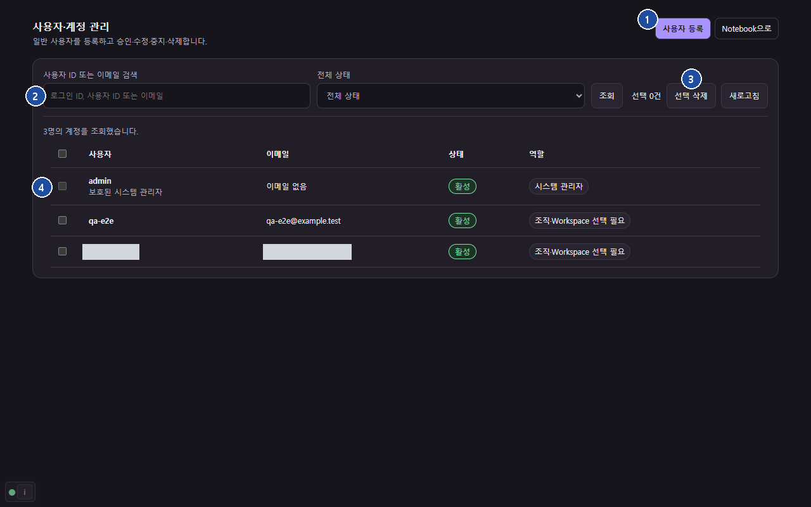

| 번호 | 항목 | 설명 | 비활성 조건 |
| --- | --- | --- | --- |
| ① | **사용자 등록** | 새 사용자 만들기 | 없음 |
| ② | **사용자 ID 또는 이메일 검색**, **전체 상태**, **조회** | 사용자 검색과 상태 필터 | 없음 |
| ③ | **선택 삭제**, **새로고침** | 체크한 계정 삭제 | 아무것도 체크하지 않았을 때 |
| ④ | 사용자 목록 | **사용자**, **이메일**, **상태**, **역할** | 보호 admin 행은 체크할 수 없음 |

각 행에는 등록 이메일 주소 전체가 보입니다. 이메일 미등록 계정은 `이메일 없음`으로 표시됩니다. 등록 이메일 주소 전체는 로그인한 시스템 관리자의 `/admin` 목록에서만 보이며 다른 화면에는 나오지 않습니다. 비밀번호, hash, token은 보이지 않습니다. 이메일 인증 대기 계정은 상태 변경을 할 수 없습니다. 상태는 **활성**과 **중지** 사이에서만 바꿀 수 있고, 본인 계정의 상태와 역할은 바꿀 수 없습니다.

보호된 초기 시스템 관리자:

- 로그인 ID는 `admin`이며 이메일은 없습니다. 목록에서 **보호된 시스템 관리자**로 표시되고 보호됨 상태라 수정 창이 읽기 전용입니다.
- 보호 admin은 삭제하거나 중지할 수 없습니다. 보호된 admin의 중지 요청은 HTTP 409 `PROTECTED_ADMIN_ACCOUNT`로 거부됩니다.
- 최초 시작 또는 운영자가 서버 콘솔에서 초기화한 직후에만 `admin/admin`으로 로그인합니다. 로그인하면 `/password-change`의 **새 비밀번호 설정** 화면으로 이동하며, 비밀번호를 바꾸기 전에는 Notebook 데이터가 보이지 않습니다.
- 비밀번호 변경 성공 직후 모든 기존 Session과 refresh family가 폐기되고 `admin/admin`은 즉시 무효가 됩니다.
- 보호 admin은 이메일이 없어 메일 재설정을 쓸 수 없습니다. 비밀번호를 잊었다면 운영자가 API 컨테이너 서버 콘솔에서 `python -m daon2_user_api.admin_cli reset-initial-password`를 한 번 실행합니다. 성공하면 `INITIAL_ADMIN_PASSWORD_RESET`과 종료 코드 0이 나옵니다. runtime 실패는 `INITIAL_ADMIN_PASSWORD_RESET_FAILED:<오류 코드>`를 표시하고 종료 코드 1로 끝납니다. 잘못된 인자는 usage를 표시하고 종료 코드 2로 끝납니다. 명령은 비밀번호·hash·token을 출력하지 않으며, 실패 원인을 확인하기 전에 반복 실행하지 않습니다.

#### 주의·오류

| 화면 메시지 | 원인 | 조치 |
| --- | --- | --- |
| "유효한 이메일을 입력하세요." | 이메일 형식 오류 | 형식에 맞게 입력 |
| "변경할 수 없는 계정 상태입니다." | 허용되지 않는 상태 변경 | **활성**·**중지** 사이로만 변경 |
| `ADMIN_USERS_UNAVAILABLE` | 목록을 불러오지 못함 | **다시 시도** |
| "이메일 변경은 먼저 수정으로 저장하세요. 초기화 메일은 저장된 이메일로만 발송됩니다." | 이메일을 바꾼 채 **비밀번호 초기화** | 먼저 **수정**으로 저장 |

사용자를 중지하면 그 사용자의 기존 Session이 끝납니다. 이 화면은 비밀번호를 보여 주거나 직접 지정하지 않습니다(**비밀번호 초기화**는 저장된 이메일로 초기화 메일을 보냅니다).

#### 관련

2-1 로그인·가입·비밀번호 재설정, 3-8 라이선스

### 3-2 조직 정책과 외부 전송 정책

#### 기능·목적

자료와 질문을 외부 모델로 보내도 되는지 정하는 외부 전송 정책을 관리합니다. 조직 정책과 Workspace 정책을 따로 저장하며, 조직 정책이 Workspace보다 우선합니다.

#### 쓸 수 있는 사람

설정 경로는 `/settings/organization`입니다. 조직 정책 저장은 시스템 관리자 또는 조직의 관리 권한이 확인된 사용자, Workspace 정책 저장은 정책 관리 권한이 있는 사용자가 합니다. 저장할 때마다 현재 비밀번호로 추가 인증(Step-up)을 합니다. Workspace에서는 조직의 외부 전송 정책을 읽기 전용으로 확인합니다(작업 화면 **설정** → **조직 정책**).

#### 사용 순서

1. 노트북 홈 **설정** → **조직 정책**을 누릅니다.
2. **1. 조직 정책** 또는 **2. Workspace 정책**을 고릅니다.
3. **정책 모드**(**외부 전송 차단**, **추가 인증 후 허용**, **추가 인증 없이 허용**)와 아래 항목을 정합니다.
4. **현재 비밀번호**를 넣고 **정책 저장**을 누릅니다.
5. 두 범위를 모두 같은 값으로 저장해야 최종 정책이 열립니다. 위쪽 최종 정책 표시를 다시 확인합니다.

#### 화면 구성

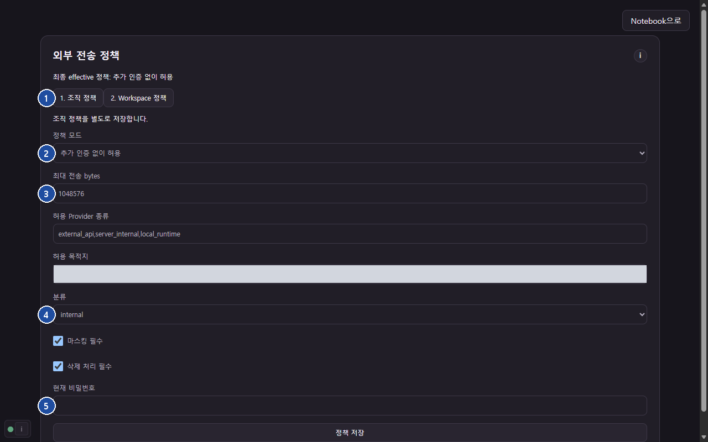

| 번호 | 항목 | 설명 | 비활성 조건 |
| --- | --- | --- | --- |
| ① | **1. 조직 정책**, **2. Workspace 정책** | 저장할 범위 | 저장 중 |
| ② | **정책 모드** | 차단 또는 허용 방식 | Workspace는 조직 차단을 완화할 수 없음 |
| ③ | **최대 전송 bytes**, **허용 Provider 종류**, **허용 목적지** | 보낼 수 있는 양과 대상. 종류와 목적지는 쉼표로 구분 | 없음 |
| ④ | **분류**, **마스킹 필수**, **삭제 처리 필수**, **필수 승인자** | 데이터 분류와 처리 조건 | 허용 방식에 따라 **필수 승인자** 숨김 |
| ⑤ | **현재 비밀번호**, **정책 저장** | 추가 인증 후 저장 | 비밀번호가 비었거나 상위 정책을 완화하려 할 때 |

새 설치의 초기 정책은 외부 전송 차단입니다. 허용 목적지는 운영 담당자가 확인한 주소만 넣으며, 이 설명서에는 목적지 주소를 적지 않습니다. 질문 전송은 internal 분류로 판정되므로 정책 **분류**가 internal이어야 외부 전송이 통과합니다.

#### 주의·오류

| 화면 메시지 | 원인 | 조치 |
| --- | --- | --- |
| "조직 차단 정책이 적용되어 Workspace에서 완화할 수 없습니다." | 조직이 차단 | 조직 정책부터 변경 |
| "정책을 저장하지 못했습니다." + `EGRESS_POLICY_PAYLOAD_INVALID` | 종류·목적지 오타 등 | 쉼표 구분과 철자 확인 |
| "정책을 저장하지 못했습니다." + 충돌 코드 | 다른 곳에서 먼저 변경(ETag 충돌) | 새로고침 후 다시 저장 |

정책 변경에는 현재 권한, 추가 인증, ETag 충돌 검사가 적용됩니다. 저장 뒤 Workspace 적용 결과를 다시 확인하고, 다른 Provider로 우회하지 않습니다.

#### 관련

2-5 대화와 근거, 3-3 모델 연결, 3-6 TTS 음성 엔진

### 3-3 모델 연결

#### 기능·목적

답변과 자료 처리에 쓰는 모델 Provider 연결을 등록·시험하고, 허용 모델과 Workspace 기본 모델을 정합니다.

#### 쓸 수 있는 사람

연결의 Endpoint·허용 모델·공용 여부는 시스템 관리자만 바꿉니다. 일반 사용자는 연결을 조회하고, 비공용 연결에 본인 계정의 개인 Key를 등록하며, 텍스트 기본 모델을 확인합니다. 노트북 홈 **설정** → **LLM 설정**(`/settings/model-connections`) 또는 작업 화면 **설정** → **LLM 설정**으로 엽니다.

#### 사용 순서

1. **연결 추가**를 누릅니다.
2. **호환 방식**을 고릅니다. **OpenAI 호환**은 Chat Completions, **Anthropic 호환**은 Messages 규격입니다. 이 호환 연결은 내부적으로 CUSTOM으로 구분됩니다. Media Bridge는 CUSTOM의 OpenAI 호환 연결로 등록합니다.
3. **Provider 표시 이름**, **연결 이름**, **두 글자 약어**, **Endpoint**, **인증 유형**을 넣고 **API Key 또는 Client Key**를 입력합니다.
4. **모델 목록 조회**로 모델을 불러오고 **사용 허용 모델**에서 최대 4개를 고릅니다. 목록에 없으면 **모델 ID 직접 입력**을 씁니다.
5. **연결 시험 및 저장**을 누릅니다. 시험에도 짧은 Provider 요청과 비용이 생길 수 있습니다.
6. 아래 **텍스트 생성 기본 모델**에서 연결과 모델을 고르고 **기본 모델 저장**을 누릅니다.

#### 화면 구성

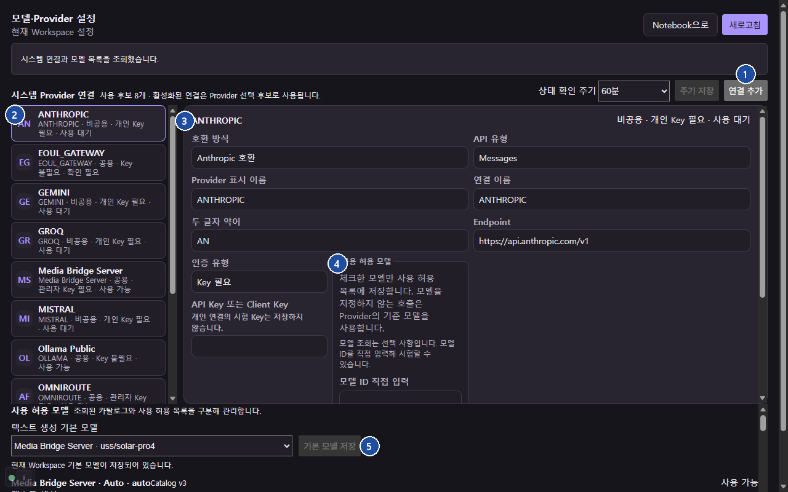

| 번호 | 항목 | 설명 | 비활성 조건 |
| --- | --- | --- | --- |
| ① | **연결 추가**, **상태 확인 주기** | 새 연결, 자동 상태 확인 주기 | 관리자 외 |
| ② | 연결 목록 | 공용·비공용, Key 필요 여부, 사용 가능 여부 | 없음 |
| ③ | **호환 방식**, **Endpoint**, **인증 유형**, **API Key 또는 Client Key**, **라우터 Auto 사용** | 연결 설정 | 관리자 외 |
| ④ | **사용 허용 모델**, **모델 목록 조회**, **모델 조회** | 허용 모델(최대 4개)과 카탈로그 새로고침 | 저장 전에는 **모델 조회** 꺼짐 |
| ⑤ | **텍스트 생성 기본 모델**, **기본 모델 저장** | 이 Workspace의 기본 모델 | 고르지 않았거나 저장된 값과 같을 때 |

버튼 차이:

| 버튼 | 동작 |
| --- | --- |
| **저장** | Provider를 호출하지 않고 설정만 저장. 결과는 확인 전 상태로 남음 |
| **연결 시험** | 입력한 값으로 연결만 확인. 저장하지 않음 |
| **연결 시험 및 저장** | 시험에 성공하면 저장 |
| **변경 취소** | 저장된 값으로 되돌림 |

Key 규칙:

- 공용 연결은 관리자 Key를, 비공용 연결은 본인 계정의 개인 Key를 씁니다. 비공용 연결에 개인 Key가 없을 때 시스템 Key로 fallback하는 경로는 없습니다.
- 일반 사용자는 **내 계정 키 시험 및 저장**, **내 계정 키 삭제**로 본인 Key만 관리합니다.
- 키 교체만 필요하면 저장된 Endpoint 재입력이나 worker 재생성은 필요 없습니다.
- Key 원문은 다시 보이지 않습니다. Key나 Provider 응답 원문을 캡처·문의 글에 붙이지 않습니다.

라우터 Auto: 라우터의 Auto는 모델 목록에서 고르는 하나의 모델입니다. OmniRoute는 `auto`, OpenRouter는 `openrouter/auto`를 씁니다. OpenAI 호환 연결은 시스템 관리자가 **라우터 Auto 사용**을 켜고 **Auto 모델 ID**를 지정할 수 있습니다. 조회 목록에 없는 Auto에는 논리 모델 표시가 붙습니다. 하위 Provider 선택·우선순위는 Gateway가 맡습니다.

기존 연결: 새 연결은 **OpenAI 호환**, **Anthropic 호환**으로 만듭니다. 이전부터 저장된 Ollama, OpenRouter, OmniRoute, Media Bridge 같은 연결은 "기존 Provider 방식"으로 보이며 계속 씁니다. 이전 배포에서 Provider 키를 환경변수로 쓰던 경우에만 운영자가 키를 연결 저장소로 1회 이관한 뒤, 환경변수 키 의존을 없앱니다.

모델 카드의 이미지 이해·문서 분석 표시는 기능 표시일 뿐, 이 화면에서 기본값을 고를 수 있다는 뜻은 아닙니다. 기본 모델은 텍스트 생성만 고릅니다. 문서 전용 모델이 없으면 PDF는 글자를 뽑아 텍스트 생성 모델로 처리합니다.

**추론 수준 확인**은 허용 모델마다 어떤 추론 수준을 받아 주는지 작은 요청으로 다시 확인합니다.

#### 주의·오류

| 화면 메시지 | 원인 | 조치 |
| --- | --- | --- |
| "Provider가 Key를 거부했습니다(인증 실패)" | Key가 틀리거나 만료 | Key 확인 후 다시 시험 |
| "두 글자 약어는 영문 대문자 2자여야 합니다." | 약어 형식 오류 | 대문자 2자 입력 |
| "저장된 시스템 Key가 없어 저장할 수 없습니다" | 공용 연결에 Key 없음 | Key 입력 후 저장 |
| "다른 변경과 충돌했습니다. 새로고침 후 다시 시도해 주세요." | 동시 변경 | **새로고침** 후 다시 |
| "연결 시험에 실패했습니다." | Endpoint·Key·네트워크 문제 | 설정 확인. 시험은 설정을 바꾸지 않음 |

#### 관련

2-4 Source 추가 창과 Source 상태, 2-5 대화와 근거, 3-2 조직 정책과 외부 전송 정책

### 3-4 지식 연결

#### 기능·목적

Daon2-RAG, Daon2, 법령 같은 MCP 지식 서버를 등록하고 시험하며 호출 한도를 정합니다. 등록한 지식은 노트북의 **Daon 승인 지식**, 문서 작성, 자료 찾기(빠른 찾기·심층 조사)에서 씁니다. 자료 찾기의 **승인 지식** 범위는 Daon2·Daon2-RAG 연결이, **문서** 범위는 Daon2-RAG 연결이 준비돼 있고 찾기 도구가 허용돼 있어야 쓸 수 있습니다.

#### 쓸 수 있는 사람

시스템 관리자. 다른 사용자는 "관리자만 지식 연결을 관리할 수 있습니다."가 보입니다. 관리 설정 화면 위쪽의 **지식 연결** 링크로 엽니다.

#### 사용 순서

1. **연결 추가**를 누릅니다.
2. **종류**, **이름**, **서버 주소**, **인증 방식**을 넣고 필요하면 허용 도구·허용 컬렉션을 고른 뒤 **등록**합니다.
3. 새 행의 **연결 확인**을 누릅니다.
4. 필요하면 **한도**에서 동시 호출 수 등을 정하고 **저장**합니다.
5. 쓰지 않는 연결은 **해제**합니다. 이 연결로 만든 산출물의 저장된 근거는 남습니다.

#### 화면 구성

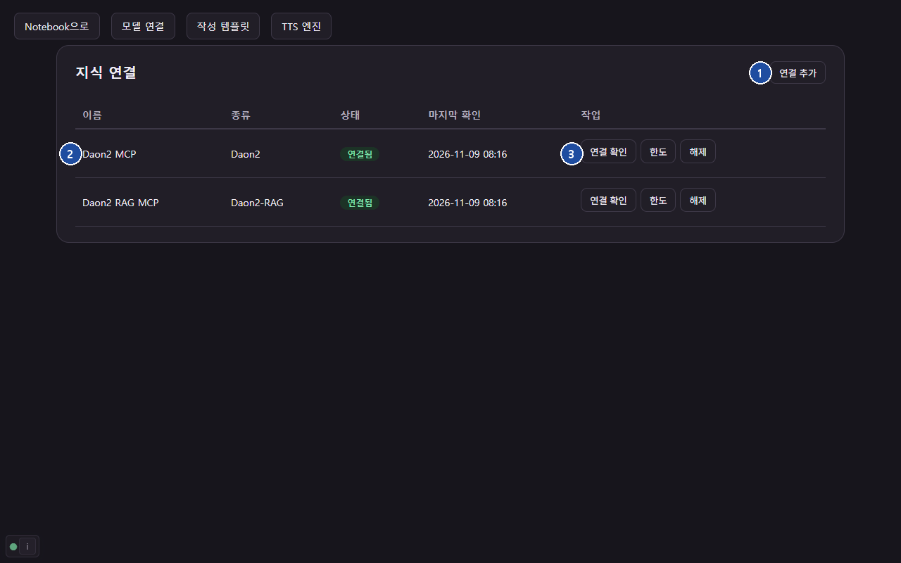

| 번호 | 항목 | 설명 | 비활성 조건 |
| --- | --- | --- | --- |
| ① | **연결 추가** | 등록 창 열기 | 관리자 외 |
| ② | 연결 목록 | 이름, 종류, 상태(**연결됨**, **확인 전**, **확인 실패** 등), 마지막 확인 | 없음 |
| ③ | **연결 확인**, **한도**, **해제** | 연결 시험, 호출 한도, 연결 해제 | 확인 중 |

#### 주의·오류

| 화면 메시지 | 원인 | 조치 |
| --- | --- | --- |
| "사설 주소는 이 환경에서 연결할 수 없습니다." | 허용되지 않는 서버 주소 | 공개 접근 가능한 주소 사용 |
| "요청을 처리하지 못했습니다. 잠시 후 다시 시도해 주세요." | 일시 오류 | 잠시 뒤 다시 |

#### 관련

2-4 Source 추가 창과 Source 상태, 2-7 문서 작성 마법사, 2-19 빠른 찾기, 2-20 심층 조사

### 3-5 문서 작성 템플릿

#### 기능·목적

조직에서 쓰는 문서 작성 템플릿을 등록·수정하고 켜거나 끕니다. 저장할 때마다 새 버전이 됩니다.

#### 쓸 수 있는 사람

시스템 관리자. 관리 설정 화면 위쪽의 **작성 템플릿** 링크로 엽니다.

#### 사용 순서

1. **새 템플릿**을 누릅니다.
2. **제목**, **설명**, **템플릿 정의(JSON)**를 넣습니다. **JSON 파일 가져오기**나 **예시 채우기**를 써도 됩니다.
3. **검증 후 저장**을 누릅니다.
4. 목록에서 **편집**, **비활성**·**활성**, **내보내기**를 합니다.

#### 화면 구성

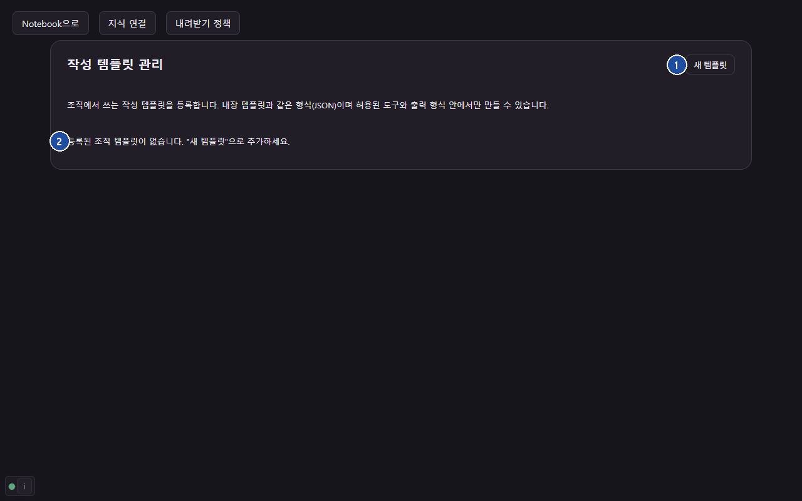

| 번호 | 항목 | 설명 | 비활성 조건 |
| --- | --- | --- | --- |
| ① | **새 템플릿** | 템플릿 등록 창 | 관리자 외 |
| ② | 템플릿 목록 | 제목, ID, 버전, 상태(**사용 중**, **비활성**), 섹션 수. 등록 전에는 안내 문구만 보임 | 없음 |
| 목록 각 줄 | **편집**, **비활성**·**활성**, **내보내기** | 수정(새 버전), 켜고 끄기, JSON 내보내기 | 없음 |

#### 주의·오류

| 화면 메시지 | 원인 | 조치 |
| --- | --- | --- |
| "JSON 형식이 올바르지 않습니다." | JSON 문법 오류 | 형식 확인 |
| "같은 ID의 템플릿이 이미 있습니다. 목록에서 편집하세요." | ID 중복 | 기존 템플릿을 편집 |

#### 관련

2-7 문서 작성 마법사, 3-4 지식 연결

### 3-6 TTS 음성 엔진

#### 기능·목적

오디오·동영상 개요의 음성을 만드는 TTS 서버를 등록하고, 기본 엔진과 목소리를 정합니다.

#### 쓸 수 있는 사람

시스템 관리자. 노트북 홈 **설정** → **음성 엔진**으로 엽니다.

#### 사용 순서

1. **엔진 추가**를 누릅니다.
2. **식별자**, **이름**, **서버 주소**, **API 키**, **전송 구분**, 두 화자의 기본 목소리를 넣고 **등록**합니다.
3. **연결 확인**을 누르면 고를 수 있는 목소리가 채워집니다.
4. **수정**으로 목소리를 고르고, 기본으로 쓸 엔진은 **기본으로**를 누릅니다.

#### 화면 구성

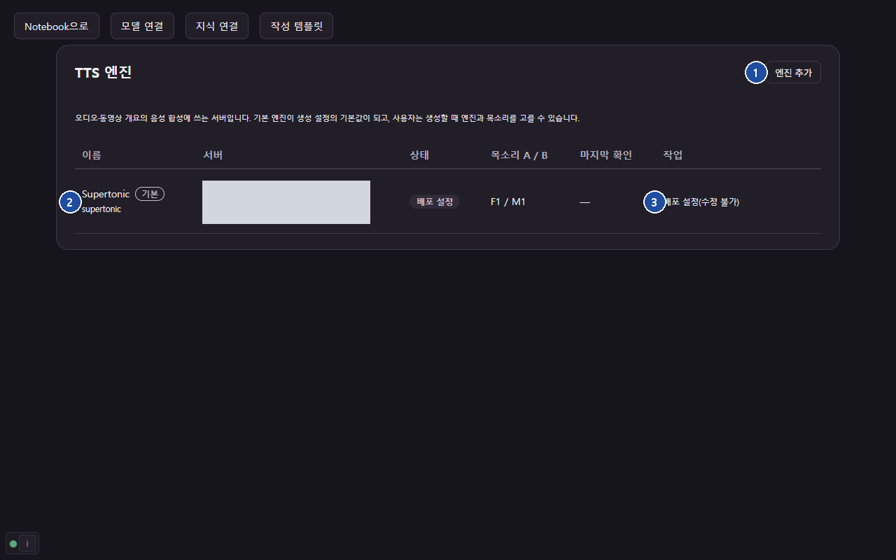

| 번호 | 항목 | 설명 | 비활성 조건 |
| --- | --- | --- | --- |
| ① | **엔진 추가** | 등록 창 | 관리자 외 |
| ② | 엔진 목록 | 이름, 서버, 상태, 목소리 A·B, 마지막 확인 | 없음 |
| ③ | 작업: **연결 확인**, **기본으로**, **수정**, **사용**·**사용 안 함**, **해제** | 시험, 기본 지정, 수정, 켜고 끄기, 해제 | 상태가 **사용 안 함**이면 연결 확인 꺼짐. 배포할 때 설정된 엔진(**배포 설정**)은 화면에서 고칠 수 없음 |

외부 API로 등록한 엔진은 3-2 외부 전송 정책의 허용 목적지에 서버 주소가 있어야 합니다. 서버 내부로 등록한 엔진은 조직이 직접 운영하는 서버입니다.

#### 주의·오류

| 화면 메시지 | 원인 | 조치 |
| --- | --- | --- |
| "식별자는 영문 소문자·숫자·-·_ 로 1~32자여야 합니다." | 식별자 형식 오류 | 형식에 맞게 입력 |
| "음성 서버가 키를 거부했습니다." | API 키 오류 | 키 확인 후 수정 |

#### 관련

2-6 스튜디오, 3-2 조직 정책과 외부 전송 정책

### 3-7 내려받기 정책

#### 기능·목적

조직 구성원이 스튜디오 산출물을 내려받기 전에 비밀번호를 한 번 더 확인하게 합니다.

#### 쓸 수 있는 사람

시스템 관리자. 작성 템플릿 화면 위쪽의 **내려받기 정책** 링크로 엽니다.

#### 사용 순서

1. **산출물 내려받기에 추가 인증 요구**를 체크합니다.
2. **저장**을 누릅니다.

#### 화면 구성

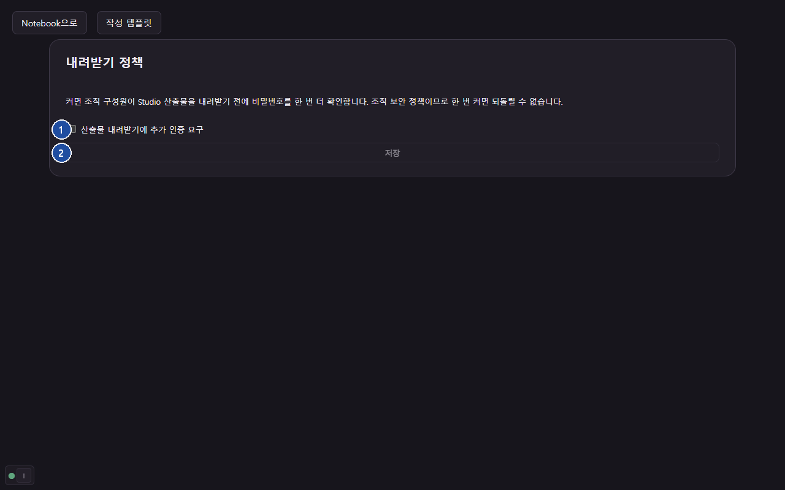

| 번호 | 항목 | 설명 | 비활성 조건 |
| --- | --- | --- | --- |
| ① | **산출물 내려받기에 추가 인증 요구** | 켜면 내려받을 때 비밀번호 확인 | 이미 켜져 있을 때 |
| ② | **저장** | 정책 저장 | 체크하지 않았거나 이미 켜져 있을 때 |

#### 주의·오류

| 화면 메시지 | 원인 | 조치 |
| --- | --- | --- |
| "저장하지 못했습니다. 잠시 후 다시 시도해 주세요." | 저장 실패 | 잠시 뒤 다시 |

이 정책은 조직 보안 정책이라 한 번 켜면 되돌릴 수 없습니다. 켜기 전에 조직과 합의합니다.

#### 관련

1-8 내려받기와 로그아웃, 2-6 스튜디오

### 3-8 라이선스

#### 기능·목적

Edition, 상태, 허용 기능, 사용 한도를 확인하고 서명된 라이선스 문서를 적용합니다.

#### 쓸 수 있는 사람

로그인한 사용자는 누구나 읽기 전용으로 봅니다. 서버가 `can_apply=true`로 판정한 경우에만 라이선스 등록·교체·적용 입력이 보입니다. 시스템 관리자 또는 현재 조직의 관리 권한이 검증된 사용자가 대상이며, Workspace 역할만으로 적용 권한이 생기지는 않습니다.

#### 사용 순서

1. **설정** → **라이선스**를 엽니다.
2. **현재 라이선스**, **허용 기능**, **사용 한도**를 확인합니다.
3. 적용 권한이 있으면 승인된 JSON 라이선스 문서를 고르고 **현재 비밀번호**를 넣은 뒤 **Step-up 후 검증·적용**을 누릅니다.
4. 제품, 기간, 서명 검증 결과를 확인합니다.

#### 화면 구성

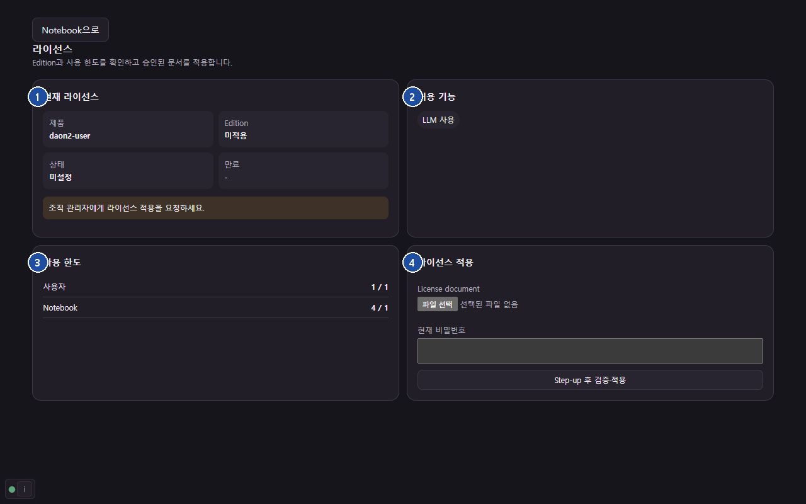

| 번호 | 항목 | 설명 | 비활성 조건 |
| --- | --- | --- | --- |
| ① | **현재 라이선스** | 제품, Edition, 상태(**정상**, **만료 예정**, **만료**, **한도 도달** 등), 만료일 | 없음 |
| ② | **허용 기능** | LLM 사용 여부 | 없음 |
| ③ | **사용 한도** | 사용자 수와 Notebook 수의 사용량/한도 | 없음 |
| ④ | **라이선스 적용** | 문서 선택, 비밀번호, **Step-up 후 검증·적용** | 적용 권한이 없으면 보이지 않음, 검증 중 |

Daon User 라이선스의 적용 대상은 사용자 수와 Notebook 수입니다. LLM 사용은 수량 한도가 아니라 허용 기능입니다. 라이선스가 없어도 기본 사용이 가능하며, 기본값은 사용자 1명, Notebook 1개, LLM 사용 가능입니다. 한도에 도달해도 로그인과 기존 데이터 조회·내보내기는 유지됩니다.

#### 주의·오류

| 화면 메시지 | 원인 | 조치 |
| --- | --- | --- |
| "라이선스 요청을 처리하지 못했습니다." + `LICENSE_APPLY_FAILED` | 문서·서명·비밀번호 검증 실패 | 문서와 비밀번호 확인 |
| "라이선스 요청을 처리하지 못했습니다." + `LICENSE_UNAVAILABLE` | 서버 확인 실패 | **다시 시도** |

라이선스 원문과 비밀번호를 로그나 문의 글에 붙이지 않습니다.

#### 관련

2-2 노트북 홈, 3-1 사용자 관리

### 3-9 운영 상태

#### 기능·목적

시스템과 Workspace의 운영 상태와 백업을 확인하고, 백업 요청과 복구를 합니다.

#### 쓸 수 있는 사람

시스템 관리자와 백업·복구 권한이 있는 사용자. 알림 화면의 **운영 상태** 탭이나 알림 링크로 `/operations`를 엽니다. 작업 화면 위쪽 **운영상태** 버튼은 같은 정보의 요약 창을 엽니다.

#### 사용 순서

1. `/operations`를 엽니다. 위쪽 **다시 조회**로 최신 상태를 봅니다.
2. 구성요소(Provider 설정, API, DB·Object Storage, 동기화, 작업 Queue)의 상태가 준비·주의·오류 중 무엇인지 확인합니다.
3. 백업: **백업 자료 선택** → 노트북과 자료 선택 → **선택 자료 백업 요청**.
4. 복구: 백업을 열고 **등록 복원 목적지 조회** → 목적지 선택 → **등록 목적지 Preview 준비** → **현재 비밀번호** → **인증 후 실행 확정**.

#### 화면 구성

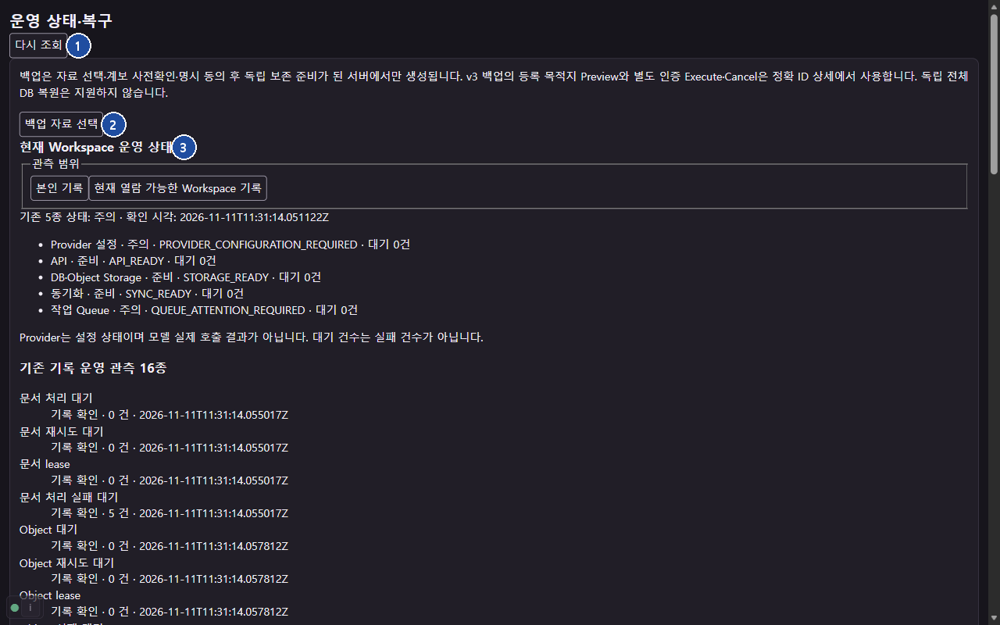

| 번호 | 항목 | 설명 | 비활성 조건 |
| --- | --- | --- | --- |
| ① | **다시 조회** | 상태 새로고침 | 처리 중 |
| ② | **백업 자료 선택** | 백업할 노트북과 자료 고르기 | 권한이 없으면 꺼짐 |
| ③ | 운영 상태 | 구성요소별 상태와 관측 기록. **관측 범위**에서 **본인 기록** 또는 Workspace 기록 선택. 백업 목록은 아래쪽에 보임 | 권한에 따라 범위가 다름 |

이 화면은 브라우저 창이 가려지거나 최소화되면 안전을 위해 내용을 숨기고 "현재 세션과 복구 대상을 확인하고 있습니다."만 보입니다. 창을 앞으로 가져오면 다시 조회합니다.

작업 화면 **운영상태** 창에서는 **LLM 설정 열기**, **동기화 설정 열기**, **상태 새로고침** 같은 안전한 복구 동작만 씁니다. 내부 주소나 포트를 직접 넣어 우회하지 않습니다.

#### 주의·오류

| 화면 메시지 | 원인 | 조치 |
| --- | --- | --- |
| "현재 권한으로 이 복구 대상에 접근할 수 없습니다." | 권한 없음 | 권한 있는 담당자에게 요청 |
| "요청을 확인하고 있습니다. 중복 전송하지 마세요." | 요청 처리 중 | 기다린 뒤 결과 확인 |

#### 관련

2-3 작업 화면, 2-10 알림·전달함, 3-3 모델 연결

### 3-10 조직 관리

#### 기능·목적

조직의 가입 신청을 승인·거부하고, 초대코드를 만들고, 조직 구성원의 작업공간 역할과 상태를 관리합니다.

#### 쓸 수 있는 사람

시스템 관리자와 해당 조직의 조직 관리자. 시스템 관리자는 노트북 홈 **설정** → **조직 관리**로 엽니다. 조직 관리자에게는 설정 메뉴 항목이 없으므로 시스템 관리자가 알려 준 주소(`/organization-admin`)로 엽니다. 권한이 없으면 "이 조직을 관리할 권한이 없습니다."가 나옵니다.

#### 사용 순서

1. 시스템 관리자는 **관리 조직**에서 조직을 고릅니다. 조직 관리자는 자기 조직이 열립니다.
2. 초대코드를 만들려면 **대상 Workspace**를 고르고, **초대코드**에 코드를 넣고, **유효기간(일)**(1~7일)과 **최대 사용 횟수**를 정한 뒤 **생성**을 누릅니다. 코드는 메일로 보내지 않으므로 안전한 다른 경로로 직접 전달합니다.
3. 가입 신청이 들어오면 **가입 신청**에서 **승인**하거나 **거부**합니다.
4. 구성원은 **변경 사유**를 적고 **실제 Workspace 역할**을 골라 **역할 저장**을 누릅니다. 잠시 막으려면 **중지**, 되돌리려면 **활성화**를 누릅니다.
5. 더 쓰지 않는 초대코드는 **폐기**합니다.

#### 화면 구성

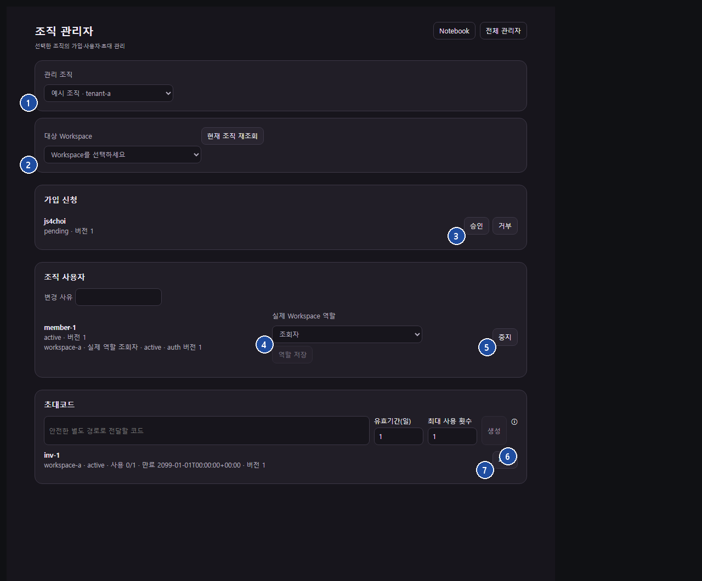

| 번호 | 항목 | 설명 | 비활성 조건 |
| --- | --- | --- | --- |
| ① | **관리 조직** | 관리할 조직 선택(시스템 관리자에게만 보임) | 없음 |
| ② | **대상 Workspace**, **현재 조직 재조회** | 초대코드가 들어갈 작업공간 선택, 목록 다시 조회 | 처리 중 |
| ③ | **승인**, **거부** | 대기 중인 가입 신청 처리 | 처리 중 |
| ④ | **변경 사유**, **실제 Workspace 역할**, **역할 저장** | 구성원의 작업공간 역할 변경과 사유 기록 | 처리 중 |
| ⑤ | **중지**, **활성화** | 구성원 상태 전환 | 처리 중 |
| ⑥ | **초대코드**, **유효기간(일)**, **최대 사용 횟수**, **생성** | 초대코드 만들기 | 대상 Workspace나 코드가 비었거나 처리 중 |
| ⑦ | **폐기** | 초대코드 폐기 | 이미 쓸 수 없는 코드이거나 처리 중 |

화면 그림의 이름·조직은 예시입니다. 초대코드는 만든 뒤 화면 입력에서 지워지며, 직접 전달해야 합니다. 메일로 보내지 않습니다.

#### 주의·오류

| 화면 메시지 | 원인 | 조치 |
| --- | --- | --- |
| "이 조직을 관리할 권한이 없습니다." | 조직 관리 권한 없음 | 시스템 관리자에게 요청 |
| "관리 조직을 찾을 수 없습니다." | 선택한 조직이 없음 | **관리 조직** 다시 선택 |
| "요청을 처리하지 못했습니다. 다시 조회하세요." | 조회·저장 실패 | **현재 조직 재조회** 후 다시 시도 |
| "결과 미확정" | 저장 결과를 확인하지 못함 | **동일 요청 결과 확인**을 누르고 새 요청은 보내지 않음 |

#### 관련

2-12 조직 가입, 3-1 사용자 관리

## 부록

### 부록 A 오류 메시지별 조치

| 화면 메시지 | 어디서 | 조치 |
| --- | --- | --- |
| `EMAIL_VERIFICATION_REQUIRED`, `EMAIL_TOKEN_INVALID`, `PASSWORD_POLICY_FAILED` | 로그인·가입 | 2-1 |
| `LICENSE_RESOURCE_LIMIT_REACHED` | 노트북 만들기 | 3-8 |
| "PDF에서 글자를 찾지 못했습니다." | Source 상태 | 2-4 |
| "기본 모델이 지정되지 않았습니다." | Source 상태 | 3-3 후 2-4 **재처리** |
| "선택한 모델을 사용할 수 없어 답변하지 못했습니다." | 대화 | 2-5 |
| "조직 정책이 외부 전송을 허용하지 않습니다." | 스튜디오·대화 | 3-2 |
| "소스 처리에 실패했습니다. Source 목록에서 사유를 확인하고 재처리해 주세요." | 문서 작성 | 2-4 |
| "한 번에 보내기에 내용이 너무 많습니다." | 문서 작성 확정 | 2-7 |
| "메모가 너무 깁니다." | 메모를 소스로 쓰기 | 2-14 |
| "소스의 첫 버전을 아직 처리하고 있습니다." | 메모를 소스에 반영 | 2-14 |
| "저장하지 못해 이전 선택으로 되돌렸습니다." | 질문 도구 | 2-15 |
| "외부 전송 정책으로 개요를 만들 수 없습니다." | 노트북 개요 | 2-16, 3-2 |
| "구성 목록이 올바르지 않습니다." | 만들기 전에 구성 확인 | 2-17 |
| "묶음을 저장하지 못해 되돌렸습니다." | 소스 묶음 | 2-18 |
| "문서가 너무 커서 소스로 추가할 수 없습니다." | 빠른 찾기·사용한 자료 추가 | 2-19 |
| "지식 연결이 응답하지 않아 자료를 찾지 못했습니다." | 빠른 찾기 | 2-19, 3-4 |
| "조사가 제한 시간 안에 끝나지 않아 멈췄습니다." | 심층 조사 | 2-20 |
| "결과를 검증하지 못했습니다. 설정을 바꿔 다시 시도하세요." | 웹 페이지 | 2-21 |
| "필터 값이 표에 없습니다" | 데이터 집계 | 2-22 |
| "이 표는 데이터 집계에만 쓸 수 있습니다." | 대화 | 2-22 |
| "Provider가 Key를 거부했습니다(인증 실패)" | 모델 연결 | 3-3 |
| `PROTECTED_ADMIN_ACCOUNT` | 사용자 관리 | 3-1 |
| `EGRESS_POLICY_PAYLOAD_INVALID` | 외부 전송 정책 | 3-2 |

### 부록 B 용어집

Daon을 쓸 때 지키는 핵심 원칙입니다.

- 질문에 사용할 Source를 사용자가 명시적으로 선택합니다.
- 근거 질문은 Citation을 원문과 함께 검토합니다.
- Provider 연결과 실제 질문 실행 지원을 구분합니다.
- 외부 전송은 조직 정책을 통과한 경우에만 수행합니다.
- 모델과 설정을 자동으로 임의 변경하지 않습니다.
- 미지원 형식이나 기능은 성공을 가장하지 않고 안전하게 중단합니다.
- Version, Run과 산출물의 계보를 보존합니다.

용어:

- Raw Source: 사용자가 직접 등록한 파일이나 텍스트
- Daon 승인 지식: Daon 2, Daon 2.5, Daon 3에서 생산·등록된 지식 패키지
- 연결형 Source: MCP나 Connector를 통해 참조하는 외부 Source
- Source Version: 특정 시점 Source의 변경 불가능한 Version
- Evidence: 질문 처리에 실제 사용된 근거 조각
- Citation: 답변에서 Evidence 위치를 가리키는 참조
- Notebook(노트북): 업무 하나의 자료·질문·산출물을 담는 작업 단위
- Workspace: 접근 권한과 작업 범위를 묶는 단위. Notebook은 Workspace 안에 있습니다
- 산출물: 스튜디오가 만든 보고서·슬라이드·퀴즈 등의 결과물
- 리비전(버전): 산출물을 고칠 때마다 새로 쌓이는 판. 이전 판은 지워지지 않습니다
- 요구사항 대응표: 문서 작성에서 요구사항마다 본문이 어떻게 대응하는지 보여 주는 표
- 외부 전송 정책: 자료와 질문을 외부 모델로 보낼 수 있는지 정하는 조직·Workspace 정책
- 답변 과정: 답변 하나에 대해 시스템이 한 일(질문 범위, 근거 찾기, 외부 전송, 모델, 검증)을 단계별로 남긴 기록
- 메모 소스: 메모로 만든 소스. 메모를 고친 뒤 반영해야 새 Source Version이 됩니다
- 질문 도구: 질문할 때 소스 말고 더 찾아볼 곳(승인 지식, 지식 연결). 노트북별로 켜고 끕니다
- 노트북 개요: 준비된 소스로 만든 요약 한 문단과 추천 질문 세 개
- 구성 확인: 슬라이드·동영상(보고서는 목차)을 끝까지 만들기 전에 장·장면 목록에서 멈추고 사람이 고친 뒤 확정하는 단계
- 소스 묶음: Raw Source 목록을 이름 붙여 나눈 묶음. 노트북을 쓰는 사람 모두가 같이 보며, 질문 범위는 소스를 하나씩 체크한 것과 같습니다
- 빠른 찾기: 조직의 승인 지식(업무 패키지)과 문서에서 자료를 찾아, 고른 것만 노트북의 승인 지식 범위나 텍스트 소스로 더하는 기능. 웹은 찾지 않습니다
- 심층 조사: 질문을 작은 질문으로 나눠 여러 번 찾은 뒤, 찾은 자료로 근거 번호(S1…)가 달린 조사 보고서를 스튜디오에 만드는 기능
- 업무 패키지: 승인 지식에서 업무 하나에 관한 승인 자료를 묶은 단위. 노트북의 승인 지식 범위에 최대 8개까지 둡니다

### 부록 C 찾아보기

| 하고 싶은 일 | 화면 |
| --- | --- |
| 가입, 로그인, 비밀번호 재설정 | 2-1 |
| 노트북 만들기·지우기 | 2-2 |
| 자료 올리기, 처리 실패 확인, 재처리 | 2-4 |
| 질문하고 근거 보기 | 2-5 |
| 답변이 어떤 자료·판정·모델을 거쳤는지 보기 | 2-13 |
| 모델·추론 수준 바꾸기 | 2-5, 2-9 |
| 보고서·슬라이드·퀴즈 만들기 | 2-6 |
| 산출물을 말로 고치기(대화로 수정) | 2-6 |
| 산출물 내려받기 | 2-6, 1-8 |
| 제안서 초안 만들기, 여러 RFP 파일 쓰기 | 2-7 |
| 메모 남기기 | 2-8 |
| 메모를 소스로 쓰기, 고친 메모를 소스에 반영 | 2-14 |
| 질문할 때 승인 지식·지식 연결 켜고 끄기 | 2-15 |
| 노트북 요약과 추천 질문 보기, 개요 다시 만들기 | 2-16 |
| 슬라이드·동영상 만들기 전에 장·장면 목록 고치기 | 2-17 |
| 소스를 묶음으로 정리, 묶음째 체크 | 2-18 |
| 조직의 승인 지식·문서에서 자료를 찾아 노트북에 더하기 | 2-19 |
| 질문 하나를 여러 번 찾아 인용이 달린 조사 보고서 만들기 | 2-20 |
| 소스로 근거 확인된 웹 페이지(HTML) 만들기·내려받기 | 2-21 |
| 표 파일(XLSX·CSV)을 집계해 집계표·차트·계산 근거 만들기 | 2-22 |
| 답변 방식 지시(맞춤설정), 노트북 복사, 채팅 기록 삭제 | 2-9 |
| 알림 확인 | 2-10 |
| 화면 테마, 설명서 내려받기, 내 비밀번호 바꾸기 | 2-11 |
| 사용자 등록·중지·역할 변경 | 3-1 |
| 외부 전송 허용·차단 | 3-2 |
| 모델 Provider 연결, 기본 모델 지정 | 3-3 |
| 지식 서버 연결 | 3-4 |
| 문서 작성 템플릿 관리 | 3-5 |
| 음성 엔진 등록 | 3-6 |
| 내려받기 추가 인증 켜기 | 3-7 |
| 라이선스 적용 | 3-8 |
| 운영 상태·백업·복구 | 3-9 |
| 조직 가입 신청 | 2-12 |
| 가입 승인·초대코드·조직 구성원 역할 | 3-10 |

### 부록 D 현재 제공 범위와 제한

- 이 설명서는 Web 화면만 설명합니다. Windows·모바일 앱은 조직이 별도로 제공한 경우에만 쓰며, 사용 범위는 제공한 운영 안내를 따릅니다.
- PDF는 글자가 들어 있는 문서만 처리합니다. 스캔 PDF와 암호 PDF는 처리하지 않습니다. 표는 글자만 읽어 칸 구조가 흐트러질 수 있습니다.
- 작업 화면 위쪽 **공유**와 노트북 복사의 자료(Source) 복사는 준비 중입니다.
- 조직을 새로 만드는 신청을 입력하는 화면과, 조직 관리자가 쓰는 설정 메뉴 항목은 아직 없습니다. 조직 관리자는 시스템 관리자가 알려 준 주소(`/organization-admin`)로 3-10을 엽니다.
- 오디오·동영상 개요는 관리자가 음성 엔진을 등록했을 때만 만들 수 있습니다.
- 빠른 찾기와 심층 조사는 관리자가 연결한 조직 내부 지식(승인 지식, 문서)만 찾습니다. 웹 검색은 하지 않습니다. 찾은 문서는 2 MiB까지 텍스트 소스로 추가합니다.
- 문서 작성의 요구사항 분석은 자료 전체를 읽지만, 아주 긴 문서는 정해진 분량까지만 읽고 그 사실을 확인 화면에 알립니다.
- 비밀번호, Token, API Key, 내부 주소를 기록하거나 공유하지 않습니다.
